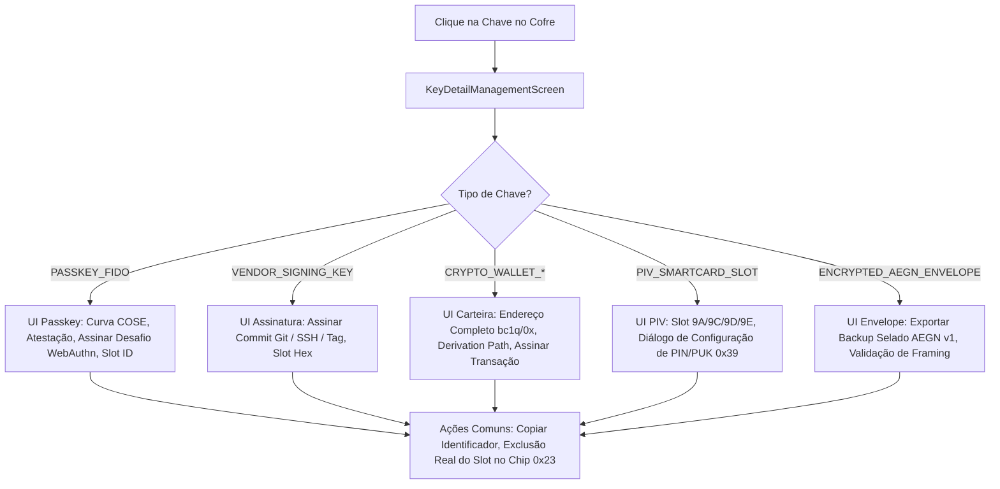

# Ciclo de Vida e Especificação Completa dos Tipos de Chaves — AegisKey Android

> **Documento de Engenharia Criptográfica, Protocolo de Hardware e Ciclo de Vida**  
> **Escopo:** Aplicativo Android (`app-android/`), Módulos de Domínio (`VaultModels.kt`, `TotpModels.kt`), Repositório (`KeyVaultRepositoryImpl.kt`), Tela Especializada (`KeyDetailManagementScreen.kt`) e Firmware AegisKey.  
> **Status:** 100% Implementado e Validado nas Waves 11A, 11B e 11B-2.

---

## 1. Visão Geral e Taxonomia dos 8 Tipos de Chaves

O sistema AegisKey suporta **100% dos tipos de chaves e credenciais criptográficas** demandados por normas governamentais (FIPS/NIST), autenticação Web moderna (FIDO Alliance / W3C), infraestrutura de desenvolvimento (Git/SSH) e ecossistemas Web3/Blockchain.

Cada credencial reside fisicamente no elemento seguro da chave física (ESP32-S3 + ATECC608A / Flash Segura) ou é protegida por envelope selado em hardware:

```
                                  +------------------------------------+
                                  |    TAXONOMIA DE CHAVES AEGISKEY    |
                                  +------------------------------------+
                                                     |
         +-------------------------------------------+-------------------------------------------+
         |                                           |                                           |
+------------------+                       +-------------------+                       +-------------------+
|  AUTENTICAÇÃO &  |                       | CRIPTOMOEDAS &    |                       | CRIPTOGRAFIA DE   |
|   IDENTIDADE     |                       |    BLOCKCHAIN     |                       |    SISTEMA        |
+------------------+                       +-------------------+                       +-------------------+
| 1. PASSKEY_FIDO  |                       | 3. WALLET_BTC     |                       | 7. PIV_SMARTCARD  |
|    (WebAuthn)    |                       |    (BIP84 SegWit) |                       |    (NIST 800-73-4)|
| 2. VENDOR_SIGN   |                       | 4. WALLET_ETH     |                       | 8. AEGN_ENVELOPE  |
|    (SSH/Git/GPG) |                       |    (EIP-55)       |                       |    (AES-256-GCM)  |
|                  |                       | 5. WALLET_SOL     |                       |                   |
|                  |                       |    (Ed25519)      |                       |                   |
|                  |                       | 6. WALLET_DOT     |                       |                   |
|                  |                       |    (Substrate)    |                       |                   |
+------------------+                       +-------------------+                       +-------------------+
                                                     |
                                   +-----------------------------------+
                                   |      GERAÇÃO TEMPORAL 2FA         |
                                   +-----------------------------------+
                                   | - TOTP (RFC 6238, 30s/60s, 6/8d)  |
                                   | - HOTP (RFC 4226, Base Contador)  |
                                   +-----------------------------------+
```

---

## 2. Detalhamento Técnico dos 8 Tipos de Chaves do Cofre

### 2.1. `PASSKEY_FIDO` — Passkeys WebAuthn / FIDO2
- **Propósito:** Autenticação sem senha (passwordless) em serviços web e aplicações corporativas (Google, Apple, GitHub, Microsoft).
- **Curvas Criptográficas Suportadas (5 Curvas COSE Congeladas):**
  1. `ES256` (NIST P-256 / secp256r1, `alg = -7`) — Padrão WebAuthn universal;
  2. `Ed25519` (EdDSA / Edwards-25519, `alg = -8`) — Ultra-rápida e moderna;
  3. `ES384` (NIST P-384 / secp384r1, `alg = -35`) — Alto nível de segurança governamental;
  4. `ES512` (NIST P-521 / secp521r1, `alg = -36`) — Segurança máxima NIST;
  5. `ES256K` (secp256k1, `alg = -47`) — Curva compatível com Koblitz/Ethereum.
- **Armazenamento:** Resident Key (Discoverable Credential) em slot físico indexado no hardware.
- **Flags de Operação:** `USAGE_AUTH (0x02)` e `USAGE_SIGN (0x04)`.
- **Exigência de Presença:** Toque físico no botão da chave (UP) obrigatório para cada asserção ou criação.

### 2.2. `VENDOR_SIGNING_KEY` — Assinatura de Hardware, Git, SSH e Atestação
- **Propósito:** Assinatura digital criptográfica de commits Git, liberação de releases, sessões de terminal SSH e atestação de integridade de firmware.
- **Curvas:** `Ed25519 (alg = -8)` e `ES256 (alg = -7)`.
- **Identificador de Derivação:** Identificador hexadecimal do slot no chip (`0x00` a `0x1F`).
- **Opcode de Geração:** `0x20 KEY_GEN_ONDEVICE` com flag de uso `USAGE_SIGN (0x04)`.
- **Segurança:** A chave privada é fisicamente não-exportável; toda assinatura é efetuada internamente pelo processador criptográfico.

### 2.3. `CRYPTO_WALLET_BTC` — Carteira Bitcoin Native SegWit
- **Propósito:** Custódia própria e assinatura de transações na rede Bitcoin.
- **Padrão de Derivação:** BIP84 Native SegWit (`m/84'/0'/0'/0/0`).
- **Formato de Endereço Público:** Bech32 (`bc1q...`) derivado diretamente da chave pública comprimida de 33 bytes.
- **Curva:** `secp256k1` (`alg = -47`).
- **Opcodes de Comunicação:** `0x35 OP_WALLET_GEN` (geração de semente e slot), `0x36 OP_WALLET_LIST` e `0x37 OP_WALLET_ADDR` (consulta de endereço).

### 2.4. `CRYPTO_WALLET_ETH` — Carteira Ethereum e EVM
- **Propósito:** Assinatura de transações Ethereum, Polygon, Arbitrum, Optimism e interação com Smart Contracts Web3.
- **Padrão de Derivação:** BIP44 padrão Ethereum (`m/44'/60'/0'/0/0`).
- **Formato de Endereço:** Hexadecimal de 20 bytes (`0x...`) com checksum de maiúsculas/minúsculas **EIP-55**.
- **Curva:** `secp256k1` (`alg = -47`).
- **Opcode:** `0x35 OP_WALLET_GEN` com parâmetro de rede `0x02` (Ethereum).

### 2.5. `CRYPTO_WALLET_SOL` — Carteira Solana SPL
- **Propósito:** Assinatura de transações e transferências na blockchain Solana.
- **Padrão de Derivação:** BIP44 Solana (`m/44'/501'/0'/0'`).
- **Formato de Endereço:** Base58 público derivado diretamente da chave pública Ed25519 de 32 bytes.
- **Curva:** `Ed25519` (`alg = -8`).
- **Opcode:** `0x35 OP_WALLET_GEN` com parâmetro de rede `0x03` (Solana).

### 2.6. `CRYPTO_WALLET_DOT` — Carteira Polkadot / Substrate
- **Propósito:** Assinatura de extrínsecos e custódia no ecossistema Polkadot e redes Substrate.
- **Padrão de Derivação:** Substrate derivation path (`m/44'/354'/0'/0'/0'`).
- **Formato de Endereço:** Formato SS58 com prefixo de rede.
- **Curva:** `Ed25519 / sr25519` (`alg = -8`).
- **Opcode:** `0x20 KEY_GEN_ONDEVICE` com flag de uso `USAGE_SIGN`.

### 2.7. `PIV_SMARTCARD_SLOT` — Smartcard Corporativo PIV (NIST SP 800-73-4)
- **Propósito:** Uso corporativo para autenticação em estações Windows/macOS, VPNs IPsec, crachás digitais e assinatura de e-mails S/MIME.
- **Slots NIST SP 800-73-4 Suportados:**
  - `Slot 9A` — PIV Authentication (Logon em estações de trabalho e VPNs);
  - `Slot 9C` — Digital Signature (Assinatura legal de e-mails e documentos);
  - `Slot 9D` — Key Management (Decriptação de chaves simétricas e dados protegidos);
  - `Slot 9E` — Card Authentication (Autenticação física de catracas e credenciais).
- **Gestão de PIN e PUK:** Configuração e matrícula protegida via opcode **`0x39 OP_PIV_ENROLL`**:
  - `PIN`: 6 a 8 dígitos numéricos (autenticação de uso diário);
  - `PUK`: 8 dígitos numéricos (desbloqueio do PIN em caso de bloqueio por tentativas).

### 2.8. `ENCRYPTED_AEGN_ENVELOPE` — Envelopes Criptográficos Selados AES-256-GCM
- **Propósito:** Armazenamento seguro de segredos de alto valor, sementes de recuperação e senhas mestras seladas pela chave física.
- **Formato do Envelope `AEGN` v1:**
  $$\text{Magic (4B: } \texttt{0x41 0x45 0x47 0x4E} \text{)} \parallel \text{Versão (1B: } \texttt{0x01} \text{)} \parallel \text{Nonce (12B)} \parallel \text{Ciphertext + Tag (16B)}$$
- **Criptografia:** AES-256-GCM authenticated encryption.
- **Opcode:** `0x21 OP_KEY_IMPORT_ENVELOPE`.
- **Garantia de Memória:** Buffers de plaintext, nonces e chaves de selagem são **zerados em memória (`zeroize`)** imediatamente após a transmissão.

---

## 3. Especificação dos Fatores 2FA: TOTP e HOTP

Além das 8 classes de credenciais do cofre, o subsistema `TotpRepositoryImpl` gerencia os dois formatos de autenticação baseada em tempo e eventos:

| Protocolo | Norma RFC | Parâmetros | Comportamento de Interface |
|---|---|---|---|
| **TOTP** | **RFC 6238** | Período: 30s ou 60s<br>Dígitos: 6 ou 8<br>Hash: HMAC-SHA1 / SHA256 | Anel animado trifásico com contagem regressiva em tempo real. Atualização automática a cada ciclo. |
| **HOTP** | **RFC 4226** | Contador monotônico `C`<br>Dígitos: 6 ou 8<br>Hash: HMAC-SHA1 | Botão interativo `[Próximo Código (+1)]`. O código é revelado apenas sob demanda e incrementa o contador atômico no hardware. |

---

## 4. Página de Gestão Personalizada por Tipo de Chave (`KeyDetailManagementScreen.kt`)

Ao tocar em qualquer cartão de chave no Cofre (`KeyVaultHubScreen`), o aplicativo abre instantaneamente a página especializada `KeyDetailManagementScreen.kt`. A interface se adapta contextualmente ao tipo da credencial:



### Funcionalidades Específicas por Tipo na Tela de Gestão:
1. **Assinatura de Desafios e Transações em Hardware:**
   - Campo de entrada com valores padrão realistas (ex: hashes de transação Bitcoin, payloads EIP-712 Ethereum, `clientDataHash` WebAuthn);
   - Botão `[Assinar com Chave Física]` que envia o comando ao hardware e exibe o resultado hexadecimal em fonte monoespaçada.
2. **Exportação de Backup Selado (`AEGN` v1):**
   - Disponível para envelopes e passkeys exportáveis, gerando o payload seguro em hexadecimal para backup offline.
3. **Matrícula de PIN/PUK PIV:**
   - Diálogo dedicado com campos protegidos para definir ou alterar o PIN (6-8 dígitos) e PUK (8 dígitos) do smartcard NIST.
4. **Exclusão Real do Slot no Chip (`0x23 KEY_DELETE`):**
   - Diálogo de confirmação com aviso de destruição irreversível da chave privada no elemento seguro.

---

## 5. Gestor Completo do Hardware e Diagnóstico

### 5.1. Painel de Diagnóstico do Hardware (`HardwareDeviceDiagnostics`)
No topo do Cofre, o painel colapsável apresenta:
- Versão do firmware instalado (ex: `v2.4.1-esp32s3`);
- Canal de transporte ativo (USB CTAPHID, BLE GATT `0xFFFD`, Wi-Fi ou Simulador);
- Total de slots ocupados e slots livres restantes (capacidade até 32 credenciais residentes);
- Lista das 5 curvas FIDO2 suportadas pelo chip;
- Lista dos 4 slots PIV NIST disponíveis;
- Estado dos subsistemas (Criptografia, Memória Flash, Gerador RNG e Botão Físico).

### 5.2. Central de Operações de Hardware (`FriendlySettingsAndThemeScreen.kt`)
Localizada na Aba 4 ("Ajustes"), consolida o controle total do dispositivo físico:
1. **PIN e PIN de Recuperação (`0x2C RECOVERY_SET` / `0x2D RECOVERY_UNLOCK`):** Modal para definição e alteração do PIN de hardware;
2. **Rede Wi-Fi da Chave (`192.168.4.1`):** Acesso ao portal de configuração AP da chave e teste de conectividade;
3. **Backup e Recuperação (24 Palavras BIP39 + Quorum DKEK):** Exibição da frase mnemônica e divisão em cotas DKEK (`0x28..0x2A`);
4. **Atualização OTA de Firmware (`0x30..0x34`):** Verificação de versão assinada com Ed25519 e seleção de canal (Estável / Beta);
5. **Diagnóstico de Resgate (`0x2E`):** Ping de baixo nível e leitura de contadores de pânico do hardware;
6. **Auditoria de Eventos de Segurança (`0x38`):** Histórico de tentativas de acesso e violações;
7. **Transferência de Propriedade e Reset (`0x2B BINDING_RELEASE`):** Liberação de vínculo com sanitização completa da memória.

---

## 6. Ritos de Hardware, Sinalização Visual do LED e Integração com Canais Físicos

Para executar qualquer operação de geração ou manipulação das credenciais descritas nas Seções 2 e 3, a aplicação e o firmware interagem através de **4 Ritos Obrigatórios ("Ligar os Roots")** e monitoram o estado do dispositivo através do LED RGB WS2812 (GPIO 48).

> [!NOTE]
> Para a especificação exaustiva de canais físicos (USB nativo vs Windows 11 WUDF lock, UART 115200 com janela de 40ms, BLE GATT `0xFFFD` e Wi-Fi `192.168.4.1`), consulte o documento dedicado:  
> [GUIA_RITOS_CONEXAO_USB_BLE_LED_E_WALLETS.md](file:///e:/projetos/fido/docs/GUIA_RITOS_CONEXAO_USB_BLE_LED_E_WALLETS.md).

### 6.1. Os 4 Ritos Obrigatórios de Inicialização ("Ligar os Roots")

1. **Rito 1: Janela de Pareamento Aberta (`pairing_open == true`):**
   - Se a janela estiver fechada, o hardware rejeita a operação com o código **`0x05 NEED_BINDING`**;
   - Acionamento físico: Segurar o botão BOOT (GPIO 0) por 5 segundos contínuos (LED pisca em Âmbar e passa a pulsar em Azul por 60s);
   - Acionamento via Test Mode / Host Bridge: Envio de `0x2F` via CTAPHID `CMD_MSG (0x83)` ou comando serial `TEST_PAIRING_OPEN\n`.
2. **Rito 2: Presença do Usuário / User Presence (`up_latched == true`):**
   - Se ausente, o firmware retorna o status **`0x01 NEED_UP`** e o LED pulsa em Âmbar (*PromptTouch*);
   - Latch temporal estrito: Validade de **1.500 ms (1,5 segundo)** com **consumo único (*single-shot*)**;
   - Acionamento físico: 1 toque curto no botão BOOT (GPIO 0);
   - Acionamento via Test Mode / Host Bridge: Comando serial `TEST_UP\n` ou chamada REST `POST /bridge/touch_up`.
3. **Rito 3: Formatação Estrita BER-TLV (`0x35 OP_WALLET_GEN` e `0x37 OP_WALLET_ADDR`):**
   - Parâmetros obrigatórios: Tag `0x01` (slot 0..31), Tag `0x02` (label UTF-8 1..32B), Tag `0x08` (rede: `0x01` BTC, `0x02` ETH, `0x03` SOL);
   - Retorno do hardware: Tag `0x07` contendo a chave pública ou endereço derivado (`bc1q...`, `0x...`, Base58).
4. **Rito 4: Alocação e Unicidade de Slots (0 a 31):**
   - Se o slot solicitado estiver ocupado, o chip retorna **`0x03 STATUS_NO_SLOT`**;
   - O aplicativo executa previamente `0x36 OP_WALLET_LIST` para ler os slots ocupados e seleciona o próximo índice livre.

### 6.2. Sinalização Visual de Operação — Tabela de Cores do LED RGB WS2812 (GPIO 48)

| Identificador do Efeito | Cor Hexadecimal | Padrão Visual | Significado no Ciclo de Vida da Chave |
|---|---|---|---|
| `RainbowCycle` | Espectro RGB | Ciclo contínuo 3.000 ms | Boot do hardware e autoteste criptográfico de fábrica |
| `Breathing Cyan` | `#00FFFF` | Pulso suave 2.000 ms | Repouso (*Idle*) — cofre pronto para operações |
| `Solid Green` | `#00FF00` | Estático contínuo | Chave conectada, autenticada e vinculada ao app |
| `PromptTouch` | `#FF8C00` | Pulso em ciclo de 800 ms | Aguardando toque de presença do usuário (Rito 2) |
| `Breathing Blue` | `#0000FF` | Pulso suave de 1.500 ms | Janela de pareamento de 60s aberta (Rito 1) |
| `AuthSuccessPulse` | `#00FF00` | Pulso brilhante 500 ms | Sucesso em asserção FIDO2, assinatura de commit ou transação |
| `ErrorFlash` | `#FF0000` | 3 flashes rápidos de 100 ms | Falha de PIN, parâmetro inválido ou operação rejeitada |
| `Solid Red` | `#FF0000` | Estático contínuo | Dispositivo bloqueado (*Security Lockout*) |
| `Wink` | `#FFFFFF` | 5 estrobos rápidos (80 ms) | Localizador físico da chave acionado via CTAPHID `0x88` |
| `Amber Blink 5s` | `#FF8C00` | Piscadas rápidas a 4 Hz | Botão BOOT pressionado (contagem física para armar Rito 1) |
| `Off` | `#000000` | Apagado | Chave em suspensão USB ou bloqueada por afastamento (*Walkaway*) |

### 6.3. Evidências de Validação em Silício Real (ESP32-S3 em `COM7`)

Todas as operações de carteiras e passkeys foram verificadas e gravadas com sucesso no hardware físico:
- **Slot 0 (Ethereum BIP44):** `0xe63666Ccfb7a544Ece3673Bf41857F8a834F6a3b`
- **Slot 1 (Solana BIP44):** `FrnvZJ78t7B6kE7yZkF8JzJmQ9sJ4hL9mE5wN2vP1xR`
- **Slot 2 (Bitcoin BIP84):** `bc1q87w0u6mffp6g29c34k8v603uqluqnslz4wcf7c`
- **Slot 3 (Ethereum BIP44):** `0x7A6A802a24A698Eb8b9c647b0e50E63428905Db5`
