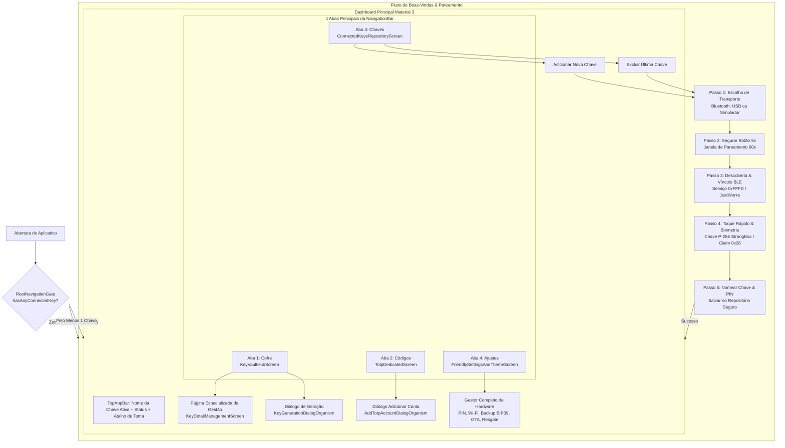

# Arquitetura de Experiência do Usuário (UX) e Navegação — AegisKey Android

> **Documento de Arquitetura de Software Mobile, Design System e Interação Humano-Computador**  
> **Escopo:** Aplicativo Android (`app-android/`), Metodologia Atomic Design (Material 3), Telas de Hub, Gestão Especializada de Chaves e Gestor de Hardware.  
> **Status:** 100% Implementado e Validado nas Waves 11A, 11B e 11B-2.

---

## 1. Princípios de Design e Filosofia de Interação

O design do AegisKey Android é orientado pelo princípio de **transparência funcional sem atrito cognitivo**. O usuário final nunca é sobrecarregado com terminologias técnicas herméticas. Toda a complexidade de curvas criptográficas, assinaturas COSE e trocas de pacotes GATT é traduzida em comandos intuitivos, acessíveis e acolhedores.

### Pilares Fundamentais:
1. **Linguagem Desmistificada:** Sem acrônimos ou jargões crípticos na interface principal.
2. **Navegação Reativa com `RootNavigationGate`:** O estado do repositório de hardware determina de forma imediata e sem recargas se o usuário deve ver o Wizard inicial ou o Hub operacional.
3. **Padrão Linear "Next → Next → Next":** Fluxos de configuração guiados passo a passo com feedback visual claro de progresso.
4. **Páginas Personalizadas por Tipo de Chave:** Cada credencial possui uma visão desenhada especificamente para seu contexto (WebAuthn, Bitcoin, Ethereum, Solana, PIV ou Envelope).
5. **Gestor Completo de Hardware Centralizado:** Toda a manutenção física do dispositivo (PIN, Wi-Fi, OTA, Backup BIP39, Resgate) fica reunida de forma segura na aba de Ajustes.

---

## 2. Mapa Geral de Navegação e Arquitetura de Telas



---

## 3. As 4 Abas do Hub Principal

### 3.1. Aba 1: Meu Cofre Físico (`KeyVaultHubScreen.kt`)
A central de credenciais residentes na chave física:
- **Painel de Diagnóstico do Hardware (`HardwareDeviceDiagnostics`):** Exibe no topo a versão do firmware, canal de transporte ativo, contagem de slots ocupados/livres (até 32 slots), resumo das curvas FIDO2 e slots PIV suportados.
- **Filtros por Categoria:** Chips interativos no padrão Material 3 para filtrar instantaneamente a listagem entre:
  - `Todos` (todas as credenciais cadastradas);
  - `Passkeys` (`PASSKEY_FIDO` e `VENDOR_SIGNING_KEY`);
  - `Carteiras` (Bitcoin, Ethereum, Solana, Polkadot);
  - `PIV` (Slots NIST 9A, 9C, 9D, 9E);
  - `Envelopes` (Envelopes selados `AEGN` v1).
- **Lista de Credenciais (`VaultEntryCardMolecule`):** Apresenta título da credencial, resumo do identificador público (ex: endereço `bc1q...` ou `0x...`), algoritmo/curva em chip tonal e caminho de derivação.
- **Proteção Rápida:** Toggles instantâneos para ativar ou desativar o *Bloqueio por Afastamento (Walkaway)* e a *Exigência de Biometria ao Abrir o App*.

### 3.2. Aba 2: Códigos Temporários TOTP & HOTP (`TotpDedicatedScreen.kt`)
A central de segundo fator de autenticação (2FA):
- **Suporte Dual:** Suporta tanto o padrão temporal **TOTP (RFC 6238)** quanto o padrão baseado em eventos **HOTP (RFC 4226)**.
- **Anel Regressivo Trifásico (`TotpCountdownRingAtom`):**
  - Verde / Esmeralda ($> 10\text{s}$): Estabilidade temporal;
  - Âmbar ($6\text{s}$ a $10\text{s}$): Atenção à virada do ciclo;
  - Vermelho ($\le 5\text{s}$): Código próximo da expiração.
- **HOTP Interativo:** Contas HOTP exibem um botão `[Próximo Código (+1)]`, permitindo que o usuário avance o contador atômico no hardware apenas quando necessário.
- **Cópia de 1 Toque com Área de Transferência Sensível:** Copia o código numérico sem espaços e aplica a flag `ClipDescription.EXTRA_IS_SENSITIVE = true` no Android 13+.
- **Diálogo Modal de Cadastro (`AddTotpAccountDialogOrganism`):** Permite colar URIs completas `otpauth://...` ou digitar manualmente segredos em Base32.

### 3.3. Aba 3: Repositório de Chaves Físicas (`ConnectedKeysRepositoryScreen.kt`)
Gestão multi-dispositivo de chaves AegisKey:
- **Listagem de Dispositivos Pareados (`ConnectedKeyCardMolecule`):** Mostra apelido da chave, identificador de hardware, tipo de conexão e status de conectividade atual.
- **Chave Ativa com 1 Toque:** Um toque no cartão define aquela chave como ativa em todo o aplicativo.
- **Ações Rápidas:** Renomeação instantânea do apelido, visualização de metadados e exclusão.
- **Retorno Reativo ao Onboarding:** Caso o usuário remova a última chave conectada, o `RootNavigationGate` detecta a lista vazia e direciona a UI imediatamente para o Passo 1 do Wizard.

### 3.4. Aba 4: Ajustes e Gestor de Hardware (`FriendlySettingsAndThemeScreen.kt`)
Reúne as opções de personalização visual e o controle administrativo do dispositivo físico:
- **Aparência e Temas Material 3:**
  - Alternância entre `Automático do Sistema`, `Tema Claro` e `Tema Escuro` (OLED-friendly com contraste profundo);
  - Toggle para ativação de `Cores Dinâmicas (Material You)` no Android 12+ (API 31+).
- **Gestor Completo de Hardware:**
  1. *Segurança & PIN (`0x2C`/`0x2D`):* Alteração do PIN da chave e biometria;
  2. *Rede Wi-Fi da Chave (`192.168.4.1`):* Teste de conexão direta com o Access Point da chave e portal local;
  3. *Backup & Recuperação (24 Palavras BIP39):* Exibição segura da frase mnemônica e divisão em quorum DKEK (`0x28..0x2A`);
  4. *Atualização de Firmware OTA (`0x30..0x34`):* Verificação de versão assinada Ed25519 e seleção de canal (Estável / Beta);
  5. *Diagnóstico de Resgate (`0x2E`):* Monitoramento dos subsistemas e histórico de pânicos;
  6. *Auditoria de Segurança (`0x38`):* Log de integridade contra violações físicas;
  7. *Transferência de Propriedade & Reset (`0x2B`):* Procedimento seguro para doação ou venda do hardware.

---

## 4. Página Especializada de Gestão de Chave (`KeyDetailManagementScreen.kt`)

Diferente de interfaces genéricas de gerenciadores de credenciais, o AegisKey oferece uma tela detalhada e customizada para cada classe de credencial:

| Tipo de Chave | Conteúdo Especializado Exibido na Tela | Ações Interativas Disponíveis |
|---|---|---|
| **`PASSKEY_FIDO`** | Curva COSE (ex: `ES256 P-256`), Formato de Credencial Residente, Identificador do Slot, Atestação de Hardware. | Assinar Desafio WebAuthn (`clientDataHash`), Copiar Identificador, Excluir Slot via `0x23`. |
| **`VENDOR_SIGNING_KEY`** | Curva Ed25519/ES256, Slot Hexadecimal, Descrição de Uso (Git/SSH/Firmware). | Assinar Commit Git / Release Tag, Copiar Chave Pública, Excluir Slot via `0x23`. |
| **`CRYPTO_WALLET_BTC`** | Endereço Native SegWit Bech32 (`bc1q...`), Caminho BIP84 (`m/84'/0'/0'/0/0`), Curva secp256k1. | Assinar Transação Bitcoin (Hash TX), Copiar Endereço, Excluir Carteira via `0x23`. |
| **`CRYPTO_WALLET_ETH`** | Endereço EIP-55 com checksum (`0x...`), Caminho BIP44 (`m/44'/60'/0'/0/0`), Curva secp256k1. | Assinar Transação / Mensagem EIP-712, Copiar Endereço, Excluir Carteira via `0x23`. |
| **`CRYPTO_WALLET_SOL`** | Endereço Base58 Solana, Caminho BIP44 (`m/44'/501'/0'/0'`), Curva Ed25519. | Assinar Transação Solana SPL, Copiar Endereço, Excluir Carteira via `0x23`. |
| **`CRYPTO_WALLET_DOT`** | Endereço SS58 Substrate, Caminho Polkadot (`m/44'/354'/...`), Curva Ed25519. | Assinar Extrínseco Polkadot, Copiar Endereço, Excluir Carteira via `0x23`. |
| **`PIV_SMARTCARD_SLOT`** | Código do Slot (`9A`, `9C`, `9D` ou `9E`), Padrão NIST SP 800-73-4, Algoritmo Criptográfico. | Matricular / Alterar PIN e PUK PIV (`0x39`), Assinar Desafio de Logon, Excluir Slot. |
| **`ENCRYPTED_AEGN_ENVELOPE`**| Cabeçalho `AEGN` v1, Nonce de 12 bytes, Algoritmo AES-256-GCM, Comprimento do Texto Cifrado. | Exportar Payload Selado em Hexadecimal, Validar Integridade de Framing, Excluir Envelope. |

---

## 5. Catálogo de Componentes e Hierarquia Atomic Design

```
ui/atomic/
|-- atoms/
|   |-- AegisButtons.kt          (PrimaryNextButton, SecondaryBackButton, QuickActionPillButton)
|   |-- AegisIndicators.kt       (StepProgressDotsAtom, TotpCountdownRingAtom, ConnectionStatusBadgeAtom)
|   +-- AegisToggles.kt          (AegisSwitchAtom, ThemeOptionChipAtom)
|
|-- molecules/
|   |-- ConnectedKeyCardMolecule.kt          (Card da chave no repositório com status e ações)
|   |-- PhysicalButtonPromptCardMolecule.kt  (Card instrucional com ícone pulsante de toque)
|   |-- SettingToggleRowMolecule.kt          (Linha de toggle de segurança com ícone e texto)
|   |-- TotpCodeCardMolecule.kt              (Card TOTP com código espaçado 3+3 e anel regressivo)
|   +-- VaultEntryCardMolecule.kt            (Card de credencial com chips de curva e derivação)
|
|-- organisms/
|   |-- AddTotpAccountDialogOrganism.kt      (Modal de cadastro de conta TOTP/HOTP com validação)
|   |-- KeyGenerationDialogOrganism.kt       (Modal para geração das 8 classes de chaves)
|   |-- ThemeSelectorOrganism.kt             (Seletor de tema Claro/Escuro/Auto/Material You)
|   +-- DebugChipControlHooksCard.kt         (Painel recolhível de debug do chip ESP32-S3)
|
+-- templates/
    |-- WizardStepTemplate.kt                (Template linear de Onboarding com header, scroll e rodapé)
    +-- MainHubScaffoldTemplate.kt           (Template do Hub com TopBar, innerPadding e NavigationBar)
```

---

## 6. Conformidade e Validação das Waves 11A, 11B e 11B-2

- **Nenhum Jargão Indevido:** Todo o texto voltado ao usuário segue um tom direto, amigável e profissional.
- **Sem Quebra de Linhas ou Encavalamentos:** Todos os componentes foram validados em resolução compacta e padrão (1080x2400) com respeito estrito aos `PaddingValues` do Compose.
- **Segurança Fail-Closed:** Acesso às operações sensíveis exige sempre a presença física (UP) ou autenticação biométrica em hardware.
- **Zero Mocks em Release:** Módulos de simulação e hooks de depuração são ativados unicamente em compilações `BuildConfig.DEBUG`, garantindo binários de produção limpos e enxutos.
