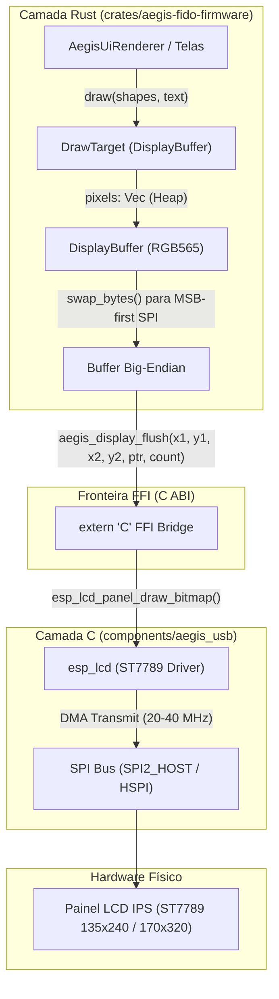

# Guia Definitivo de Arquitetura LCD: C + Rust no ESP-IDF

Este documento explica em detalhes a arquitetura híbrida desenvolvida para controle de telas LCD/IPS em Rust sobre o framework nativo ESP-IDF (v5.x), tomando como referência o driver da **LilyGO TTGO T-Display** (ESP32) e **LilyGO T-Display-S3** (ESP32-S3).

Este guia foi desenhado para ser **100% replicável em outros microcontroladores, placas e modelos de display** (ST7789, ILI9341, GC9A01, SSD1306, ST7735, etc.).

---

## 1. Visão Geral da Arquitetura Híbrida

A arquitetura adota o padrão **Clean FFI Bridge**:
- **Camada C (Hardware & DMA):** Utiliza o subsistema oficial `esp_lcd` do ESP-IDF. Gerencia clocks SPI, canais de DMA de alta velocidade, controle de pinos GPIO (Reset, DC, Backlight, Power) e registradores do controlador de vidro (MADCTL, RAMCTL, INVON/INVOFF, offsets de CGRAM).
- **Camada Rust (Lógica, Renderização & Tipagem Segura):** Implementa o trait `DrawTarget` da biblioteca padrão de sistemas embarcados [`embedded-graphics`](https://crates.io/crates/embedded-graphics), gerenciamento de estados de tela, cálculo vetorial de formas, textos com corte de caracteres seguro (UTF-8 safe) e framebuffer dinâmico em Heap.



---

## 2. Estrutura de Arquivos

A organização do código no repositório divide-se de forma estrita entre componentes de hardware e motores lógicos:

| Arquivo | Linguagem | Responsabilidade |
| :--- | :--- | :--- |
| [`components/aegis_usb/CMakeLists.txt`](file:///e:/projetos/fido/crates/aegis-fido-firmware/components/aegis_usb/CMakeLists.txt) | CMake | Registra o componente no sistema de compilação do ESP-IDF e injeta as dependências `esp_lcd`, `esp_driver_spi`, `esp_driver_gpio`. |
| [`components/aegis_usb/include/aegis_display.h`](file:///e:/projetos/fido/crates/aegis-fido-firmware/components/aegis_usb/include/aegis_display.h) | C Header | Contrato público C com funções de inicialização, backlight e flush DMA. |
| [`components/aegis_usb/aegis_display_st7789.c`](file:///e:/projetos/fido/crates/aegis-fido-firmware/components/aegis_usb/aegis_display_st7789.c) | C | Configuração do barramento SPI DMA, inicialização do `esp_lcd_panel_st7789`, gaps de tela e envio assíncrono. |
| [`src/display/st7789.rs`](file:///e:/projetos/fido/crates/aegis-fido-firmware/src/display/st7789.rs) | Rust | Binding FFI seguro para as funções em C, configuração de pinagem por placa e conversão de endianness do buffer. |
| [`src/display/ui.rs`](file:///e:/projetos/fido/crates/aegis-fido-firmware/src/display/ui.rs) | Rust | Framebuffer RGB565 em heap, paleta de cores Cyberpunk, implementação do `DrawTarget` e renderização de todas as telas. |
| [`src/display/mod.rs`](file:///e:/projetos/fido/crates/aegis-fido-firmware/src/display/mod.rs) | Rust | `DisplayManager` unificado, sincronizando telas do LCD com animações do LED RGB WS2812. |

---

## 3. Camada de Hardware em C (`esp_lcd`)

### 3.1. Por que usar `esp_lcd` em vez de bibliotecas antigas?
A partir do ESP-IDF v5, o subsistema `esp_lcd` substitui implementações antigas (como LovyanGFX ou drivers SPI manuais), oferecendo:
1. Suporte a **SPI com DMA automático**, liberando a CPU durante o envio de frames.
2. Controle padronizado de **janelas de desenho (`set_gap` / `draw_bitmap`)**.
3. Gerenciamento nativo de rotação (`swap_xy`), espelhamento (`mirror`) e inversão (`invert_color`).

### 3.2. Configuração do Barramento SPI e Painel

No arquivo [`aegis_display_st7789.c`](file:///e:/projetos/fido/crates/aegis-fido-firmware/components/aegis_usb/aegis_display_st7789.c):

```c
#include "esp_lcd_panel_io.h"
#include "esp_lcd_panel_vendor.h"
#include "esp_lcd_panel_ops.h"
#include "driver/spi_master.h"
#include "driver/gpio.h"

// 1. Inicializar o Barramento SPI com suporte a DMA
spi_bus_config_t buscfg = {
    .sclk_io_num = PIN_NUM_CLK,
    .mosi_io_num = PIN_NUM_MOSI,
    .miso_io_num = -1,
    .quadwp_io_num = -1,
    .quadhd_io_num = -1,
    .max_transfer_sz = LCD_WIDTH * LCD_HEIGHT * sizeof(uint16_t),
};
spi_bus_initialize(LCD_HOST, &buscfg, SPI_DMA_CH_AUTO);

// 2. Anexar a camada de I/O do LCD ao SPI (Modo 0, Clock 20-40MHz)
esp_lcd_panel_io_handle_t io_handle = NULL;
esp_lcd_panel_io_spi_config_t io_config = {
    .dc_gpio_num = PIN_NUM_DC,
    .cs_gpio_num = PIN_NUM_CS,
    .pclk_hz = 20 * 1000 * 1000,
    .lcd_cmd_bits = 8,
    .lcd_param_bits = 8,
    .spi_mode = 0,
    .trans_queue_depth = 10,
};
esp_lcd_new_panel_io_spi((esp_lcd_spi_bus_handle_t)LCD_HOST, &io_config, &io_handle);

// 3. Inicializar o Controlador ST7789
esp_lcd_panel_dev_config_t panel_config = {
    .reset_gpio_num = PIN_NUM_RST,
    .rgb_ele_order = LCD_RGB_ELEMENT_ORDER_RGB, // <-- REGRA CRUCIAL DE CORES
    .bits_per_pixel = 16,
};
esp_lcd_new_panel_st7789(io_handle, &panel_config, &s_panel_handle);

// 4. Sequência de Ativação do Vidro
esp_lcd_panel_reset(s_panel_handle);
esp_lcd_panel_init(s_panel_handle);
esp_lcd_panel_invert_color(s_panel_handle, true); // Painéis IPS requerem INVON
esp_lcd_panel_set_gap(s_panel_handle, GAP_X, GAP_Y);
esp_lcd_panel_disp_on_off(s_panel_handle, true);
```

### 3.3. Flush via DMA
A função de flush envia as coordenadas e os dados em um único comando DMA não-bloqueante:

```c
void aegis_display_flush(uint16_t x1, uint16_t y1, uint16_t x2, uint16_t y2, const uint16_t *pixels, uint32_t count) {
    if (!s_initialized || s_panel_handle == NULL || pixels == NULL || count == 0) return;
    esp_lcd_panel_draw_bitmap(s_panel_handle, x1, y1, x2 + 1, y2 + 1, pixels);
}
```

---

## 4. O Mistério das Cores e do Endianness (Guia de Diagnóstico)

Durante o desenvolvimento em microcontroladores, erros de cor são muito comuns. Esta seção detalha como identificar e eliminar cada um.

### 4.1. Por que o Ciano virou Laranja/Amarelo? (A "Cor Nova")
No controlador ST7789, o registrador `MADCTL` (comando `0x36`) possui um bit que seleciona a ordem física dos subpixels no vidro:
- `Bit 3 = 0`: **RGB** (Subpixels Vermelho, Verde, Azul).
- `Bit 3 = 1`: **BGR** (Subpixels Azul, Verde, Vermelho).

Se o código Rust gera a cor Ciano Elétrico (`#00F0FF` -> $R=0, G=60, B=31$):
- Quando `rgb_ele_order = LCD_RGB_ELEMENT_ORDER_BGR`: O controlador ST7789 envia o canal de maior intensidade ($31$) para o subpixel **Vermelho**, e o canal de zero ($0$) para o subpixel **Azul**.
- **Resultado:** Vermelho no máximo + Verde no máximo = **Amarelo/Laranja brilhante**.
- O fundo Slate escuro (`#0B0F19`), que tem mais azul que vermelho, tornou-se **marrom avermelhado**.

> [!IMPORTANT]
> **Regra de Ouro:** Sempre configure `.rgb_ele_order = LCD_RGB_ELEMENT_ORDER_RGB` a menos que o fabricante do módulo LCD declare explicitamente que o vidro possui subpixels BGR invertidos.

### 4.2. Por que o ESP32 precisa de `swap_bytes()`?
O processador Xtensa (e RISC-V dos novos ESP32) é **Little-Endian**:
- Um valor `u16` como `0x079F` (Ciano RGB565) é armazenado na memória RAM como:
  - Byte no endereço `[0]` = `0x9F` (Byte Baixo: Verde baixo + Azul)
  - Byte no endereço `[1]` = `0x07` (Byte Alto: Vermelho + Verde alto)
- Quando a DMA do barramento SPI transmite o array `&[u16]`, ela lê byte a byte a partir do endereço `0`.
- O controlador ST7789, porém, espera receber primeiro o **Byte Alto (MSB)** contendo os bits de Vermelho.
- **Sem o `swap_bytes()`**, o display recebe `0x9F` primeiro, corrompendo a decomposição de cores.
- **Com o `swap_bytes()` em Rust:** O `0x079F` passa a ser armazenado na RAM como `[0x07, 0x9F]`. A transmissão SPI envia `0x07` primeiro e o display decodifica o pixel com precisão absoluta.

Em [`src/display/st7789.rs`](file:///e:/projetos/fido/crates/aegis-fido-firmware/src/display/st7789.rs):
```rust
let mut be_pixels = Vec::with_capacity(buffer.pixels.len());
for p in &buffer.pixels {
    be_pixels.push((*p).into_storage().swap_bytes());
}

aegis_display_flush(
    0,
    0,
    width - 1,
    height - 1,
    be_pixels.as_ptr(),
    be_pixels.len() as u32,
);
```

### 4.3. Tabela Diagnóstica de Cores

| Sintoma Visual na Tela | Causa Técnica | Solução |
| :--- | :--- | :--- |
| **Ciano vira Laranja; Vermelho vira Azul** | Inversão de Ordem de Elemento (`BGR` ativo) | Mudar `panel_config.rgb_ele_order` para `LCD_RGB_ELEMENT_ORDER_RGB`. |
| **Preto vira Branco; Cores em "negativo fotográfico"** | Polaridade do LCD invertida | Alternar `esp_lcd_panel_invert_color(s_panel_handle, true/false)`. Telas IPS usam `true`. |
| **Cores "lavadas", listras com ruído verde/magenta** | Conflito de Endianness SPI | Garantir que os bytes sejam enviados em Big-Endian com `swap_bytes()`. |
| **Imagem deslocada para fora da tela (barra preta)** | Offsets de corte da matriz CGRAM incorretos | Ajustar `GAP_X` e `GAP_Y` via `esp_lcd_panel_set_gap()`. |

---

## 5. Camada Gráfica em Rust (`embedded-graphics`)

### 5.1. Alocação em Heap contra Stack Overflow
Em placas ESP32, cada task do FreeRTOS possui uma pilha (stack) limitada (geralmente 4 KB a 16 KB). Um display de 135x240 pixels em RGB565 consome:
$$\text{Tamanho} = 135 \times 240 \times 2 \text{ bytes} = 64.800 \text{ bytes (63,3 KB)}$$

Tentar instanciar `[Rgb565; 135 * 240]` na stack causa um **Crash de Stack Overflow imediato**. Por isso, o framebuffer deve ser alocado na Heap via `Vec<Rgb565>`:

```rust
pub struct DisplayBuffer {
    pub pixels: Vec<Rgb565>,
}

impl DisplayBuffer {
    pub fn new() -> Self {
        Self {
            pixels: alloc::vec![colors::BG_DARK; DISPLAY_WIDTH * DISPLAY_HEIGHT],
        }
    }
}
```

### 5.2. Implementando o `DrawTarget`
Para que qualquer primitiva geométrica, linha, círculo ou fonte da biblioteca `embedded-graphics` possa desenhar no buffer:

```rust
impl embedded_graphics::draw_target::DrawTarget for DisplayBuffer {
    type Color = Rgb565;
    type Error = core::convert::Infallible;

    fn draw_iter<I>(&mut self, pixels: I) -> Result<(), Self::Error>
    where
        I: IntoIterator<Item = embedded_graphics::Pixel<Self::Color>>,
    {
        for embedded_graphics::Pixel(coord, color) in pixels.into_iter() {
            if coord.x >= 0 && coord.y >= 0 {
                let x = coord.x as usize;
                let y = coord.y as usize;
                if x < DISPLAY_WIDTH && y < DISPLAY_HEIGHT {
                    self.pixels[y * DISPLAY_WIDTH + x] = color;
                }
            }
        }
        Ok(())
    }
}
```

### 5.3. Centralização e Limites UTF-8 Seguros
Telas menores (como 135px de largura) cortam textos longos. A função `center_text_x` garante centralização perfeita:

```rust
fn center_text_x(text: &str, char_w: i32) -> i32 {
    let w = (text.len() as i32) * char_w;
    ((DISPLAY_WIDTH as i32 - w) / 2).max(2)
}
```

Para truncar cabeçalhos com caracteres especiais (ex: `"SOLICITAÇÃO"` contendo `Ç` e `Ã` que gastam 2 bytes em UTF-8), **nunca use fatiamento direto por bytes `&text[..max]`** (isso causaria pânico ao cortar no meio de um caractere). Use verificação de fronteira de caractere:

```rust
let mut end = title.len();
if end > max_title_chars {
    end = max_title_chars;
    while end > 0 && !title.is_char_boundary(end) {
        end -= 1;
    }
}
let display_title = &title[..end];
```

---

## 6. Receita Passo a Passo para Replicar em Outros Modelos

Para adaptar este código para qualquer outro display ou microcontrolador:

### Passo 1: Descubra os pinos e resolução física
Consulte o datasheet ou esquema elétrico da sua placa. Por exemplo:
- **Resolução Nativa:** Largura ($W$) e Altura ($H$).
- **Controlador:** ST7789, ILI9341, GC9A01, etc.
- **Pinos:** `MOSI`, `SCLK`, `CS`, `DC`, `RST`, `BL` (Backlight), `PWR` (se houver chave de energia).

### Passo 2: Configure a tabela de Gaps (CGRAM Offset)
Controladores como ST7789 suportam internamente matrizes de até $240 \times 320$. Se o vidro físico possui apenas $135 \times 240$ ou $170 \times 320$, a imagem precisa de um deslocamento inicial:

| Modelo / Resolução | Orientação | Largura ($W$) | Altura ($H$) | `GAP_X` | `GAP_Y` |
| :--- | :--- | :--- | :--- | :--- | :--- |
| **LilyGO TTGO Classic (1.14")** | Retrato (Vertical) | 135 | 240 | 52 | 40 |
| **LilyGO TTGO Classic (1.14")** | Paisagem (Horizontal) | 240 | 135 | 40 | 53 |
| **LilyGO T-Display-S3 (1.9")** | Paisagem (Horizontal) | 320 | 170 | 0 | 35 |
| **Display Redondo GC9A01 (1.28")** | Circular | 240 | 240 | 0 | 0 |
| **Display Padrão ILI9341 (2.8")** | Retrato / Paisagem | 240 | 320 | 0 | 0 |

### Passo 3: Adapte o arquivo C
No arquivo [`aegis_display_st7789.c`](file:///e:/projetos/fido/crates/aegis-fido-firmware/components/aegis_usb/aegis_display_st7789.c), troque a inicialização do driver para o seu componente. Por exemplo, para um display **ILI9341**:
1. No CMakeLists.txt adicione o componente correspondente (`esp_lcd` já suporta `esp_lcd_new_panel_ili9341` através do idf-component-manager ou chamadas genéricas).
2. Substitua `esp_lcd_new_panel_st7789` por `esp_lcd_new_panel_ili9341`.
3. Ajuste `GAP_X` e `GAP_Y` conforme a tabela acima.

### Passo 4: Atualize as constantes no Rust
Em [`src/display/ui.rs`](file:///e:/projetos/fido/crates/aegis-fido-firmware/src/display/ui.rs), declare a resolução da sua placa através de uma feature do Cargo:

```rust
#[cfg(feature = "board-meu-display")]
pub const DISPLAY_WIDTH: usize = 240;
#[cfg(feature = "board-meu-display")]
pub const DISPLAY_HEIGHT: usize = 240;
```

---

## 7. Compilação e Gravação

Ao compilar o firmware em Rust com ESP-IDF v5, certifique-se de apontar a variável `IDF_PATH` para a versão correta do toolchain:

```powershell
# 1. Definir o caminho correto do ESP-IDF v5.3.x
$env:IDF_PATH="C:\.embuild\espressif\esp-idf\v5.3.1"

# 2. Compilar a imagem de release com as features da placa
cargo +esp build -p aegis-fido-firmware --target xtensa-esp32-espidf --release --no-default-features --features board-ttgo-classic "-Zbuild-std=std,panic_abort"

# 3. Converter o binário ELF em formato Flash ESP32
esptool.py --chip esp32 elf2image --flash_size 4MB -o C:\t\aegis-app-esp32.bin C:\t\xtensa-esp32-espidf\release\aegis-fido-firmware

# 4. Gravar na placa via porta serial
esptool.py --chip esp32 --port COM8 --baud 921600 write_flash 0x10000 C:\t\aegis-app-esp32.bin
```

---
*Documentação gerada para o projeto AegisKey (FIDO2 / WebAuthn Authenticator em Rust puro para ESP32 e ESP32-S3).*
