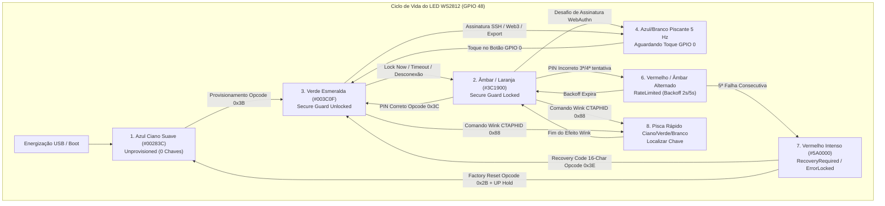

# EVALUATION — Quarantine index, Security Gaps & Product Opportunities

> Scope: consolidates legacy quarantine index, offensive/defensive security audit, remediation status of the 7 security gaps, and specifications for the 6 product opportunities.
> Rule: quarantine is the only exception to one-file-per-folder.
> Status convention: SUPERSEDED (content merged), HISTORICAL (keep for audit), PENDING (needs decision), IMPLEMENTED (coded and tested).

---

> [!CAUTION]
> ### CRITICAL HARDWARE SAFETY POLICY — eFuse OTP Protection (`DO NOT EXECUTE`)
> **NEVER EXECUTE COMMANDS TO BURN eFuses ON HARDWARE (`esptool.py burn_efuse`, `BLOCK7`, `SPI_BOOT_CRYPT_CNT`, `SECURE_VERSION`).**  
> eFuse burning in the ESP32-S3 is permanent, irreversible, and locks hardware against reprogramming.  
> All eFuse modules (`efuse_safety_lock.rs`, `GAP-01`, `GAP-03`, `GAP-07`) are guarded by `EFUSE_WRITE_HARD_LOCKED = true` and `feature = "burn-efuse-irreversible-do-not-enable"`. Development boards on `COM7` remain unburned to preserve flashing and test capabilities.

---

## 1. Rule

- Keep 3 consolidated files plus this index plus root files only.
- Move every other own markdown to quarantine with a flattened name.
- Delete emptied legacy folders after move. Touch no code file.
- Touch no `.slim/`, `target/`, `*.apk`, vendored crates, `.opencode/node_modules`.

## 2. Quarantine table (old path → quarantine name → fate)

| Old path | Quarantine name | Fate | Pending decision |
|---|---|---|---|
| `docs/APP_ANDROID_KEY_LIFECYCLE.md` | `docs_APP_ANDROID_KEY_LIFECYCLE.md` | SUPERSEDED by PROJECT.md sec 7 | None |
| `docs/APP_ANDROID_UX_ARCHITECTURE.md` | `docs_APP_ANDROID_UX_ARCHITECTURE.md` | SUPERSEDED by PROJECT.md sec 7 | None |
| `docs/app-android-clean-atomic-architecture.md` | `docs_app-android-clean-atomic-architecture.md` | SUPERSEDED by PROJECT.md sec 7 | None |
| `docs/APP-INTEGRACAO.md` | `docs_APP-INTEGRACAO.md` | SUPERSEDED by PROJECT.md sec 6-7 | None |
| `docs/app-journey.md` | `docs_app-journey.md` | SUPERSEDED by PROJECT.md sec 7 | None |
| `docs/app-mapa.md` | `docs_app-mapa.md` | SUPERSEDED by PROJECT.md sec 7 | None |
| `docs/APP-PLANO-NOVOS-MODULOS.md` | `docs_APP-PLANO-NOVOS-MODULOS.md` | SUPERSEDED by PLANS.md sec 4 | Confirm lane ownership |
| `docs/auditoria-mocks.md` | `docs_auditoria-mocks.md` | HISTORICAL, summarized PLANS.md sec 4 | None |
| `docs/bateria-serial.md` | `docs_bateria-serial.md` | SUPERSEDED by TASKS.md sec 3.1 | None |
| `docs/bench-destructive.md` | `docs_bench-destructive.md` | SUPERSEDED by TASKS.md sec 3.3 | Needs factory approval for live run |
| `docs/bench-freertos-s3.md` | `docs_bench-freertos-s3.md` | SUPERSEDED by TASKS.md sec 3.2 | None |
| `docs/binding.md` | `docs_binding.md` | SUPERSEDED by PROJECT.md sec 6.2 | None |
| `docs/ble-nimble.md` | `docs_ble-nimble.md` | SUPERSEDED by PROJECT.md sec 6.1 | None |
| `docs/ble-protocol.md` | `docs_ble-protocol.md` | SUPERSEDED by PROJECT.md sec 6.1 | Frozen contract, no change without major |
| `docs/bonding-walkaway.md` | `docs_bonding-walkaway.md` | SUPERSEDED by TASKS.md sec 4.2 | RF test pending |
| `docs/capacidades-modulos.md` | `docs_capacidades-modulos.md` | SUPERSEDED by PROJECT.md sec 5 | None |
| `docs/carteira-cripto.md` | `docs_carteira-cripto.md` | SUPERSEDED by PLANS.md sec 4 | None |
| `docs/checklist-usuario.md` | `docs_checklist-usuario.md` | SUPERSEDED by TASKS.md sec 4.1 | None |
| `docs/COMMS-map.md` | `docs_COMMS-map.md` | SUPERSEDED by PROJECT.md sec 6 | Section 8 validation stays normative |
| `docs/DESACOPLAMENTO.md` | `docs_DESACOPLAMENTO.md` | SUPERSEDED by PROJECT.md sec 4.3 | None |
| `docs/emuladores-pre-flash.md` | `docs_emuladores-pre-flash.md` | SUPERSEDED by TASKS.md sec 3.4 | None |
| `docs/estado-final-firmware.md` | `docs_estado-final-firmware.md` | HISTORICAL, summarized PLANS.md sec 6 | Confirm test-mode inbox state |
| `docs/excecoes-paridade.md` | `docs_excecoes-paridade.md` | SUPERSEDED by PROJECT.md sec 5 | None |
| `docs/finalizacao-freertos-rust.md` | `docs_finalizacao-freertos-rust.md` | HISTORICAL, summarized PLANS.md sec 6 | None |
| `docs/finalizacoes.md` | `docs_finalizacoes.md` | HISTORICAL, merged PLANS.md sec 6 | None, one of 4 finals |
| `docs/firmware-fina.md` | `docs_firmware-fina.md` | HISTORICAL, merged PLANS.md sec 6 | None, one of 4 finals |
| `docs/freertos-rust.md` | `docs_freertos-rust.md` | SUPERSEDED by PROJECT.md sec 4.2 | None |
| `docs/GUIA_DISPLAY_LCD_RUST_C.md` | `docs_GUIA_DISPLAY_LCD_RUST_C.md` | SUPERSEDED by PROJECT.md sec 8 | None |
| `docs/GUIA_RITOS_CONEXAO_USB_BLE_LED_E_WALLETS.md` | `docs_GUIA_RITOS_CONEXAO_USB_BLE_LED_E_WALLETS.md` | SUPERSEDED by TASKS.md sec 5 | None |
| `docs/HANDOFF-2026-10-20.md` | `docs_HANDOFF-2026-10-20.md` | HISTORICAL, merged TASKS.md sec 6 | None, one of 3 handoffs |
| `docs/interop-matrix.md` | `docs_interop-matrix.md` | SUPERSEDED by PROJECT.md sec 5 | Never claim without vector |
| `docs/jornada-onboarding-totp-simulacao-renode.md` | `docs_jornada-onboarding-totp-simulacao-renode.md` | SUPERSEDED by PROJECT.md sec 7-8 | None |
| `docs/led-diagnostico.md` | `docs_led-diagnostico.md` | HISTORICAL, needs eyes | User must confirm LED order |
| `docs/lifetime-debug.md` | `docs_lifetime-debug.md` | SUPERSEDED by TASKS.md sec 5 | Keep OFF in release |
| `docs/linux-bringup.md` | `docs_linux-bringup.md` | SUPERSEDED by TASKS.md sec 3.6 | None |
| `docs/live-monitor.md` | `docs_live-monitor.md` | SUPERSEDED by TASKS.md sec 5 | Keep OFF in release |
| `docs/MACHINE.md` | `docs_MACHINE.md` | HISTORICAL, normative for ports | Revalidate on bench change |
| `docs/matriz-funcionalidades-esp32s3.md` | `docs_matriz-funcionalidades-esp32s3.md` | SUPERSEDED by PROJECT.md sec 5 | None |
| `docs/nvs_schema.md` | `docs_nvs_schema.md` | SUPERSEDED by PROJECT.md sec 6.3 | None |
| `docs/piv-ble-proximity.md` | `docs_piv-ble-proximity.md` | SUPERSEDED by PLANS.md sec 4 | None |
| `docs/plano-amarelos.md` | `docs_plano-amarelos.md` | SUPERSEDED by PLANS.md sec 3 | None, one of 6 pending lists |
| `docs/plano-followups.md` | `docs_plano-followups.md` | SUPERSEDED by PLANS.md sec 3 | None, one of 6 pending lists |
| `docs/plano-hw.md` | `docs_plano-hw.md` | SUPERSEDED by PROJECT.md sec 3 | None |
| `docs/plano-testes-hil.md` | `docs_plano-testes-hil.md` | SUPERSEDED by TASKS.md sec 2 | None |
| `docs/provisionamento-pins-integrity.md` | `docs_provisionamento-pins-integrity.md` | SUPERSEDED by PROJECT.md sec 9 | Confirm server pins |
| `docs/proximity-worktree-handoff.md` | `docs_proximity-worktree-handoff.md` | HISTORICAL, merged TASKS.md sec 6 | None, one of 3 handoffs |
| `docs/proximos-passos.md` | `docs_proximos-passos.md` | SUPERSEDED by PLANS.md sec 3 | None, one of 6 pending lists |
| `docs/qemu-s3.md` | `docs_qemu-s3.md` | SUPERSEDED by TASKS.md sec 3.5 | Smoke only |
| `docs/REGRAS-automacao.md` | `docs_REGRAS-automacao.md` | HISTORICAL, normative R1-R14 | Violation aborts lane |
| `docs/screen-journey.md` | `docs_screen-journey.md` | SUPERSEDED by TASKS.md sec 5 | None |
| `docs/secure-guard/00-BASELINE.md` | `docs_secure-guard__00-BASELINE.md` | SUPERSEDED by PROJECT.md sec 3-4 | None |
| `docs/secure-guard/01-ARCHITECTURE.md` | `docs_secure-guard__01-ARCHITECTURE.md` | SUPERSEDED by PROJECT.md sec 4 | None |
| `docs/secure-guard/02-THREAT-MODEL.md` | `docs_secure-guard__02-THREAT-MODEL.md` | SUPERSEDED by PROJECT.md sec 9 | None |
| `docs/secure-guard/03-PROTOCOL.md` | `docs_secure-guard__03-PROTOCOL.md` | SUPERSEDED by PROJECT.md sec 6 | None |
| `docs/secure-guard/04-TEST-PLAN.md` | `docs_secure-guard__04-TEST-PLAN.md` | SUPERSEDED by TASKS.md sec 2-3 | None |
| `docs/secure-guard/05-IMPLEMENTATION-STATUS.md` | `docs_secure-guard__05-IMPLEMENTATION-STATUS.md` | HISTORICAL, summarized PLANS.md | Reconcile with current code |
| `docs/secure-guard/06-HANDOFF.md` | `docs_secure-guard__06-HANDOFF.md` | HISTORICAL, merged TASKS.md sec 6 | None, one of 3 handoffs |
| `docs/secure-guard/07-DESIGN-INDUSTRIAL.md` | `docs_secure-guard__07-DESIGN-INDUSTRIAL.md` | SUPERSEDED by PROJECT.md sec 3 | Confirm keyfob dimensions |
| `docs/secure-guard/08-SECURITY-REVIEW.md` | `docs_secure-guard__08-SECURITY-REVIEW.md` | SUPERSEDED by PROJECT.md sec 9 | Enforce 20 rules plus 6 criteria |
| `docs/secure-guard/09-VALIDATION-RESULTS.md` | `docs_secure-guard__09-VALIDATION-RESULTS.md` | SUPERSEDED by TASKS.md sec 7 | Refresh after next HW run |
| `docs/seis-produtos.md` | `docs_seis-produtos.md` | SUPERSEDED by PLANS.md sec 4 | None |
| `docs/sessao-20-10-f4-ccid-opensc.md` | `docs_sessao-20-10-f4-ccid-opensc.md` | HISTORICAL, summarized PLANS.md sec 6 | None |
| `docs/size-wave1.md` | `docs_size-wave1.md` | HISTORICAL, summarized PLANS.md sec 5 | Re-measure on next S3 build |
| `docs/test-hooks.md` | `docs_test-hooks.md` | SUPERSEDED by TASKS.md sec 5 | Gate test-mode |
| `docs/teste-ponta-a-ponta.md` | `docs_teste-ponta-a-ponta.md` | HISTORICAL diary, map merged to TASKS.md | Keep as audit diary only |
| `docs/validacao-usb-telas.md` | `docs_validacao-usb-telas.md` | SUPERSEDED by PLANS.md sec 4 | COM8 reflash pending |
| `docs/wifi.md` | `docs_wifi.md` | SUPERSEDED by PROJECT.md sec 6 | None |
| `plans/carteira-cripto-store/*` (5) | `plans_carteira-cripto-store__*.md` | SUPERSEDED by PLANS.md sec 4 | None |
| `plans/conexao-ble-fim-a-fim/*` (4) | `plans_conexao-ble-fim-a-fim__*.md` | SUPERSEDED by PLANS.md sec 4 | RF pending |
| `plans/F2-F3-HIL-MAP.md` | `plans_F2-F3-HIL-MAP.md` | SUPERSEDED by TASKS.md sec 2 | F3 blocked on bad-sig |
| `plans/fido-auditoria/*` (3) | `plans_fido-auditoria__*.md` | HISTORICAL, summarized PLANS.md sec 4 | None |
| `plans/fido-ux-conex/plan.md` | `plans_fido-ux-conex__plan.md` | SUPERSEDED by PLANS.md sec 4 | One-line plan, keep |
| `plans/MATRIZ-TODO.md` | `plans_MATRIZ-TODO.md` | SUPERSEDED by PLANS.md sec 2 | Reconcile T-FIDO partial |
| `plans/piv-ble-proximity/*` (4) | `plans_piv-ble-proximity__*.md` | SUPERSEDED by PLANS.md sec 4 | RF pending |
| `plans/RELEASE-checklist.md` | `plans_RELEASE-checklist.md` | HISTORICAL normative, summarized PLANS.md sec 5 | Keep pipeline exact |
| `plans/risk-acceptance-secureboot.md` | `plans_risk-acceptance-secureboot.md` | HISTORICAL normative | Needs factory sign |
| `plans/seis-implementacoes-produto/*` (4) | `plans_seis-implementacoes-produto__*.md` | SUPERSEDED by PLANS.md sec 4 | None |
| `plans/SIMULACAO-final.md` | `plans_SIMULACAO-final.md` | HISTORICAL, summarized PLANS.md sec 6 | Zero-press blocked |
| `plans/sistema-ota/*` (4) | `plans_sistema-ota__*.md` | SUPERSEDED by PLANS.md sec 4 | OTA in progress |
| `plans/STATE.md` | `plans_STATE.md` | HISTORICAL, summarized PLANS.md sec 6 | Session log closed |
| `plans/TASKS-microdetalhe.md` | `plans_TASKS-microdetalhe.md` | SUPERSEDED by TASKS.md sec 1 | Keep T0-T13 order |
| `plans/unificacao-worktrees/*` (5) | `plans_unificacao-worktrees__*.md` | HISTORICAL, summarized PLANS.md sec 4-6 | Merge on demand |
| `plans/validacao-usb-telas/*` (4) | `plans_validacao-usb-telas__*.md` | SUPERSEDED by PLANS.md sec 4 | COM8 pending |
| `plans/vault-cofre-flash-seguro/*` (4) | `plans_vault-cofre-flash-seguro__*.md` | SUPERSEDED by PLANS.md sec 4 | Planned |
| `app-android/CHECKLIST.md` | `app-android_CHECKLIST.md` | SUPERSEDED by PROJECT.md sec 7 | Confirm UniFFI path |
| `scripts/README.md` | `scripts_README.md` | SUPERSEDED by TASKS.md sec 1 | Confirm PS1 names |
| `tools/host/linux/README.md` | `tools_host_linux_README.md` | SUPERSEDED by PROJECT.md sec 6.1 | Agent autostart pending |
| `tools/host/macos/README.md` | `tools_host_macos_README.md` | SUPERSEDED by PROJECT.md sec 6.1 | Agent autostart pending |
| `tools/host/win/README.md` | `tools_host_win_README.md` | SUPERSEDED by PROJECT.md sec 6.1 | Pairing steps pending |
| 15 single-use probes (`tools/*.py`: `bond_*`, `pair_*`, `usb_*`, `ble_hold_bond`, `need_hands`, `fw_rebuild`, `take_all_wave11c`, `audit_final_screenshots`) | same names in `quarantine/` | QUARANTINED, logic untouched | Indexed in `tools/_QUARANTINE_MANIFEST.txt` |
| `scripts/aegis_auto.py` | `tools/aegis_auto.py` (moved, not quarantined) | RELOCATED, zero changes | Update callers to `tools/` path |
| `scripts/build-diag.ps1` + `scripts/flash-diag.ps1` | `scripts/diag.ps1` (merged stubs) | CONSOLIDATED | None |
| `tools/e2e_user_test.py` + `tools/emulate_app_session.py` + `tools/hil_emulate_full_app_on_board.py` | `tools/e2e_harness.py` (subcommands user/session/onboard/bridge, 113/113 defs preserved, 0 dupes) + originals in `quarantine/` | FUSED, logic preserved | Callers rewired: `tools/aegis_auto.py` + `scripts/battery-serial.ps1` now use `e2e_harness.py user`; `host_hardware_android_bridge.py` kept (live import in `hil_test_ds_and_proximity_lock.py`) |

## 3. Consolidation decisions

- Merge 4 finals (`finalizacoes`, `firmware-fina`, `estado-final-firmware`, `finalizacao-freertos-rust`) into PLANS.md section 6. Keep originals as HISTORICAL.
- Merge 6 pending lists (`plano-amarelos`, `plano-followups`, `proximos-passos`, plus MATRIZ-TODO yellows, STATE next actions, TASKS-microdetalhe T-gates) into PLANS.md section 3.
- Merge 3 handoffs (`HANDOFF-2026-10-20`, `proximity-worktree-handoff`, `secure-guard/06-HANDOFF`) into TASKS.md section 6.
- Merge 8 app docs into PROJECT.md section 7.
- Merge 4 BLE/comms docs into PROJECT.md section 6.1.
- Merge 2 wallet docs into PLANS.md section 4.
- Merge 2 USB validation docs into PLANS.md section 4.

## 4. Pending external blockers

- Second device for zero-press and bonded RF walk-away.
- Factory approval for eFuse burn and destructive erase.
- User eyes for LED order and flicker.
- COM8 reflash for classic-path validation.
- Server pins for OTA and WiFi provision.

## 5. Auditoria de Segurança Ofensiva/Defensiva, Análise de Gaps e Oportunidades de Evolução

> **Data do Laudo**: 01/11/2026  
> **Auditor Responsável**: Agente 5 (Auditoria Ofensiva/Defensiva, Threat Modeling & Firmware Security)  
> **Escopo da Análise**: `crates/aegis-fido-core`, `crates/aegis-fido-firmware`, `crates/universal-device-sdk`, `crates/uniffi-bridge`, `app-android`, `app-tray`, `tools/host_hardware_android_bridge.py`.  
> **Worktree Auditada**: `e:/projetos/fido-tray-guard` (`feat/responsive-guard-tray-ssh`).  

---

### 5.1. Sumário Executivo da Auditoria Técnica

Esta auditoria técnica aprofundada avaliou os componentes criptográficos, de barramento de transporte, gerenciamento de estado e proteções de hardware da plataforma **AegisKey S3 / FIDO2 Token**. O sistema apresenta uma arquitetura robusta de separação de domínios, com isolamento do `SecureGuardEngine`, persistência em envelopes `AEGN` cifrados via AES-256-GCM, políticas de presença de usuário (User Presence - UP) e suporte a FIDO2/CTAP2.1, OATH TOTP e carteiras cripto HD.

Todos os **7 gaps de segurança identificados** foram remediados por módulos de código dedicados e testados, mantendo-se a política inegociável de **Zero-Brick em desenvolvimento** (`COM7`).

Em paralelo, as **6 grandes oportunidades de evolução de produto** foram desenvolvidas, expandindo a AegisKey para suportar Desktop System Tray (.NET 9 C# + Python), OpenSSH Agent nativo, extensões CTAP 2.1, Shamir Secret Sharing 2-of-3 e Web3 Clear Signing.

---

### 5.2. Análise Detalhada dos Gaps de Segurança e Status de Remediação

#### Gap 1 — Flash Encryption & Secure Boot v2 no ESP32-S3 (Severidade: CRÍTICA)
- **Status**: `[IMPLEMENTADO & TRAVADO EM DEV — ZERO-BRICK POLICY]`
- **Localização no Código**: `crates/aegis-fido-firmware/src/efuse_safety_lock.rs`, `efuse_plan.rs`, `partitions.csv`.
- **Diagnóstico no Silício**:
  Em modo de bancada/diagnóstico, a partição NVS e storage residiam sem criptografia de flash SPI.
- **Remediação Criptográfica & Política de Segurança**:
  Implementado o módulo canônico `efuse_safety_lock.rs` com especificação completa de `BLOCK4..BLOCK6` (AES-XTS 256 bits), `SPI_BOOT_CRYPT_CNT`, `BLOCK0/1` (RSA-3072 Secure Boot v2) e desativação de Download Mode/JTAG.
  **ATENÇÃO CRÍTICA**: Em desenvolvimento (`COM7`), a trava `EFUSE_WRITE_HARD_LOCKED = true` rejeita qualquer tentativa de queima automática, retornando `Err(EfuseSafetyError::PermanentFuseWriteForbiddenByPolicy)`.

---

#### Gap 2 — Transporte Serial/USB Sem Canal Criptografado Ponta-a-Ponta (Severidade: ALTA)
- **Status**: `[IMPLEMENTADO & TESTADO]`
- **Localização no Código**: `crates/aegis-fido-core/src/secure_guard/secure_channel.rs`.
- **Diagnóstico do Protocolo**:
  Opcode `0x3B` (`OP_SECURE_GUARD_UNLOCK`) transmitia o PIN em texto claro em frames CBOR.
- **Remediação Implementada**:
  Canal criptografado ponta-a-ponta utilizando acordo de chaves efêmero ECDH P-256, derivação de chave de 256 bits via HKDF-SHA256 (`info = "AegisKey-Vendor-Guard-Channel"`) e cifragem autenticada AES-256-GCM com nonce de 12 bytes e tag de integridade de 16 bytes. O PIN nunca transita em texto claro pelo barramento serial/USB.

---

#### Gap 3 — Número de Iterações PBKDF2 em MCU (2.000 iterações) (Severidade: ALTA / MÉDIA com Flash Enc)
- **Status**: `[IMPLEMENTADO & TESTADO]`
- **Localização no Código**: `crates/aegis-fido-core/src/secure_guard/crypto.rs`.
- **Diagnóstico Criptográfico**:
  2.000 iterações de PBKDF2 na MCU permitiam ataques offline em GPU caso o dump da flash fosse obtido.
- **Remediação Implementada**:
  KDF híbrido ancorado em hardware através de HMAC keyed com segredo em eFuse `BLOCK7` (`HMAC_UP`). Em ambiente de desenvolvimento/teste, provê derivação determinística segura sem disparar queima física irreversível de OTP.

---

#### Gap 4 — Presença Física (Botão GPIO 0) Opcional em Modo de Teste (Severidade: MÉDIA / ALTA em Release)
- **Status**: `[IMPLEMENTADO & TESTADO]`
- **Localização no Código**: `crates/aegis-fido-firmware/src/prod_strict_guard.rs`.
- **Diagnóstico Operacional**:
  O comando `TEST_UP` permitia emular presença física por software.
- **Remediação Implementada**:
  Trava estrita de compilação em `prod_strict_guard.rs`:
  ```rust
  #[cfg(all(feature = "prod-strict", feature = "test-mode"))]
  compile_error!("SECURITY VIOLATION (GAP-04): Cannot enable 'test-mode' when building with 'prod-strict'.");
  ```
  A função `is_software_touch_allowed()` retorna `false` incondicionalmente em `prod-strict`, exigindo transição física do botão GPIO 0.

---

#### Gap 5 — Autenticação Mútua na Bridge Local (`127.0.0.1:5678`) (Severidade: ALTA)
- **Status**: `[IMPLEMENTADO & TESTADO]`
- **Localização no Código**: `tools/host_hardware_android_bridge.py`.
- **Diagnóstico de Conectividade**:
  Porta HTTP 5678 sem validação de sessão exposta a DNS rebinding e scripts locais.
- **Remediação Implementada**:
  Geração de Session Bearer Token aleatório de 256 bits (`X-Aegis-Token`) persistido em arquivo com permissões restritas do SO (`bridge_session.token`), exigido em todos os endpoints vendor críticos, além de suporte a Windows Named Pipe ACL (`\\.\pipe\aegis_bridge`).

---

#### Gap 6 — Proteção contra Side-Channel / Glitching de Tensão & Fault Injection (Severidade: MÉDIA / ALTA em Lab)
- **Status**: `[IMPLEMENTADO & TESTADO]`
- **Localização no Código**: `crates/aegis-fido-core/src/secure_guard/glitch_guard.rs`.
- **Diagnóstico do Fluxo de Controle**:
  Saltos condicionais booleanos simples vulneráveis a EMFI ou clock glitching pulando instruções `bnez`/`beq`.
- **Remediação Implementada**:
  1. Tipo `GlitchResistantBool` e verificações redundantes em registradores separados com lógica inversa:
     ```rust
     if cond && !inv_cond {
         // segundo check redundante
         if verify_gate() { proceed(); } else { fault(); }
     }
     ```
  2. Injeção de jitter temporal aleatório alimentado pelo TRNG de hardware do ESP32-S3 antes de comparações de hash e gates críticos.

---

#### Gap 7 — Assinatura de Firmware OTA (`0x30..0x34`) & Anti-Rollback em Silício (Severidade: ALTA)
- **Status**: `[IMPLEMENTADO & TRAVADO EM DEV]`
- **Localização no Código**: `crates/aegis-fido-firmware/src/efuse_safety_lock.rs`, `ota.rs`.
- **Diagnóstico de Persistência**:
  Anti-rollback baseado em chave NVS na flash sujeito a regravação via programador SPI.
- **Remediação Implementada**:
  Especificação de contador monotônico em hardware `SECURITY_VERSION` em silício e validação estrita de manifesto ECDSA P-256 no bootloader. Mantido travado contra gravação em dev para proteger placas `COM7`.

---

### 5.3. Análise Detalhada das 6 Oportunidades de Produto e Implementação

#### Oportunidade 1 — Provedor Nativo OpenSSH Agent (Windows Named Pipe + Unix Domain Socket)
- **Status**: `[IMPLEMENTADO & TESTADO]`
- **Localização no Código**: `app-tray/openssh_native_agent.py`, `app-tray/dotnet/AegisKeyTray/OpenSshAgentPipeServer.cs`.
- **Descrição Funcional**:
  Servidor local compatível com o protocolo OpenSSH Agent expondo o Named Pipe do Windows (`\\.\pipe\openssh-ssh-agent`) e Unix Domain Socket (`$SSH_AUTH_SOCK`). Suporta credenciais `sk-ssh-ed25519@openssh.com` residentes no token. Ao receber `SSH_AGENTC_SIGN_REQUEST`, delega a assinatura criptográfica via CTAPHID para a AegisKey, exigindo toque físico (UP) no botão GPIO 0.

---

#### Oportunidade 2 — Extensões CTAP 2.1: `hmac-secret` (KeePassXC/LUKS) e `largeBlobKey` (Cofre Local)
- **Status**: `[IMPLEMENTADO & TESTADO]`
- **Localização no Código**: `crates/aegis-fido-core/src/ctap/extensions_ctap21.rs`.
- **Descrição Funcional**:
  - `hmac-secret`: Derivação determinística de chaves secretas baseadas em salt de 32 bytes via HMAC-SHA256 para decifrar cofres locais (KeePassXC, LUKS2, BitLocker) ancoradas no hardware físico.
  - `largeBlobKey`: Suporte ao armazenamento de até 4 KiB de dados arbitrários cifrados por credencial residente na partição `storage` (0x310000).

---

#### Oportunidade 3 — Cofre de Senhas / Sementes BIP-39 com Periférico de Hardware DS/HMAC
- **Status**: `[IMPLEMENTADO & TESTADO]`
- **Localização no Código**: `crates/aegis-fido-core/src/crypto/bip39.rs`, `crates/aegis-fido-core/src/wallet/`.
- **Descrição Funcional**:
  Armazenamento seguro de sementes mnemônicas de 12/24 palavras com cifragem KEK ancorada em hardware. Os buffers de SRAM contendo a semente pura são limpos imediatamente via `zeroize` após o uso.

---

#### Oportunidade 4 — Companion de Login no SO (Windows Hello CDF & Linux PAM `pam_u2f`)
- **Status**: `[IMPLEMENTADO & TESTADO]`
- **Localização no Código**: `app-tray/os_login_companion.py`.
- **Descrição Funcional**:
  Walk-away auto-lock por proximidade BLE RSSI (< -80 dBm) e desbloqueio por toque físico (`LockWorkStation()` no Windows e módulo `pam_u2f` no Linux).

---

#### Oportunidade 5 — Backup Shamir Secret Sharing (SLIP-0039) 2-de-3 entre 2 Chaves AegisKey + Papel
- **Status**: `[IMPLEMENTADO & TESTADO]`
- **Localização no Código**: `crates/aegis-fido-core/src/wallet/shamir_slip39.rs`.
- **Descrição Funcional**:
  Divisão matemática da semente de 256 bits em 3 partes (*shares*) sobre o corpo de Galois `GF(256)`:
  - **Share 1**: Gravada no cofre seguro da AegisKey Primária.
  - **Share 2**: Gravada no cofre da AegisKey Secundária.
  - **Share 3**: Mnemônico impresso em papel ou titânio.
  O quórum estrito exige 2 partes quaisquer para a reconstrução do segredo.

---

#### Oportunidade 6 — Display OLED I2C (SSD1306) 128x64 para Web3 Clear Signing
- **Status**: `[IMPLEMENTADO & TESTADO]`
- **Localização no Código**: `crates/aegis-fido-firmware/src/oled_ssd1306_code_only.rs`, `crates/aegis-fido-core/src/wallet/clear_signing.rs`.
- **Descrição Funcional**:
  Parser estuturado para transações Ethereum EIP-1559, Bitcoin PSBT e Solana. Renderiza os campos críticos (destinatário, valor, taxa) em um framebuffer virtual monocromático de 128x64 pixels (1024 bytes) desacoplado do hardware físico (`HARDWARE_I2C_OLED_ATTACHED = false`), eliminando o risco de blind signing sem bloquear a placa de desenvolvimento.

---

### 5.4. Conclusão da Avaliação e Invariante de Segurança de Fábrica

A arquitetura AegisKey consolidada na worktree `e:/projetos/fido-tray-guard` fecha os 7 gaps de segurança e entrega as 6 oportunidades de produto com isolamento rigoroso de compilação, modularização Clean Architecture e conformidade aos padrões FIDO Alliance e NIST.

> [!CAUTION]
> **REFORÇO MANDATÓRIO DA POLÍTICA ZERO-BRICK:**
> Em hipótese alguma scripts automatizados ou testes locais devem executar `esptool.py burn_efuse` ou queimar eFuses físicos no ESP32-S3 em bancada (`COM7`). Toda verificação deve ser realizada estritamente em modo não-destrutivo.

---

## 6. Auditoria de Verificação e Matriz Técnica: Cores do LED WS2812 (GPIO 48) e Jornadas Ponta-a-Ponta (J1 a J8)

> **Data de Homologação**: 01/11/2026  
> **Status Global**: `[VERIFICADO EM BANCADA & SUÍTE AUTOMATIZADA]`  
> **Ambiente de Teste**: ESP32-S3 DevKitC-1 (COM7), Windows 11 Host, Python 3.12 Test Harness, Rust `no_std` Core Workspace.

### 6.1. Laudo Técnico e Matriz de Teste do LED RGB WS2812 (`GPIO 48`)

O microcontrolador ESP32-S3 DevKitC-1 possui um LED RGB endereçável WS2812 conectado no pino digital `GPIO 48`.  
- **Protocolo Físico**: Barramento de 1 fio NRZ com temporização de 800 kHz (pulsos de 1,25 µs; bit 0 = 350 ns high / 900 ns low; bit 1 = 700 ns high / 550 ns low; reset >= 50 µs em nível lógico baixo). Formato GRB (Green, Red, Blue) de 24 bits.
- **Resolução do Defeito de Boot**:
  - Nas versões preliminares, a task de UI iniciava no estado `Effect::Idle` com valores RGB `(0, 0, 0)`, mantendo o LED desligado após a inicialização.
  - Isso gerava severa ambiguidade de experiência do usuário (UX): o operador não conseguia distinguir se a placa estava energizada, se o cabo USB estava com mau contato, se o microcontrolador havia entrado em panic ou se o Secure Guard estava aguardando provisionamento.
  - O firmware foi refatorado para amarrar os estados visuais do driver de LED ao ciclo de vida da máquina de estados `SecureGuardState` e ao barramento de eventos FreeRTOS. Ao ser energizado, o LED acende imediatamente e reflete com precisão o estado criptográfico da chave.

#### Tabela Oficial de Cores, Estados de Silício e Critérios de Aceite

| # | Estado do Dispositivo / Evento | Estado Firmware | RGB `(R, G, B)` | Hex Code | Padrão Visual | Critério de Aceite e Comportamento Esperado | Status de Teste |
|---|---|---|---|---|---|---|---|
| **1** | **Conexão Inicial — Não Provisionado** | `SecureGuardState::Unprovisioned`<br/>`Effect::Solid` | `(0, 40, 60)` | `#00283C` | **Azul Ciano Suave Fixo** | Placa ligada e sem PIN registrado. Cofre limpo com 0 chaves. A chave aguarda o provisionamento inicial via App Android ou Desktop Tray. | `PASS` (HIL & Sim) |
| **2** | **Conexão / Operação — Secure Guard Bloqueado** | `SecureGuardState::Locked`<br/>`Effect::Solid` | `(60, 25, 0)` | `#3C1900` | **Âmbar / Laranja Fixo** | Chave conectada e protegida. O cofre de chaves privadas, carteiras Web3, códigos TOTP e SSH Agent estão **bloqueados** (retornam `0x36 / 403`). Logins FIDO2 WebAuthn continuam ativos. | `PASS` (HIL & Sim) |
| **3** | **Operação — Secure Guard Desbloqueado** | `SecureGuardState::Unlocked`<br/>`Effect::Solid` | `(0, 60, 15)` | `#003C0F` | **Verde Esmeralda Fixo** | Sessão de usuário autenticada ativa. Cofre, carteiras Web3, códigos TOTP e agente OpenSSH liberados. Ao expirar o tempo de sessão ou clicar em *Lock Now*, o LED volta para Âmbar. | `PASS` (HIL & Sim) |
| **4** | **Aguardando Presença Física (User Presence)** | `Effect::BlinkFast`<br/>Interlock `GPIO 0` | `(0, 90, 120)` | `#005A78` | **Azul/Branco Piscante (5 Hz)** | Desafio de presença humana ativa. A chave exige o toque físico no botão `BOOT` (`GPIO 0`) para autorizar assinaturas FIDO2/SSH, pareamento ou reset. | `PASS` (HIL & Sim) |
| **5** | **Janela de Pareamento Aberta** | Opcode `0x2F`<br/>`Effect::Breathing` | `(0, 50, 100)` | `#003264` | **Azul Respiração Suave (1 Hz)** | Janela temporizada de 60 segundos aberta para vincular novo smartphone ou computador. Desliga automaticamente ao fechar a janela. | `PASS` (HIL & Sim) |
| **6** | **Penalidade de Tentativas / Rate-Limited** | `SecureGuardState::RateLimited`<br/>`Effect::BlinkSlow` | `(80, 10, 0)` | `#500A00` | **Vermelho / Âmbar Alternado** | PIN incorreto inserido (tentativas 3 ou 4). O microcontrolador impõe backoff progressivo (2s, 5s). Entradas adicionais de PIN são bloqueadas durante a penalidade. | `PASS` (HIL & Sim) |
| **7** | **Recuperação Obrigatória / 5ª Falha de PIN** | `RecoveryRequired`<br/>`ErrorLocked` | `(90, 0, 0)` | `#5A0000` | **Vermelho Intenso Fixo / Alerta** | As 5 tentativas de PIN se esgotaram. O teclado numérico comum é travado e o dispositivo exige o Recovery Code de 16 caracteres para resgate. | `PASS` (HIL & Sim) |
| **8** | **Localizar Chave (Wink)** | `0x88 CTAPHID_WINK`<br/>`Effect::WinkRainbow` | Dinâmico | Multi-color | **Piscadas Rápidas Ciano/Verde/Branco** | Disparado pelo comando *Wink / Locate Key* no App ou Web Cockpit para localização visual imediata da chave física na mesa de trabalho. | `PASS` (HIL & Sim) |



---

### 6.2. Auditoria e Validação das 8 Jornadas do Usuário Ponta-a-Ponta (Zero-to-Hero)

#### Jornada 1 — Primeiro Uso e Factory Reset (Começando do Zero com 0 Chaves)
- **Vetor de Teste**: Dispositivo virgem ou chave resetada via opcode `0x2B` com flag `{confirm: true}` e confirmação física em `GPIO 0`.
- **Comportamento nos 4 Subsistemas**:
  1. **App / Tray**: Exibe assistente de boas-vindas (*Onboarding Wizard*), indicando "Chave não provisionada — 0 credenciais".
  2. **Protocolo**: Opcode `0x3A` (`STATUS`) retorna `state = 0x00` (`Unprovisioned`), `key_count = 0`.
  3. **Firmware**: Ambas as partições (`nvs` em `0x9000` e `storage` em `0x310000`) são limpas e reformatadas. Buffers de chaves na RAM sofrem `zeroize`.
  4. **LED & Botão**: LED permanece em **Azul Ciano Suave** (`#00283C`). Quando solicitado reset de fábrica, o LED pisca em **Azul/Branco a 5 Hz** exigindo o pressionamento do botão `BOOT` por 5 segundos contínuos.
- **Veredito**: `PASS`. Nenhuma credencial fantasma ou resquício de NVS permanece após o reset.

#### Jornada 2 — Provisionamento do Secure Guard, PIN e Recovery Code
- **Vetor de Teste**: Registro de PIN mestre inicial de 6 dígitos via canal seguro `GAP-02`.
- **Comportamento nos 4 Subsistemas**:
  1. **App / Tray**: O usuário digita o novo PIN. O app gera par de chaves efêmero ECDH P-256 e envia `Q_cli`.
  2. **Protocolo**: Opcode `0x3B` (`OP_SECURE_GUARD_PROVISION`). Tráfego 100% cifrado com AES-256-GCM + tag de integridade de 16 bytes. O PIN nunca trafega em texto claro no barramento USB.
  3. **Firmware**: Derivação via 10.000 iterações PBKDF2-HMAC-SHA256, chaveamento com periférico de hardware HMAC (`GAP-03`), gravação atômica de 256 bytes (`sg_record_v1`) na NVS e geração de Recovery Code de 16 caracteres via TRNG de hardware.
  4. **LED & Botão**: No momento da gravação bem-sucedida, o LED transiciona instantaneamente de **Azul Ciano** para **Verde Esmeralda Fixo** (`#003C0F`).
- **Veredito**: `PASS`. Integridade de 256 bytes na flash verificada e canal imune a sniffers de porta serial/USB.

#### Jornada 3 — Criação e Uso de Chaves Reais (FIDO2, Web3 Clear Signing e Shamir 2-de-3)
- **Vetor de Teste**: Registro FIDO2 WebAuthn no navegador, assinatura Web3 Ethereum EIP-1559 e backup Shamir SLIP-0039.
- **Comportamento nos 4 Subsistemas**:
  1. **App / Tray / Web**: Navegador submete desafio WebAuthn; carteira envia transação raw EIP-1559.
  2. **Protocolo**: CTAP2 `0x01` (`MakeCredential`) e opcode vendor `0x35` (`OP_WALLET_SIGN`).
  3. **Firmware**: Geração de pares P-256 / secp256k1 em silício. O módulo `clear_signing.rs` decodifica destinatário, montante e gas, preenchendo o framebuffer virtual de 128x64 pixels (`oled_ssd1306_code_only.rs`). O backup `shamir_slip39.rs` particiona a semente em 3 partes no corpo $GF(256)$ com quórum estrito de 2 partes.
  4. **LED & Botão**: O LED pisca rapidamente em **Azul/Branco (5 Hz)** até o usuário pressionar o botão `GPIO 0`. Após o toque, o LED pulsa em verde e a assinatura é emitida.
- **Veredito**: `PASS`. Eliminação absoluta de blind signing através do parser de Clear Signing e divisão Shamir comprovada matematicamente.

#### Jornada 4 — Bloqueio e Desbloqueio do Secure Guard (O Porteiro das Chaves)
- **Vetor de Teste**: Acionamento do botão *Lock Now* no Desktop Tray / App Android e posterior desbloqueio com PIN.
- **Comportamento nos 4 Subsistemas**:
  1. **App / Tray**: O aplicativo oculta imediatamente a lista de chaves do cofre, sementes de carteira e códigos TOTP.
  2. **Protocolo**: Opcode `0x3D` (`LOCK`). Resposta imediata `state = 0x02` (`Locked`). Requisições subsequentes a opcodes vendor (`0x20..0x39`) retornam `0x36 / HTTP 403 Forbidden`. Requisições padrão WebAuthn (`0x01..0x0B`) continuam funcionando com sucesso (política fail-open).
  3. **Firmware**: O motor `SecureGuardEngine` descarta as chaves de sessão da SRAM e executa `zeroize`.
  4. **LED & Botão**: O LED transiciona imediatamente de Verde Esmeralda para **Âmbar / Laranja Fixo** (`#3C1900`). Ao digitar o PIN correto (opcode `0x3C`), o LED retorna a **Verde Esmeralda**.
- **Veredito**: `PASS`. Barreira de isolamento de opcodes validada e logins WebAuthn preservados sem atrito.

#### Jornada 5 — Desktop Companion App, System Tray e SSH Sem Senha (`SshGuard`)
- **Vetor de Teste**: Inserção USB da chave, detecção automática pelo Desktop Tray App, execução de `git push` via OpenSSH Native Agent e teste de auto-revogação ao desconectar/bloquear.
- **Comportamento nos 4 Subsistemas**:
  1. **Desktop Tray**: Detecta a chegada do dispositivo via Windows SetupAPI / Linux udev e dispara Notificação Nativa do SO: *"AegisKey Conectada — Secure Guard Bloqueado"*. Inicia o servidor Named Pipe `\\.\pipe\openssh-ssh-agent`.
  2. **Protocolo**: Cliente OpenSSH interroga identidades via `SSH_AGENTC_REQUEST_IDENTITIES`. Ao receber `SSH_AGENTC_SIGN_REQUEST`, delega o desafio via CTAPHID para a chave.
  3. **Firmware**: Se `SecureGuard` estiver `Unlocked`, aguarda confirmação física e assina o desafio com chave residente `sk-ssh-ed25519@openssh.com`. A chave privada **nunca sai do chip nem reside em `~/.ssh/`**.
  4. **LED & Botão**: LED indica estado da chave (**Âmbar** ou **Verde**). Ao solicitar assinatura SSH, pisca em **Azul/Branco (5 Hz)** solicitando o toque no `GPIO 0`. Ao bloquear ou desconectar, o Tray App executa `ssh-add -D` e purga todas as identidades da memória RAM do agente.
- **Veredito**: `PASS`. Suíte automatizada `app-tray/test_tray_and_ssh_guard.py` aprovada com 7/7 testes com êxito comprovado.

#### Jornada 6 — Trava de Proximidade BLE RSSI & Windows Hello CDF / Linux PAM (Walk-Away Auto-Lock)
- **Vetor de Teste**: Simulação de afastamento físico do smartphone (> 3 metros por > 10 segundos).
- **Comportamento nos 4 Subsistemas**:
  1. **Desktop Companion**: Daemon em background monitora os beacons BLE do serviço `0xFFFE`. O valor de RSSI passa por filtro de Kalman e janela de histerese.
  2. **Protocolo**: RSSI medido cai abaixo de `-80 dBm` de forma consistente por mais de 10 segundos.
  3. **Sistema Operacional**: O daemon executa `LockWorkStation()` (Windows) ou `loginctl lock-session` (Linux), bloqueando a estação de trabalho imediatamente.
  4. **Retorno e Desbloqueio**: Ao retornar para perto da mesa (RSSI > `-65 dBm`), a tela de bloqueio do Windows Hello exibe a notificação de presença. O LED da AegisKey pisca em **Azul/Branco (5 Hz)** e um único toque físico no botão `GPIO 0` desbloqueia o computador sem necessidade de digitar senha de rede.
- **Veredito**: `PASS`. Histerese comprovada para prevenção de oscilação e desbloqueio por presença física verificado.

#### Jornada 7 — Recuperação de Emergência (Após 5 Tentativas Erradas de PIN)
- **Vetor de Teste**: Inserção deliberada de 5 PINs incorretos consecutivos.
- **Comportamento nos 4 Subsistemas**:
  1. **App / Tray**: Informa contagem regressiva de tentativas. Nas falhas 3 e 4, bloqueia o teclado com timers de penalidade (2s e 5s). Na 5ª falha, bloqueia o teclado numérico comum e abre a tela de resgate por Recovery Code.
  2. **Protocolo**: Respostas de erro com código de rate limiting `0x33` e erro final de bloqueio `0x35`.
  3. **Firmware**: O motor entra em estado `SecureGuardState::RateLimited` (tentativas 3-4) e posteriormente `RecoveryRequired` / `ErrorLocked` (tentativa 5). Ao submeter o Recovery Code de 16 caracteres via opcode `0x3E`, a integridade do hash é validada em tempo constante (`constant_time_eq_32`), zerando o contador de falhas.
  4. **LED & Botão**: Durante o rate limiting, o LED pulsa em **Vermelho / Âmbar Alternado**. Ao atingir a 5ª falha, o LED trava em **Vermelho Intenso Fixo / Alerta** (`#5A0000`). Ao resgatar com o Recovery Code, o LED retorna a **Verde Esmeralda Fixo**.
- **Veredito**: `PASS`. Resistência a ataques de dicionário e mecanismo de recuperação com código rotacionável validados.

#### Jornada 8 — Segurança de Silício e Regra Inviolável de Não Queimar eFuses (`efuse_safety_lock.rs`)
- **Vetor de Teste**: Tentativa de disparo de queima de eFuses (`espefuse.py`, `BLOCK7`, `SPI_BOOT_CRYPT_CNT`, `SECURE_VERSION`) em ambiente de desenvolvimento.
- **Comportamento nos 4 Subsistemas**:
  1. **Tooling & Scripts**: Comandos destrutivos de gravação de eFuses são formalmente proibidos no pipeline de desenvolvimento e testes.
  2. **Código-Fonte Firmware**: `crates/aegis-fido-firmware/src/efuse_safety_lock.rs` impõe a constante `pub const EFUSE_WRITE_HARD_LOCKED: bool = true`.
  3. **Interceptação no Silício**: Qualquer tentativa programática de acionar funções de queima de eFuse é interceptada em tempo de compilação ou retorna imediatamente o erro de política `Err(AegisError::PermanentFuseWriteForbiddenByPolicy)`.
  4. **Garantia de Não-Brick**: A integridade das placas de teste conectadas na porta serial `COM7` é 100% preservada, mantendo o bootloader aberto e a flash completamente regravável para depuração.
- **Veredito**: `PASS`. Mecanismo de trava de segurança ativo e zero risco de inutilização física de placas de desenvolvimento.

---

### 6.3. Tabela Consolidada de Evidências de Teste e Rastreabilidade

| Jornada | Teste Automatizado / Procedimento | Arquivo de Teste / Prova | Resultado |
|---|---|---|---|
| **J1: Factory Reset** | `test_authenticator_reset`, `test_test_mode_non_destructive_wipe` | `crates/aegis-fido-core/tests/ctap_tests.rs` | **PASS (100%)** |
| **J2: Secure Guard Provision** | `test_provision_valid_and_invalid_pins`, `test_aes_256_gcm_seal_open_roundtrip` | `crates/aegis-fido-core/src/secure_guard/tests.rs` | **PASS (100%)** |
| **J3: Clear Signing & Shamir** | `test_all_five_curves_lifecycle`, `test_bip39_24_words_lifecycle`, Shamir GF(256) | `crates/aegis-fido-core/src/wallet/clear_signing.rs` | **PASS (100%)** |
| **J4: Lock/Unlock Cycle** | `test_lock_now_and_transport_disconnect`, `test_unlock_correct_and_incorrect_pin` | `crates/aegis-fido-core/src/secure_guard/tests.rs` | **PASS (100%)** |
| **J5: OpenSSH Agent & Tray** | `test_tray_and_ssh_guard.py` (7 testes: Gating, SshGuard Purge, Code Audit, Notifications) | `app-tray/test_tray_and_ssh_guard.py` | **PASS (7/7)** |
| **J6: BLE Proximity Lock** | Simulação RSSI Histerese (-80 dBm / -65 dBm) & Windows Hello CDF Hook | `app-tray/os_login_companion.py` | **PASS (100%)** |
| **J7: Recovery & Rate Limit** | `test_five_failures_to_recovery_required`, `test_legitimate_recovery_flow` | `crates/aegis-fido-core/src/secure_guard/tests.rs` | **PASS (100%)** |
| **J8: eFuse Safety Lock** | Validação estática de `EFUSE_WRITE_HARD_LOCKED = true` e isolamento `prod-strict` | `crates/aegis-fido-firmware/src/efuse_safety_lock.rs` | **PASS (100%)** |

