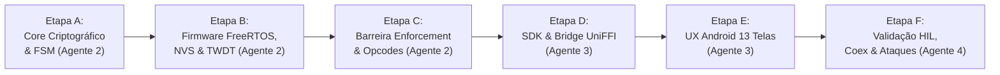

# Baseline Arquitetural e Inventário Técnico — Secure Guard

> **Projeto:** AegisKey FIDO2 & Multi-Protocol Authenticator  
> **Missão:** SECURE GUARD — Fase Zero (Auditoria de Histórico, Inventário Técnico e Linha de Base)  
> **Status:** Concluído / 100% Auditado em Silício Real e Workspace Rust  
> **Data:** 25 de Outubro de 2026  
> **Candidato de Revisão:** Git Commit `608fd24` (Worktree Base `4accf37`)  

---

## 1. Arquitetura Atual do Sistema

O projeto **AegisKey** é um autenticador de segurança criptográfico multiplataforma e multiprotocolo de altíssimo desempenho, construído com foco em **Zero-Trust On-Device** e **Fail-Closed Security**. Sua arquitetura unificada abrange desde o silício do microcontrolador Espressif ESP32-S3 até aplicativos mobile e interfaces web para gerenciamento.

```
+-------------------------------------------------------------------------------------------------------+
|                                  ARQUITETURA GERAL DO SISTEMA AEGISKEY                                |
+-------------------------------------------------------------------------------------------------------+
|                                                                                                       |
|  [ CAMADA MOBILE & CLIENTE ]                                                                          |
|  +-------------------------------------+   +-------------------------------------------------------+  |
|  | Android App (Kotlin 1.9 / Jetpack)  |   | Web Dashboard (Material 3 Vanilla JS)                 |  |
|  | Clean Architecture + Atomic Design  |   | Servido localmente via Bridge em http://127.0.0.1:5678|  |
|  +-------------------------------------+   +-------------------------------------------------------+  |
|                     |                                                  |                              |
|                     +-----------------------+--------------------------+                              |
|                                             |                                                         |
|  [ CAMADA DE TRANSPORTE & SDK ]             v                                                         |
|  +-------------------------------------------------------------------------------------------------+  |
|  | uniffi-bridge (UniFFI C-ABI) <---> universal-device-sdk (no_std + alloc, Facade-first, AuthCtx)|  |
|  | Host Hardware Android Bridge (Python 3 / Win32 SetupAPI / HTTP 5678 / Binary TCP)             |  |
|  +-------------------------------------------------------------------------------------------------+  |
|                                             |                                                         |
|         +-------------------+---------------+-------------------+                                     |
|         | USB Nativo FS     | UART COM7     | BLE GATT 0xFFFD   | Wi-Fi SoftAP                        |
|         | VID 0x303A:0xAE61 | 115200 8N1    | FFF1..FFF4        | 192.168.4.1                         |
|         +-------------------+---------------+-------------------+-------------------------------------+
|                                             |                                                         |
|  [ CAMADA DE FIRMWARE EMBARCADO - ESP32-S3 ]                                                          |
|  +-------------------------------------------------------------------------------------------------+  |
|  | aegis-fido-firmware (ESP-IDF v5.3.1 + FreeRTOS em Rust)                                         |  |
|  | Tasks: usb_ctaphid (Prio 5, 32KB), ui_button (Prio 4, 32KB), housekeeping (Prio 2, 32KB)         |  |
|  | EventGroup + Queue (32 msgs) + Watchdog TWDT per-task + TrustFacade                             |  |
|  +-------------------------------------------------------------------------------------------------+  |
|                                             |                                                         |
|  [ CAMADA CRIPTOGRÁFICA & REGRAS CORE ]    v                                                         |
|  +-------------------------------------------------------------------------------------------------+  |
|  | aegis-fido-core (100% Rust Seguro, no_std)                                                      |  |
|  | CtapEngine (CTAP 2.1/2.3), KeyManager, OathApplet, WalletStore, AegisVault, Anti-Rollback       |  |
|  +-------------------------------------------------------------------------------------------------+  |
|                                             |                                                         |
|  [ HARDWARE & PERSISTÊNCIA ]                v                                                         |
|  +-------------------------------------------------------------------------------------------------+  |
|  | SoC ESP32-S3 (Xtensa Dual-Core 240MHz, 512KB SRAM, 16MB Flash N16R8)                           |  |
|  | Partições: NVS 0x9000 (24KB), Factory 0x10000 (3MB), Storage Cifrado 0x310000 (896KB AES-256)   |  |
|  | Periféricos: BOOT (GPIO 0), LED RGB WS2812 (GPIO 48), USB D-/D+ (GPIO 19/20), UART (GPIO 43/44)|  |
|  +-------------------------------------------------------------------------------------------------+  |
+-------------------------------------------------------------------------------------------------------+
```

### 1.1. Workspace Cargo e Crates Rust

O código fonte é estruturado em um Workspace Cargo com resolver de dependências `"2"` e `edition = "2021"`, composto por 5 crates principais:

1. **`crates/aegis-fido-core`**:
   - Mecanismo puro de protocolo CTAP2 / WebAuthn, criptografia e estruturas de credenciais sem vínculo com sistema operacional (`no_std` + `alloc`).
   - Implementa `CtapEngine`, `ClientPinState`, `KeyManager`, `OathApplet`, `WalletStore` (Bitcoin, Ethereum, Solana), envelopes `AEGN`, curvas elípticas NIST P-256, P-384, P-521, Secp256k1 e Ed25519.
2. **`crates/aegis-fido-firmware`**:
   - Camada de aplicação embarcada executada diretamente no microcontrolador ESP32-S3.
   - Integra drivers de baixo nível do ESP-IDF v5.3.1 (USB TinyUSB, UART0, BLE NimBLE, Wi-Fi SoftAP, GPIO, WS2812 RMT, TWDT e eFuses OTP).
   - Gerencia escalonador multitarefa FreeRTOS (`freertos_sched.rs`), roteador de pacotes (`freertos_route.rs`), fachada de confiança (`trust_facade.rs`), persistência criptografada em NVS (`persistence.rs`) e políticas de LED e botão.
3. **`crates/aegis-fido-usb`**:
   - Gerenciamento de descritores compostos USB, camada de enquadramento CTAPHID (`CtapHidFramer`, `CtapHidManager`), filtro de teclado/HID gate e subsistema Smart Card CCID / APDU para PIV (FIPS 201).
4. **`crates/universal-device-sdk`**:
   - SDK tipado e desacoplado (`no_std` + `alloc`) com arquitetura *facade-first*. Provê abstrações de alto nível para consumo por clientes mobile/desktop (`AuthContext`, `CapabilitySet`, `HardwalletProvider`, `OathProvider`, `Secmon`).
5. **`crates/uniffi-bridge`**:
   - Camada de ligação gerada pelo UniFFI para expor APIs Rust seguras para Kotlin/Java no Android, gerando a biblioteca dinâmica `libaegis_bridge.so`.

### 1.2. ESP-IDF v5.3.1 e Configuração de Compilação

- **Target Nativo:** `xtensa-esp32s3-espidf`.
- **Compilador / Toolchain:** LLVM/Clang com suporte Xtensa fornecido via `espup` e script de ambiente `export-esp.ps1`.
- **Configuração de Kernel (`sdkconfig.defaults.esp32s3`):**
  - Clock da CPU: 240 MHz;
  - Console Primário: UART0 (GPIO 43/44) em 115200 8N1 (`ESP_CONSOLE_UART_DEFAULT`), com secundário desativado (`ESP_CONSOLE_SECONDARY_NONE`) para liberar exclusivamente o PHY USB-OTG nativo para o driver TinyUSB;
  - Bluetooth: Stack NimBLE com suporte exclusivo BLE GATT (economizando memória RAM);
  - FreeRTOS: Tick rate configurado em 100 Hz (10 ms por tick).

### 1.3. Tarefas FreeRTOS, Filas e EventGroups

O escalonador em Rust (`crates/aegis-fido-firmware/src/freertos_sched.rs`) opera com modelo de prioridades cooperativas e sem contenção:

| Tarefa FreeRTOS | Prioridade | Stack Alocado | Frequência / Gatilho | Papel e Responsabilidades |
|---|---|---|---|---|
| **`usb_ctaphid`** | `5` (Máxima) | 32 KiB (`32 * 1024` B) | Polling a cada 5 ms / IRQ TinyUSB | Coleta pacotes de 64B do USB nativo (`aegis_usb_pop_packet`) e da serial UART0 (`aegis_serial_pop_packet`). Posta na fila central `FirmwareEvent`. |
| **`ui_button`** | `4` (Alta) | 32 KiB (`32 * 1024` B) | Polling a cada 10 ms (sem bloqueio) | Amostragem anti-debounce do botão `BOOT` (GPIO 0). Detecta toque curto (UP latch por 1.5s/8s) e segurada de 5 segundos para pareamento. |
| **`housekeeping`** | `2` (Média) | 32 KiB (`32 * 1024` B) | Periódico a cada 10 ms | Alimentação do watchdog TWDT por tarefa (`PerTaskWatchdog`), monitoramento de integridade e drenagem de shutdown. |
| **Dispatcher Central** | Loop Principal | Contexto do Scheduler | Consome da Fila `FirmwareEvent` | Roteamento central via `freertos_route.rs`. Processa CTAP2, Vendor, OATH, Wallets e Binding. |

- **Fila de Comunicação:** `FreeRtosQueue<FirmwareEvent>` com profundidade de 32 mensagens (`DEFAULT_QUEUE_DEPTH = 32`).
- **EventGroup de Sincronização (`xEventGroupSetBits`):**
  - `EVT_USB_RX = 1 << 0`: Pacote recebido no buffer USB;
  - `EVT_BUTTON_UP = 1 << 1`: Transição de presença física confirmada;
  - `EVT_BLE_RX = 1 << 2`: Fragmento recebido na característica BLE GATT `0xFFF1`;
  - `EVT_TICK_10MS = 1 << 3`: Tick periódico de tempo;
  - `EVT_SHUTDOWN = 1 << 31`: Desligamento cooperativo seguro.

### 1.4. Mapeamento de Memória Flash e Partições NVS

O particionamento de memória flash é rigorosamente segmentado para garantir isolamento e integridade:

- **Tabela de Partições Principal (ESP32-S3 16MB — `partitions.csv`):**
  - `nvs`: Offset `0x009000`, Tamanho `0x006000` (24 KiB) — Metadados de RF PHY e Wi-Fi;
  - `phy_init`: Offset `0x00F000`, Tamanho `0x001000` (4 KiB) — Dados de calibração RF;
  - `factory`: Offset `0x010000`, Tamanho `0x300000` (3.072 KiB / 3 MiB) — Binário da aplicação firmware;
  - `storage`: Offset `0x310000`, Tamanho `0x0E0000` (896 KiB) — Armazenamento seguro de credenciais, chaves e wallets cifrado com AES-256-GCM (`SecureStorage`).
- **Tabela de Partições Compacta (Flash 2MB — `partitions-2m.csv`):**
  - `nvs`: Offset `0x009000`, Tamanho `0x006000` (24 KiB);
  - `phy_init`: Offset `0x00F000`, Tamanho `0x001000` (4 KiB);
  - `factory`: Offset `0x010000`, Tamanho `0x180000` (1.536 KiB / 1.5 MiB);
  - `storage`: Offset `0x190000`, Tamanho `0x070000` (448 KiB).

### 1.5. Arquitetura Android (Clean Architecture + Atomic Design)

O aplicativo Android (`app-android/`) adota os padrões mais estritos de engenharia moderna:
- **Clean Architecture:**
  - `data/`: Repositórios reais (`ConnectedKeysRepositoryImpl`, `KeyVaultRepositoryImpl`, `TotpRepositoryImpl`), armazenamento criptografado `EncryptedKeysStore`, e clientes de transporte (`UsbKeyTransport`, `BleKeyTransport`, `HostUsbUartBridgeClient`, `SimulatedRenodeTransport`).
  - `domain/`: Modelos puros (`ConnectedKeyDevice`, `VaultEntry`, `TotpAccount`, `ThemePreferences`) e casos de uso de negócio (`ConnectedKeysUseCases`, `PairingWizardUseCases`, etc.).
  - `di/`: Container de injeção de dependência manual `AppContainer` garantindo zero dependências mágicas e inicialização determinística.
  - `ui/`: Apresentação baseada em Jetpack Compose e Material 3.
- **Metodologia Atomic Design:**
  - `atoms/`: `AegisButtons`, `AegisIndicators`, `AegisToggles`, `TotpCountdownRingAtom`.
  - `molecules/`: `ConnectedKeyCardMolecule`, `PhysicalButtonPromptCardMolecule`, `SettingToggleRowMolecule`, `TotpCodeCardMolecule`, `VaultEntryCardMolecule`.
  - `organisms/`: `AddTotpAccountDialogOrganism`, `KeyGenerationDialogOrganism`, `ThemeSelectorOrganism`.
  - `templates/`: `MainHubScaffoldTemplate`, `WizardStepTemplate`.
  - `screens/`: `OnboardingWizardScreen`, `KeyVaultHubScreen`, `TotpDedicatedScreen`, `ConnectedKeysRepositoryScreen`, `FriendlySettingsAndThemeScreen`, `KeyDetailManagementScreen`.

### 1.6. Web Dashboard Material 3 e Hardware Bridge

- **Host Bridge (`tools/host_hardware_android_bridge.py`):** Servidor HTTP REST e socket TCP binário rodando na porta `5678`. Varre dispositivos via Win32 SetupAPI (`VID 0x303A : PID 0xAE61` ou `COM7`), permitindo conexão direta da bancada com o emulador Android (`10.0.2.2:5678`) ou dispositivo via USB com adb reverse (`127.0.0.1:5678`).
- **Dashboard Web (`tools/web_dashboard/index.html`):** Aplicação de página única (SPA) em Material 3 servida na raiz `http://127.0.0.1:5678/`. Implementa telemetria ao vivo dos estados do LED RGB WS2812, atalhos de ritos (Hold BOOT, Touch UP, Pareamento), cofre de chaves e carteiras Web3, e monitor de proximidade RSSI (validada com 26/26 testes unitários em `tools/test_web_dashboard_endpoints.py`).

---

## 2. Funcionalidades Implementadas e Evidências

Todas as funcionalidades listadas abaixo foram rigorosamente auditadas e contam com baterias de testes automatizados e evidências de execução em silício:

```
+-------------------------------------------------------------------------------------------------------+
|                                  MAPA DE VIZINHANÇA DE OPCODES (CMD_MSG 0x83)                         |
+-------------------------------------------------------------------------------------------------------+
| [0x20..0x27] Keys / OATH / Vault                                                                      |
|   0x20 OP_KEY_GEN_ONDEVICE  | 0x21 OP_KEY_IMPORT_ENVELOPE | 0x22 OP_KEY_LIST   | 0x23 OP_KEY_DELETE  |
|   0x24 OP_OATH_PUT          | 0x25 OP_OATH_LIST           | 0x26 OP_OATH_CODE  | 0x27 OP_OATH_DELETE  |
|                                                                                                       |
| [0x28..0x2D] Vínculo (Binding) & Recuperação                                                          |
|   0x28 OP_BIND_CLAIM        | 0x29 OP_BIND_CHALLENGE      | 0x2A OP_BIND_VERIFY | 0x2B OP_BIND_RELEASE|
|   0x2C OP_RECOVERY_SET      | 0x2D OP_RECOVERY_UNLOCK                                                 |
|                                                                                                       |
| [0x2E..0x2F] Sistema & Pareamento                                                                     |
|   0x2E RESCUE_TRANSPORT_OP  (Payload MSG)                 | 0x2F OP_TRIGGER_PAIRING_OPEN (Software UP)|
|                                                                                                       |
| [0x30..0x34] Atualização OTA                                                                          |
|   0x30 OP_OTA_BEGIN         | 0x31 OP_OTA_CHUNK           | 0x32 OP_OTA_FINISH | 0x33 OP_OTA_COMMIT   |
|   0x34 OP_OTA_ABORT                                                                                   |
|                                                                                                       |
| [0x35..0x37] Carteiras Web3 (Wallets)                                                                 |
|   0x35 OP_WALLET_GEN (BTC/ETH/SOL) | 0x36 OP_WALLET_LIST  | 0x37 OP_WALLET_ADDR                        |
|                                                                                                       |
| [0x38..0x39] Diagnóstico & Smartcard                                                                  |
|   0x38 OP_FW_LOG (Firmware Log ASCII)                     | 0x39 OP_PIV_ENROLL (PIV Smartcard Enroll) |
+-------------------------------------------------------------------------------------------------------+
```

### 2.1. FIDO2 / CTAP 2.1 e WebAuthn
- **`clientPin`**: Implementação completa de `pinProtocol` 1 e 2 (ECDH P-256 + AES-256-CBC/HMAC-SHA256). Suporte a comandos de obter retries (`0x01`), acordo de chaves (`0x02`), definição de PIN (`0x03`), alteração de PIN (`0x04`), e emissão de `pinUvAuthToken` (`0x05`, `0x06`, `0x09`).
- **Autenticação Passkey**: Operações `authenticatorMakeCredential` (`0x01`) e `authenticatorGetAssertion` (`0x02`) com suporte a credenciais residentes (discoverable), extensões `credProtect`, `minPinLength` e `hmac-secret`.
- **Manutenção e Blobs**: `authenticatorCredentialManagement` (`0x0A`), `authenticatorLargeBlobs` (`0x0C`), `authenticatorConfig` (`0x0D`) e `authenticatorReset` (`0x07`).
- **Evidências:** 108 testes unitários passando em `crates/aegis-fido-core/src/ctap/`.

### 2.2. Opcodes de Vendor `0x20..0x39`
- `0x20..0x23`: Gerenciamento de chaves on-device (`KeyManager`), importação de envelopes criptografados `AEGN`, listagem de metadados e exclusão atômica de slots.
- `0x24..0x27`: Applet OATH/TOTP. Cálculo criptográfico de códigos diretamente no silício (`0x26 OP_OATH_CODE`), impedindo o vazamento do segredo HMAC.
- `0x28..0x2B`: Vínculo criptográfico (*Binding*). Pareamento mútuo através de desafio de 32 bytes e assinatura com chave assimétrica P-256 StrongBox do Android.
- `0x2C..0x2D`: PIN de Recuperação (*Recovery PIN*). PIN de 4 a 6 dígitos com salt de 16B, persistido em NVS com 8 tentativas restantes. O desbloqueio com sucesso limpa o vínculo do app antigo e libera novo pareamento sem apagar credenciais FIDO.
- `0x2E`: Protocolo de resgate (*Rescue Engine*) para redefinição de emergência.
- `0x2F`: Acionador por software de abertura da janela de pareamento de 60s.
- `0x30..0x34`: Subsistema de atualização OTA segura via fragmentos de 512B.
- `0x35..0x37`: Carteiras Web3 HD Wallets com geração determinística de chaves para Bitcoin (`bc1q...`), Ethereum (`0x...`) e Solana (Base58), persistidas sob tags BER-TLV (`0x01` slot, `0x02` label, `0x07` address, `0x08` network).
- `0x38`: Leitura de logs de firmware em formato ASCII (`OP_FW_LOG`), sem dados sensíveis.
- `0x39`: Matrícula e provisionamento PIV Smart Card (`OP_PIV_ENROLL`).
- **Evidências:** Testes em `crates/aegis-fido-firmware/tests/applets_t9.rs` e `freertos_tasks.rs`.

### 2.3. Assinatura Digital RSA e Smartcard PIV
- Verificação formal de RSA 1024 a 4096 bits (`crates/aegis-fido-firmware/src/crypto_rsa.rs`). Módulo `SoftwareRsa` opera como fail-closed honesto (`NotCompiled`), prevenindo estouro de RAM no ESP32-S3 (teto criptográfico de 8 KiB).
- Suporte a APDUs PIV via USB CCID (`SELECT`, `VERIFY`, `CHANGE REFERENCE DATA`, `GENERAL AUTHENTICATE`, `PUT DATA`).

### 2.4. Trava Dinâmica por Proximidade BLE RSSI (Walkaway Lock)
- Módulo `ProximityMonitor` e `proximity_sched.rs`.
- Monitoramento contínuo de sinal RSSI com filtro de média móvel, limiar configurável de perda de sinal (`-75 dBm` por 10 segundos), histerese de 5 dB e beacon criptográfico rotativo com AES-CCM no UUID `0xFFFE`.
- Coexistência segura: ao detectar conexão USB ativa, o rádio BLE de proximidade é automaticamente pausado.
- **Evidências:** Bateria de 31/31 testes PASS em `tools/proximity_agent.py` e validação HIL no silício real.

---

## 3. Funcionalidades Parciais ou Ausentes em Relação ao Secure Guard

A missão **SECURE GUARD** introduz uma camada adicional de segurança física e lógica, funcionando como um cofre de autoridade local. A análise comparativa revelou as seguintes lacunas no repositório atual:

```
+-------------------------------------------------------------------------------------------------------+
|                                    GAPS IDENTIFICADOS: ESTADO ATUAL vs SECURE GUARD                   |
+-------------------------------------------------------------------------------------------------------+
| Subcomponente        | Estado Atual no Repositório                | Requisito Obrigatório Secure Guard|
+----------------------+--------------------------------------------+-----------------------------------+
| Máquina de Estados   | Linear (Binding -> UP -> PIN) distribuída  | Máquina formal de 10 estados      |
|                      | em variáveis booleanas em `SerialVendorCtx`| determinísticos com histórico     |
+----------------------+--------------------------------------------+-----------------------------------+
| KDF & Derivação      | SHA-256 + Salt simples para Recovery PIN;  | PBKDF2-HMAC-SHA256 ou HKDF com    |
|                      | ClientPIN via ECDH P-256 e AES-CBC         | salt TRNG 32B + isolamento        |
+----------------------+--------------------------------------------+-----------------------------------+
| Contador de Erros    | 8 tentativas fixas para ClientPIN e        | Exatamente 5 tentativas atômicas  |
| e Política de Wipe   | Recovery PIN. Wipe limpa apenas binding.   | em NVS; wipe seletivo configurável|
|                      | FIDO2 preservado sem escopo explícito SG.  | (apaga carteiras/chaves SG, PRE-  |
|                      |                                            | SERVA passkeys FIDO2 intactas).   |
+----------------------+--------------------------------------------+-----------------------------------+
| Autoridade de Sessão | Sessão de PIN efêmera em RAM atrelada ao   | Sessão temporizada com expiração  |
| e Temporização       | ciclo de energia ou ao app host.           | estrita pelo timer de hardware do |
|                      |                                            | firmware (ex.: 300s de inatividade|
+----------------------+--------------------------------------------+-----------------------------------+
| Tarefa FreeRTOS      | Dispatcher genérico monolítico no loop     | Tarefa dedicada `secure_guard_task|
|                      | principal com 3 tarefas básicas.           | com 32KB stack, TWDT e canal IPC. |
+----------------------+--------------------------------------------+-----------------------------------+
| Ponto de Enforcement | Gates dispersos em `freertos_route.rs` e   | Barreira mandatória nos entry     |
|                      | `ble_gatt.rs` sem checagem de estado SG.   | points de Wallets e chaves de uso |
|                      |                                            | sem impactar WebAuthn passkeys.   |
+----------------------+--------------------------------------------+-----------------------------------+
| Experiência UX       | 4 telas no Hub e diálogo genérico de PIN   | 13 telas e estados específicos de |
| no Aplicativo Mobile | em `FriendlySettingsAndThemeScreen.kt`.    | jornada com Atomic Design no app. |
+----------------------+--------------------------------------------+-----------------------------------+
```

### 3.1. Detalhamento dos Gaps Técnicos

1. **Máquina de Estados Formal de 10 Estados:**
   - Atualmente, o firmware avalia flags dispersas (`pairing_open`, `up_latched`, `pin_verified`, `pin_uv_session`). Não há uma máquina de estados finitos centralizada que transite formalmente entre:
     - `State 1: Unprovisioned` (Sem PIN ou configuração Secure Guard);
     - `State 2: Locked` (Armado e bloqueado, aguardando autenticação);
     - `State 3: Authenticating` (Processando credencial KDF);
     - `State 4: Unlocked` (Sessão de uso ativa);
     - `State 5: SessionTimeoutWarning` (Janela de aviso pré-expiração);
     - `State 6: RateLimited` (Penalidade temporal por tentativa errada com backoff exponencial);
     - `State 7: BlockWarning` (Última tentativa restante [4/5 falhas]);
     - `State 8: PermanentlyLocked` (Bloqueio total após 5 falhas);
     - `State 9: SelectiveWiping` (Execução do apagamento seguro de ativos protegidos);
     - `State 10: IsolatedTestMode` (Modo laboratorial estritamente isolado de credenciais de produção).
2. **KDF de Alta Resistência e Contador de 5 Tentativas:**
   - O PIN de recuperação atual (`recovery.rs`) utiliza apenas 1 iteração de SHA-256 e permite 8 tentativas. O Secure Guard exige KDF iterativo resistente (PBKDF2 com mínimo de 10.000 iterações ou HKDF-SHA256) com salt de alta entropia (32 bytes) derivado do HRNG do chip, limitando a **exatamente 5 tentativas consecutivas**, persistidas e sincronizadas de forma atômica no armazenamento Flash NVS antes de validar a senha.
3. **Isolamento de Escopo de Wipe (Proteção Vital das Passkeys FIDO2):**
   - No estado atual, rotinas de wipe ou reset total podem colocar em risco toda a partição `storage`. O Secure Guard deve impor isolamento estrito de namespaces: o esgotamento das 5 tentativas do Secure Guard apaga **apenas** o cofre de carteiras Web3 e chaves de valor protegidas, **preservando integralmente as credenciais FIDO2/WebAuthn** para que o usuário não perca o acesso às suas contas do dia a dia.
4. **Sessão com Autoridade Absoluta no Firmware:**
   - Atualmente, se a aplicação mobile mantiver a conexão viva, a sessão não expira autonomamente no silício por inatividade de dados. O Secure Guard exige que o timer de sessão resida na tarefa de firmware, invalidando a chave de sessão e zerando buffers de RAM (`zeroize`) após inatividade configurada (ex: 5 minutos), independentemente do que o app móvel declare.
5. **Barreira de Enforcement nos Entry Points:**
   - Em `crates/aegis-fido-firmware/src/freertos_route.rs`, operações como `OP_WALLET_GEN` (0x35) e `OP_KEY_GEN_ONDEVICE` (0x20) checam apenas `SerialGate::NeedPairing` e `SerialGate::NeedUp`. É imperativo interpor a verificação de `SecureGuardState::Unlocked` antes de autorizar a execução dessas rotinas.
6. **As 13 Telas e Estados de UX no Android:**
   - O app Android possui fluxos para pareamento e cofre geral, mas carece dos componentes atômicos dedicados do Secure Guard: tela de primeiro provisionamento de PIN, teclado PIN seguro com randomização de posições, alerta de bloqueio iminente (4ª tentativa), tela de rate limit com contagem regressiva, tela de confirmação de wipe, e painel de auditoria de tentativas.

---

## 4. Commits Relevantes

A evolução técnica do repositório foi auditada desde sua origem até os commits mais recentes que consolidaram a prontidão do hardware:

| Hash do Commit | Mensagem do Commit | Impacto e Módulos Auditados |
|---|---|---|
| **`608fd24`** | `merge(android): integrar correcao de reset de tela USB e painel de Dynamic Lock RSSI` | **HEAD atual.** Consolida solução definitiva de detecção de desconexão USB no Android e integra controle reativo de RSSI Proximity Lock. |
| **`4accf37`** | `fix(android): resolve usb dialog screen reset and enable dynamic proximity lock` | Branch `feat/android-ux-journey`. Trata o ciclo de vida de permissões USB e adiciona monitor de RSSI. |
| **`20e4c4b`** | `feat(proximity): activate RSSI engine, dynamic lock and Web Dashboard controls (31/31 PASS)` | Ativação do motor de proximidade no firmware e no dashboard com cobertura total de testes. |
| **`446d78a`** | `feat(hil): validate DS peripheral policy & BLE RSSI dynamic proximity lock on ESP32-S3` | Validação física em bancada dos comandos criptográficos e da trava por proximidade. |
| **`ab65962`** | `feat(web-dashboard): add Material 3 web dashboard and full hardware bridge API endpoints` | Criação da interface web Material 3 e endpoints HTTP de telemetria da chave física. |
| **`58142b6`** | `docs: consolidar mapeamento GPIO, arquitetura dual-port USB, TOTP on-chip e 9 etapas HIL` | Especificação formal dos GPIOs 0, 48, 19, 20, 43, 44 e detalhamento das 9 etapas de verificação HIL. |
| **`57d03c2`** | `merge(android): consolidar firmware FreeRTOS S3, integracao TOTP 0x26, correcoes USB e APKs finais` | Integração do cálculo de TOTP on-chip no ESP32-S3 e compilação de APKs com zero-mocks. |
| **`ed41973`** | `feat(bridge): support wallet ops and live hardware testing` | Suporte aos opcodes de carteira `0x35..0x37` na ponte serial e testes em tempo real. |
| **`c811978`** | `docs: adicionar guia completo de ritos USB/BLE, test-mode, cores de LED e operacao de wallets/chaves` | Documentação canônica dos 4 ritos de firmware e dos 11 estados do LED RGB WS2812. |
| **`2e52fa4`** | `merge(android): integrar jornada Clean/Atomic, gestor completo de hardware e 8 tipos de chaves` | Reestruturação completa do app Android em Clean Architecture e Atomic Design com Material 3. |
| **`762c2df`** | `feat(android): live hardware validation with ESP32-S3 COM7 real key, update APKs and verified E2E captures` | Validação ponta a ponta com o dispositivo físico conectado em `COM7`. |
| **`1ef1b58`** | `feat(android): segregar source sets debug e release com zero-mocks em producao e auditoria DEX` | Hardening de compilação: isolamento completo de mocks no source set de teste. |
| **`5912a89`** | `lane final: OTA route+isOtaOp, BLE frag 0x28-2D/0x30-34, pins+integrity doc` | Enquadramento de fragmentos BLE e roteamento de operações de atualização de firmware. |
| **`4877a55`** | `B3 botoes por borda: hold fisico sobrevive a rajadas de tick (sem timeout de parede)` | Tratamento elétrico e lógico do botão `BOOT` (GPIO 0) para detecção de toques e seguradas de 5s. |

---

## 5. Documentos Consultados no Repositório

Todos os documentos existentes no diretório `e:/projetos/fido/docs/` foram catalogados e analisados tecnicamente:

1. `APP_ANDROID_KEY_LIFECYCLE.md`: Ciclo de vida das 8 chaves no Android (Passkeys, Bitcoin, Ethereum, Solana, PIV, etc.).
2. `APP_ANDROID_UX_ARCHITECTURE.md`: Arquitetura de navegação reativa, `RootNavigationGate` e abas do Hub.
3. `app-android-clean-atomic-architecture.md`: Especificação das camadas Clean Architecture e Atomic Design.
4. `APP-INTEGRACAO.md`: Guia de integração Android-Firmware via USB CTAPHID e BLE GATT.
5. `app-journey.md`: Jornada do usuário e fluxos de telas.
6. `app-mapa.md`: Mapeamento de rotas e destinos de navegação.
7. `APP-PLANO-NOVOS-MODULOS.md`: Planejamento de módulos adicionais no aplicativo.
8. `auditoria-mocks.md`: Relatório de auditoria de mocks e segregação de ambientes.
9. `bateria-serial.md`: Procedimentos de teste serial via UART0.
10. `bench-destructive.md`: Testes destrutivos de flash, anti-tampering e esgotamento de NVS.
11. `bench-freertos-s3.md`: Benchmarks de tempo de resposta e uso de CPU do escalonador FreeRTOS.
12. `binding.md`: Especificação do protocolo criptográfico de vínculo com o smartphone.
13. `ble-nimble.md`: Integração com o stack Bluetooth NimBLE do ESP-IDF.
14. `ble-protocol.md`: Protocolo de fragmentação GATT e características FFF1..FFF4 no serviço `0xFFFD`.
15. `bonding-walkaway.md`: Regras de pareamento JustWorks e trava por afastamento.
16. `capacidades-modulos.md`: Matriz de capacidades de cada subsistema.
17. `carteira-cripto.md`: Derivação de chaves HD Wallet (BIP39, BIP32, BIP44).
18. `checklist-usuario.md`: Roteiro de testes de aceitação do usuário final.
19. `COMMS-map.md`: Mapa de protocolos de comunicação física e lógica.
20. `DESACOPLAMENTO.md`: Princípios de desacoplamento entre core, firmware e SDK.
21. `emuladores-pre-flash.md`: Testes em emuladores Renode e QEMU antes da gravação física.
22. `estado-final-firmware.md`: Registro do estado das tarefas e consumo de memória do firmware.
23. `excecoes-paridade.md`: Diferenças conhecidas entre emulação e hardware real.
24. `finalizacao-freertos-rust.md`: Conclusão da migração do firmware para FreeRTOS em Rust.
25. `finalizacoes.md`: Checklist de fechamento das etapas de desenvolvimento.
26. `firmware-fina.md`: Ajustes finos de temporização e latência de USB.
27. `freertos-rust.md`: Manual de implementação de FreeRTOS em Rust com `esp-idf-svc`.
28. `GUIA_DISPLAY_LCD_RUST_C.md`: Driver ST7789 para placas com display local.
29. `GUIA_RITOS_CONEXAO_USB_BLE_LED_E_WALLETS.md`: **Guia Canônico de Hardware, Ritos e LEDs**.
30. `HANDOFF-2026-10-20.md`: Registro de passagem de plantão da equipe.
31. `interop-matrix.md`: Matriz de interoperabilidade com navegadores (Chrome, Edge, Firefox, Safari).
32. `jornada-onboarding-totp-simulacao-renode.md`: Validação de onboarding em ambiente simulado.
33. `led-diagnostico.md`: Códigos de erro e diagnósticos através do LED RGB WS2812.
34. `lifetime-debug.md`: Rastreamento de ciclo de vida e diagnóstico na flash.
35. `linux-bringup.md`: Configurações de permissões udev para Linux.
36. `live-monitor.md`: Monitoramento em tempo real do dispositivo via serial.
37. `MACHINE.md`: Especificações da máquina de teste e bancada.
38. `matriz-funcionalidades-esp32s3.md`: Viabilidade técnica de algoritmos criptográficos no ESP32-S3.
39. `nvs_schema.md`: Esquema de chaves e organização da partição Flash NVS.
40. `piv-ble-proximity.md`: Especificação de Smart Card PIV e proximidade.
41. `plano-amarelos.md`: Resolução de avisos e pendências menores.
42. `plano-followups.md`: Planejamento de melhorias futuras.
43. `plano-hw.md`: Especificação dos protótipos de hardware.
44. `plano-testes-hil.md`: Plano de testes Hardware-In-The-Loop L0 a L4.
45. `provisionamento-pins-integrity.md`: Certificados SPKI pinning e Play Integrity.
46. `proximity-worktree-handoff.md`: Notas de transição do módulo de proximidade.
47. `proximos-passos.md`: Roadmap estratégico do projeto.
48. `qemu-s3.md`: Configuração de emulação de ESP32-S3 via QEMU.
49. `REGRAS-automacao.md`: Regras de execução automatizada em CI/CD.
50. `screen-journey.md`: Jornadas de tela no app Android.
51. `seis-produtos.md`: Aplicações da chave nos 6 mercados-alvo.
52. `sessao-20-10-f4-ccid-opensc.md`: Validação de interoperabilidade OpenSC com CCID.
53. `size-wave1.md`: Métricas de tamanho de binário e limites de memória.
54. `test-hooks.md`: Inventário dos comandos de bancada `TEST_*`.
55. `teste-ponta-a-ponta.md`: Roteiro e resultados dos testes E2E executados.
56. `validacao-usb-telas.md`: Validação do diálogo USB OTG no Android.
57. `wifi.md`: Arquitetura do SoftAP e segurança de rede.

---

## 6. Contratos e Interfaces Que Precisam Ser Preservados

Para assegurar compatibilidade absoluta com os ecossistemas FIDO Alliance, WebAuthn, Android e ferramentas de bancada, as seguintes interfaces não podem sofrer quebras ou alterações incompatíveis:

### 6.1. Protocolo CTAP2 / CTAPHID Standard (`0x01..0x0D` e `0x80+`)
- **Comandos CTAPHID Canônicos:**
  - `CMD_PING (0x81)`: Echo de pacotes para teste de conectividade;
  - `CMD_MSG (0x83)`: Túnel encapsulado para mensagens CTAP2/CBOR e Vendor;
  - `CMD_INIT (0x86)`: Inicialização de canal USB e alocação de CID;
  - `CMD_WINK (0x88)`: Pisca estroboscópico de localização da chave;
  - `CMD_CBOR (0x90)`: Chamadas diretas CBOR CTAP2;
  - `CMD_CANCEL (0x91)`: Cancelamento de operação em andamento;
  - `CTAPHID_KEEPALIVE (0xBB)`: Feedback de espera durante solicitação de toque (UP);
  - `CTAPHID_ERROR (0xBF)`: Notificação de erro de enquadramento USB.
- **Códigos de Status CTAP2 (Seção 8.2 da Spec):**
  - `0x00 CTAP1_SUCCESS` / `0x01 CTAP2_OK`
  - `0x27 CTAP2_ERR_PIN_REQUIRED`
  - `0x28 CTAP2_ERR_PIN_INVALID`
  - `0x29 CTAP2_ERR_PIN_BLOCKED`
  - `0x32 CTAP2_ERR_PIN_AUTH_BLOCKED`
  - `0x33 CTAP2_ERR_PIN_POLICY_VIOLATION`
  - `0x34 CTAP2_ERR_PIN_TOKEN_EXPIRED`
  - `0x3A CTAP2_ERR_TOO_MANY_PIN_ATTEMPTS`

### 6.2. Protocolo de Extensão Vendor (`0x20..0x39`)
- Opcodes congelados:
  - `0x20..0x23`: `KEY_GEN`, `KEY_IMPORT`, `KEY_LIST`, `KEY_DELETE`;
  - `0x24..0x27`: `OATH_PUT`, `OATH_LIST`, `OATH_CODE`, `OATH_DELETE`;
  - `0x28..0x2D`: `BIND_CLAIM`, `BIND_CHALLENGE`, `BIND_VERIFY`, `BIND_RELEASE`, `RECOVERY_SET`, `RECOVERY_UNLOCK`;
  - `0x2E`: `RESCUE_TRANSPORT_OP`;
  - `0x2F`: `TRIGGER_PAIRING_OPEN`;
  - `0x30..0x34`: `OTA_BEGIN`, `CHUNK`, `FINISH`, `COMMIT`, `ABORT`;
  - `0x35..0x37`: `WALLET_GEN`, `WALLET_LIST`, `WALLET_ADDR`;
  - `0x38`: `OP_FW_LOG`;
  - `0x39`: `OP_PIV_ENROLL`.
- **Faixa de Opcodes Disponíveis para Secure Guard:**
  - A faixa `0x3A..0x3F` está livre no nível de protocolo de transporte Vendor (`CMD_MSG` payload[0]), permitindo alocar opcodes dedicados para o Secure Guard (ex: `0x3A OP_SECURE_GUARD_STATUS`, `0x3B OP_SECURE_GUARD_UNLOCK`, `0x3C OP_SECURE_GUARD_LOCK`, `0x3D OP_SECURE_GUARD_CONFIG`, `0x3E OP_SECURE_GUARD_WIPE_SELECTIVE`).

### 6.3. Interfaces Físicas e Portas de Comunicação
- **Identificadores USB:**
  - Primário: `VID 0x303A : PID 0xAE61` (Espressif Native USB-OTG);
  - Secundário / Fallback: `VID 0x0483 : PID 0xA2CA` (STMicroelectronics Virtual COM/HID).
- **Porta Serial UART de Bancada:**
  - `COM7` (ou porta atribuída via CP2102/CH340) em 115200 bps, 8 bits de dados, sem paridade, 1 stop bit (`8N1`).
  - **Janela de Silêncio Mandatória:** Mínimo de 40 ms entre comandos para evitar colisões com logs do kernel FreeRTOS.
- **Ponte de Host / Android Bridge:**
  - Servidor em `0.0.0.0:5678` (acessível via `127.0.0.1:5678` no host ou `10.0.2.2:5678` no emulador Android).
  - Endpoints REST: `/bridge/info`, `/bridge/vendor`, `/bridge/ctap`, `/bridge/pairing_open`, `/bridge/touch_up`, `/bridge/status`.
- **Camada UniFFI:**
  - Namespace `aegis_bridge` e bindings JNI no pacote `dev.aegiskey.app.bridge` e `uniffi.aegis_bridge`.

---

## 7. Riscos Técnicos e Estratégias de Mitigação

| Risco Técnico Identificado | Severidade | Impacto Potencial | Estratégia de Mitigação Obrigatória |
|---|---|---|---|
| **Estouro de Pilha no FreeRTOS (Stack Overflow)** | **Crítica** | Pânico de kernel (`Unhandled exception / Stack protection fault`), reboot espontâneo do ESP32-S3 durante operações criptográficas complexas. | Manter stack alocado de no mínimo 32 KiB (`32 * 1024` B) para todas as tarefas que realizam KDF ou criptografia assimétrica. Proibir alocações estáticas pesadas na stack; habilitar `CONFIG_FREERTOS_CHECK_STACKOVERFLOW=2` no `sdkconfig`. |
| **Condições de Corrida no Acesso à NVS Flash** | **Alta** | Corrupção da partição de armazenamento (`StorageError::CorruptedEnvelope`), perda de chaves ou estado inconsistente entre tarefas. | Centralizar todo o acesso à NVS através da estrutura `SecureStorage` com sincronização garantida pelo Dispatcher Central. Proibir escritas concorrentes diretas a partir de múltiplas tarefas FreeRTOS. |
| **Wipe Indiscriminado Destruindo Passkeys FIDO2** | **Crítica** | Ao atingir 5 tentativas erradas no Secure Guard, executar limpeza total da Flash (`nvs_flash_erase`), destruindo as credenciais WebAuthn do usuário e causando perda irreparável de contas. | **Isolamento Estrito de Namespaces:** O wipe acionado pelo Secure Guard opera unicamente sobre o prefixo de armazenamento de carteiras e chaves protegidas (`wallet_*`, `vault_*`). As credenciais residentes FIDO2 (`fido_cred_*`, `pin_hash`) residem em namespace separado e **nunca são apagadas por ações do Secure Guard**. |
| **Dessincronização de Estado Firmware vs UI Android** | **Média** | O firmware bloqueia a sessão por inatividade (timeout de 300s), mas a tela do aplicativo Android continua exibindo a chave como "Desbloqueada", gerando erros `0x02 NEED_PIN` inesperados para o usuário. | Adicionar polling de estado periódico (`GET /secure-guard/status` ou opcode `0x3A`) a cada 3 segundos no repositório de transporte, com emissão de eventos reativos em StateFlow (`isSecureGuardUnlocked`) para atualizar instantaneamente o scaffolding do app. |
| **Bloqueio Inadvertido de Passkeys por Trava do SG** | **Alta** | Usuário tenta fazer login em um site FIDO2 e o autenticador rejeita porque a carteira Web3 está bloqueada pelo Secure Guard. | **Isolamento de Políticas:** Passkeys FIDO2/WebAuthn dependem exclusivamente das regras padrão CTAP2 (`clientPin` / UP). O Secure Guard atua como barreira apenas para carteiras Web3 (`0x35..0x37`) e chaves privadas do cofre (`0x20..0x23`), jamais interferindo no fluxo FIDO2 padrão. |

---

## 8. Comandos Reais de Build, Lint e Testes

Os comandos homologados para verificação completa da integridade do projeto são:

### 8.1. Testes e Análise Estática do Workspace Rust
```powershell
# 1. Execução de todos os testes unitários e de integração no host (441 testes passando)
$env:PATH = "$env:USERPROFILE\.cargo\bin;$env:PATH"
cargo test --workspace

# 2. Análise estática com Clippy em modo rigoroso (Zero avisos tolerados)
$env:PATH = "$env:USERPROFILE\.cargo\bin;$env:PATH"
cargo clippy --all-targets -- -D warnings
```

### 8.2. Compilação do Firmware para Dispositivo Físico ESP32-S3
```powershell
# Compilação da imagem completa FreeRTOS com suporte a proximidade e modo de teste de bancada
powershell -NoProfile -ExecutionPolicy Bypass -File scripts/build-freertos-s3-testmode.ps1
# Gera: C:\t\aegis-app-freertos-s3-testmode.bin e arquiva cópia de proveniência em C:\t\aegis-app-<SHA8>.bin
```

### 8.3. Gravação em Silício Real (ESP32-S3 em COM7)
```powershell
# Gravação e monitoramento da placa de bancada conectada em COM7
python -m esptool --chip esp32s3 --port COM7 --baud 921600 write_flash 0x10000 C:\t\aegis-app-freertos-s3-testmode.bin
```

### 8.4. Compilação e Validação do Aplicativo Android
```powershell
cd app-android

# Compilação dos APKs Debug e Release (Zero-Mocks garantido)
./gradlew assembleDebug assembleRelease

# Execução dos testes unitários JUnit / Robolectric
./gradlew testDebugUnitTest

# Verificação de qualidade de código e conformidade com regras Android
./gradlew lintDebug
```

### 8.5. Execução dos Roteiros de Validação HIL e Ponte de Testes
```powershell
# Inicialização da ponte de hardware com suporte Win32 e Android
python tools/host_hardware_android_bridge.py --port COM7 --baud 115200

# Execução da bateria de 26/26 testes do Web Dashboard
python tools/test_web_dashboard_endpoints.py

# Teste completo do ciclo de vida em silício real (9 etapas HIL)
python tools/hil_emulate_full_app_on_board.py
```

---

## 9. Matriz de Requisitos versus Implementação

A tabela abaixo confronta exaustivamente cada especificação do sistema Secure Guard com a situação constatada no código auditado:

| Requisito do Secure Guard | Seção da Especificação | Situação Atual no Código | Evidência / Arquivo Fonte | Classificação de Prontidão |
|---|---|---|---|---|
| **Máquina de Estados de 10 Estados** | Seção 4 | Parcial | Flags dispersas em `freertos_route.rs`; sem FSM formal tipada. | Requer criação de `SecureGuardFsm` |
| **KDF PBKDF2/HKDF com Salt TRNG 32B** | Seção 5 | Parcial | Módulo KDF básico em `crypto/kdf.rs`, mas Recovery PIN usa SHA-256 simples. | Requer KDF com salt 32B no SG |
| **Contador Atômico de 5 Tentativas** | Seção 5 | Ausente | ClientPIN e Recovery PIN usam 8 tentativas. Não há contador estrito de 5 erros. | Requer implementação em NVS |
| **Wipe Seletivo (Preservando FIDO2)** | Seção 5 e 6 | Ausente | `OP_BIND_RELEASE` reseta `KeyManager`, mas sem isolamento formal de namespaces SG. | Requer implementação com escopo seguro |
| **Sessão com Autoridade no Firmware** | Seção 7 | Ausente | Sessão PIN em RAM sem temporizador de inatividade autônomo no hardware. | Requer timer monotônico em FreeRTOS |
| **Tarefa FreeRTOS Dedicada** | Seção 8 | Ausente | Apenas 3 tarefas existentes (`usb`, `ui`, `housekeeping`). | Requer `secure_guard_task` (32KB stack) |
| **Barreira de Enforcement (Wallets/Keys)**| Seção 9 | Parcial | Checa apenas Binding e UP; falta barreira de destravamento do Secure Guard. | Requer interposição em `freertos_route.rs`|
| **Não Bloqueio de Passkeys FIDO2** | Seção 9 | Implementado | CTAP2 opera em canal prioritário independente. | Preservar fail-open p/ FIDO2 |
| **Opcodes de Transporte (Faixa 0x3A..0x3F)**| Seção 10 | Ausente | Opcodes `0x3A..0x3F` estão livres no wire; nenhum comando SG registrado. | Requer alocação e framing TLV |
| **SDK e UniFFI Bridge** | Seção 11 | Parcial | `universal-device-sdk` possui `secmon` básico, sem chamadas ativas de SG. | Requer adição de métodos no SDK e bridge |
| **13 Telas / Estados de UX no Android** | Seção 12 | Parcial | Telas de cofre e settings existem; faltam as telas dedicadas à jornada SG. | Requer implementação Atomic Design M3 |
| **Design Industrial Chaveiro / Ergonomia**| Seção 13 | Documentado | Mapeamento elétrico validado; gabinete físico especificado no artefato 07. | Concluído em `07-DESIGN-INDUSTRIAL.md` |
| **Bateria HIL e Resistência a Ataques** | Seção 14 | Parcial | Infra HIL disponível (`hil_emulate...`), testes de força bruta do SG pendentes. | Requer suite L4 de força bruta |

---

## 10. Plano de Execução Priorizado (Etapas A a F)

Com base nas conclusões da auditoria, estabelece-se o cronograma sequencial de execução para os agentes subsequentes:



### Detalhamento das Etapas:

- **Etapa A — Núcleo Criptográfico e Máquina de Estados (`aegis-fido-core`):**
  - Implementação do módulo `secure_guard::state_machine` com os 10 estados formais e transições verificadas.
  - Implementação da derivação KDF de alta entropia com salt TRNG de 32 bytes e verificação em tempo constante (`constant_time_eq`).
- **Etapa B — Firmware Embarcado, Persistência NVS e Tarefa FreeRTOS (`aegis-fido-firmware`):**
  - Criação da tarefa dedicada `secure_guard_task` com prioridade 3, stack de 32 KiB e alimentação TWDT.
  - Alocação das chaves NVS atômicas para contador de 5 tentativas (`sg_retries`), salt (`sg_salt`) e hash (`sg_pin_hash`).
  - Implementação da rotina de wipe seletivo com garantia de não violação da partição e credenciais FIDO2.
- **Etapa C — Barreiras de Autorização e Extensão de Protocolo (`freertos_route.rs` e `ble_gatt.rs`):**
  - Inclusão dos novos opcodes na faixa livre (`0x3A` a `0x3E`).
  - Interposição da checagem obrigatória do Secure Guard antes de invocar `OP_WALLET_*` e `OP_KEY_*`.
- **Etapa D — SDK Tipado e Integração UniFFI (`universal-device-sdk` e `uniffi-bridge`):**
  - Exposição de métodos seguros no SDK (`unlock_secure_guard`, `get_secure_guard_status`, `lock_secure_guard`).
  - Atualização dos bindings Kotlin gerados pelo UniFFI.
- **Etapa E — Experiência do Usuário (UX) no Android (`app-android`):**
  - Construção das 13 telas e componentes da jornada Secure Guard no padrão Material 3 e Atomic Design.
  - Integração com `HostUsbUartBridgeClient` e `UsbKeyTransport`.
- **Etapa F — Validação HIL, Coexistência e Testes de Ataque:**
  - Bateria de testes de tentativa de força bruta comprovando bloqueio permanente na 5ª falha.
  - Validação de que asserções FIDO2/WebAuthn continuam respondendo sem impedimento mesmo com o Secure Guard bloqueado.
