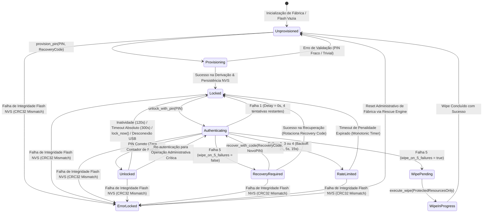
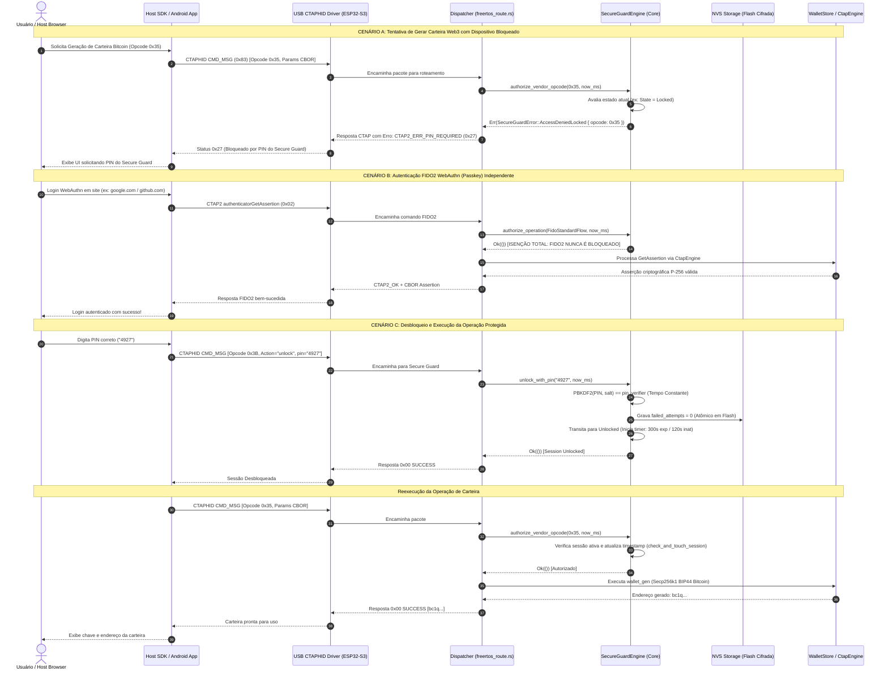

# Arquitetura do Sistema e Máquina de Estados — AegisKey Secure Guard

> **Projeto:** AegisKey FIDO2 & Multi-Protocol Hardware Authenticator  
> **Subsistema:** Secure Guard (Cofre Local de Autoridade, Zero-Trust On-Device)  
> **Status:** Documento Normativo e de Engenharia de Software / Arquitetura Canônica  
> **Data:** 25 de Outubro de 2026  
> **Módulos Auditados:** `crates/aegis-fido-core/src/secure_guard/`, `crates/aegis-fido-firmware/`, `crates/universal-device-sdk/`, `crates/uniffi-bridge/`, `app-android/`  

---

## 1. Visão Geral da Arquitetura em Camadas

O subsistema **Secure Guard** atua como o **Cofre Central de Autoridade e Autorização Local** da AegisKey. Ele implementa o paradigma **Zero-Trust On-Device**, no qual a chave criptográfica não confia cegamente no sistema operacional hospedeiro, no aplicativo Android nem nos canais físicos de transporte (USB, BLE ou UART). 

A arquitetura do Secure Guard segue rigorosamente os princípios de **Clean Architecture** e **SOLID**:
- **Independência de Frameworks e Plataforma:** A lógica de negócio essencial (`aegis-fido-core::secure_guard`) é 100% Rust Seguro, compilada em modo `#![no_std]` + `alloc`, livre de qualquer dependência direta de sistema operacional, drivers ou hardware específico.
- **Inversão de Dependências (DIP):** Os módulos de alto nível não dependem de módulos de baixo nível. Tanto o firmware embarcado (ESP-IDF / FreeRTOS) quanto os SDKs de host interagem com a máquina de estados através de contratos e interfaces puras.
- **Princípio da Responsabilidade Única (SRP):** Cada submódulo do Secure Guard resolve exclusivamente uma dimensão do domínio (FSM de estados, KDF, integridade persistente, ring buffer de auditoria e autorização de recursos).

```
+-------------------------------------------------------------------------------------------------------------------+
|                                     VISÃO EM CAMADAS DO SUBSISTEMA SECURE GUARD                                   |
+-------------------------------------------------------------------------------------------------------------------+
|                                                                                                                   |
|  [ CAMADA DE APRESENTAÇÃO - ANDROID APP ]                                                                         |
|  +-------------------------------------------------------------------------------------------------------------+  |
|  | Jetpack Compose / Material 3 / Atomic Design (13 Telas de Jornada de Segurança)                             |  |
|  | Atoms (PinKeypadAtom, StatusRingAtom) -> Molecules (PinEntryMolecule) -> Organisms -> Screens             |  |
|  | SecureGuardViewModel <--- StateFlow<SecureGuardUiState> <--- SecureGuardUseCases                            |  |
|  +-------------------------------------------------------------------------------------------------------------+  |
|                                                     |                                                             |
|                                                     v                                                             |
|  [ CAMADA DE INTERFACE & SDK ]                                                                                    |
|  +-------------------------------------------------------------------------------------------------------------+  |
|  | dev.aegiskey.app.bridge (JNI) <---> uniffi-bridge (libaegis_bridge.so)                                        |  |
|  | universal-device-sdk: Facade-First, AuthContext, SecmonProvider, Protocol Encoders/Decoders (CBOR)           |  |
|  | Host Hardware Android Bridge (tools/host_hardware_android_bridge.py: HTTP 5678 / TCP Binário)               |  |
|  +-------------------------------------------------------------------------------------------------------------+  |
|                                                     |                                                             |
|                                                     v                                                             |
|  [ CANAL FÍSICO DE TRANSPORTE ]                                                                                   |
|  +-------------------------------------------------------------------------------------------------------------+  |
|  | USB Native FS (VID 0x303A : PID 0xAE61) | BLE GATT (0xFFFD/0xFFF1) | UART COM7 (115200 8N1)                   |  |
|  | Enquadramento CTAPHID (CMD_MSG 0x83 -> Opcodes Vendor 0x3A..0x3E)                                           |  |
|  +-------------------------------------------------------------------------------------------------------------+  |
|                                                     |                                                             |
|                                                     v                                                             |
|  [ CAMADA DE FIRMWARE EMBARCADO - ESP32-S3 ]                                                                     |
|  +-------------------------------------------------------------------------------------------------------------+  |
|  | FreeRTOS Scheduler (freertos_sched.rs / freertos_route.rs)                                                  |  |
|  | Tarefa Dedicada: secure_guard_task (Prioridade 3, Stack de 32 KiB, Alimentação Per-Task TWDT)                |  |
|  | Barreira de Autorização: authorize_vendor_opcode() interceptando Opcodes 0x20..0x37                         |  |
|  | Persistência Flash NVS Atômica: SecureGuardPersistentRecord (256B, CRC32, Magic AEGSG001)                   |  |
|  +-------------------------------------------------------------------------------------------------------------+  |
|                                                     |                                                             |
|                                                     v                                                             |
|  [ CAMADA CRIPTOGRÁFICA CORE (no_std) ]                                                                           |
|  +-------------------------------------------------------------------------------------------------------------+  |
|  | aegis-fido-core::secure_guard                                                                               |  |
|  |  * state.rs       : Máquina formal de 10 estados canônicos (0x00..0x09)                                     |  |
|  |  * crypto.rs      : PBKDF2-HMAC-SHA256, subtle::ConstantTimeEq, CRC32 IEEE 802.3, Zeroize                   |  |
|  |  * policy.rs      : Limite estrito de 5 erros, Backoff progressivo, Timeouts de Sessão                      |  |
|  |  * persistence.rs : Serializador binário determinístico de 256 bytes                                         |  |
|  |  * audit.rs       : AuditRingBuffer de 32 eventos, estritamente numérico, Zero Secrets in Logs              |  |
|  |  * resource.rs    : Classificador ProtectedResourceClass & Escopo de Wipe Seletivo                          |  |
|  |  * engine.rs      : Orquestrador SecureGuardEngine garantindo coexistência não bloqueante com FIDO2        |  |
|  +-------------------------------------------------------------------------------------------------------------+  |
+-------------------------------------------------------------------------------------------------------------------+
```

---

## 2. Máquina de Estados Finita Formal (10 Estados Canônicos)

O ciclo de vida do Secure Guard é governado por uma máquina de estados finita formal (`SecureGuardState` em `crates/aegis-fido-core/src/secure_guard/state.rs`). Cada estado possui um código binário determinístico (`0x00` a `0x09`) e regras de transição estritas validadas via `can_transition_to()` e `validate_transition()`.

### 2.1. Tabela dos 10 Estados Canônicos

| Estado Enum (`SecureGuardState`) | Código Wire | Descrição Operacional | Capacidades de Execução |
|---|---|---|---|
| **`Unprovisioned`** | `0x00` | Dispositivo de fábrica ou recém-limpo após wipe. Nenhum PIN configurado. | Apenas aceita `provision_pin`. Recursos protegidos rejeitados com `NotProvisioned`. FIDO2 passkeys funcionam normalmente. |
| **`Provisioning`** | `0x01` | Transição ativa de gravação do primeiro PIN e derivação de salt/verificador. | Operação interna atômica transitória. Bloqueia chamadas concorrentes. |
| **`Locked`** | `0x02` | Dispositivo provisionado e armado. Nenhuma sessão ativa de uso. | Recursos protegidos (Wallets e Chaves) bloqueados. FIDO2 passkeys livres. Aceita comando de `unlock_with_pin`. |
| **`Authenticating`** | `0x03` | Executando KDF iterativo (PBKDF2) e comparação em tempo constante. | Estado transitório. Temporizador TWDT alimentado. |
| **`Unlocked`** | `0x04` | PIN verificado com sucesso. Sessão temporizada ativa no silício. | Recursos protegidos liberados. Sessão atualizada a cada atividade (`check_and_touch_session`). |
| **`RecoveryRequired`** | `0x05` | 5 erros consecutivos de PIN atingidos sob política padrão. | Bloqueio de PIN. Apenas aceita `recover_with_code` com segredo de recuperação de 16B de uso único. FIDO2 preservado. |
| **`RateLimited`** | `0x06` | Penalidade temporal ativa após falha de autenticação (Backoff progressivo). | Rejeição imediata de qualquer tentativa de PIN até expirar o tempo (`remaining_ms`). |
| **`WipePending`** | `0x07` | 5 falhas atingidas sob política `wipe_on_5_failures = true`. | Dispositivo sinalizado para limpeza seletiva antes de liberar novas ações. |
| **`WipeInProgress`** | `0x08` | Execução ativa da rotina de limpeza de memória e destruição de credenciais. | Sobrescreve com zeros (`zeroize`) verificadores e chaves protegidas. |
| **`ErrorLocked`** | `0x09` | Estado terminal fail-closed acionado por falha de integridade Flash/CRC. | Bloqueio total de emergência. Exige reinicialização completa ou reparo. FIDO2 isolado. |

### 2.2. Diagrama de Transição de Estados (Mermaid)



---

## 3. Barreira de Autorização (Enforcement Gate)

A Barreira de Autorização é o mecanismo central que garante a soberania da AegisKey. Toda requisição recebida pelos canais USB, BLE ou UART passa pelo método `authorize_vendor_opcode(opcode, now_ms)` em `SecureGuardEngine`.

### 3.1. Classificação de Recursos e Matriz de Autorização

O subsistema categoriza as operações conforme a estrutura `ProtectedResourceClass` (`crates/aegis-fido-core/src/secure_guard/resource.rs`):

| Categoria do Recurso | Opcodes / Comandos Abrangidos | Exige Secure Guard `Unlocked`? | Comportamento se `Locked` / `Recovery` |
|---|---|---|---|
| **`FidoStandardFlow`** | CTAP2 `MakeCredential` (0x01), `GetAssertion` (0x02), `ClientPIN` (0x06), CTAPHID Ping/Wink | **NÃO (Nunca)** | **Sempre Permitido.** Não é bloqueado pelo estado do Secure Guard. |
| **`CryptoWalletOperation`** | `0x35` (Gen Wallet), `0x36` (List Wallets), `0x37` (Wallet Address) BTC/ETH/SOL | **SIM (Obrigatório)** | **Rejeitado com erro `0x27 ACCESS_DENIED_LOCKED`** (`SecureGuardError::AccessDeniedLocked`). |
| **`ProtectedKeyOperation`** | `0x20` (Key Gen), `0x21` (Key Import AEGN), `0x22` (Key List), `0x23` (Key Delete) | **SIM (Default: True)** | **Rejeitado com erro `0x27 ACCESS_DENIED_LOCKED`**. Configurável via política. |
| **`OathTotpOperation`** | `0x24` (OATH Put), `0x25` (List), `0x26` (Calc TOTP Code), `0x27` (Delete) | **NÃO (Default: False)** | **Permitido para leitura rápida de códigos**, salvo se `protect_oath = true`. |
| **`SecureGuardAdmin`** | `0x3A` (Status), `0x3B` (Unlock/Provision/Recover), `0x3C` (Lock) | **NÃO** | **Permitido**, pois constituem os mecanismos de consulta e desbloqueio. |
| **`SecureGuardAdminConfig`** | `0x3D` (Config Policy), `0x3E` (Wipe Seletivo) | **SIM** | **Exige sessão desbloqueada** para impedir reconfiguração não autorizada. |

### 3.2. Diagrama de Sequência de Autorização (Mermaid)

O diagrama abaixo ilustra o contraste entre uma requisição protegida de Carteira Web3 e uma autenticação FIDO2 WebAuthn:



---

## 4. Arquitetura FreeRTOS no ESP32-S3

A implementação de firmware da AegisKey (`crates/aegis-fido-firmware/`) roda sobre o FreeRTOS do ESP-IDF v5.3.1 em ambiente dual-core Xtensa LX7 a 240 MHz.

### 4.1. Mapeamento de Tarefas e Prioridades

O escalonamento do FreeRTOS adota o padrão de isolamento estrito sem contenção de lock, com filas de mensagens determinísticas:

| Nome da Tarefa | Prioridade FreeRTOS | Stack Alocado | Núcleo de Afinidade | Papel e Responsabilidades |
|---|---|---|---|---|
| **`usb_ctaphid`** | `5` (Máxima) | 32 KiB (`32768` B) | Core 0 | Driver USB TinyUSB nativo e UART0. Drena buffers de 64 bytes e posta na fila central `FirmwareEvent`. |
| **`ui_button`** | `4` (Alta) | 32 KiB (`32768` B) | Core 1 | Varredura periódica a cada 10 ms do botão `BOOT` (GPIO 0). Latch de Presença Física (UP) e Hold de 5s para pareamento. |
| **`secure_guard_task`** | `3` (Média-Alta) | **32 KiB (`32768` B)** | Core 0 | **Guardião da Autoridade.** Executa KDFs pesados (PBKDF2), temporizador de sessão monotônico, controle de taxa e persistência NVS. |
| **`housekeeping`** | `2` (Média) | 32 KiB (`32768` B) | Core 1 | Monitor de integridade do Task Watchdog (TWDT), telemetria do LED WS2812 e rotinas de baixa prioridade. |

> [!IMPORTANT]
> **Stack de 32 KiB Mandatório:** O cálculo de PBKDF2-HMAC-SHA256 e operações criptográficas de curvas elípticas alocam estados internos transitórios e contextos HMAC. Um stack menor que 32 KiB provoca estouro de pilha e pânico de kernel no ESP32-S3 (`Stack protection fault`).

### 4.2. Sincronização entre Tarefas e IPC

- **Fila Principal de Eventos (`FreeRtosQueue<FirmwareEvent>`):** Profundidade de 32 slots. Transporta eventos assíncronos (`UsbPacketReceived`, `ButtonPressed`, `TimerTick`, `SessionTimeout`).
- **EventGroup de Sincronização de Sinais (`xEventGroupSetBits`):**
  - `EVT_USB_RX = 1 << 0`: Notificação de pacote USB recebido;
  - `EVT_BUTTON_UP = 1 << 1`: Presença física do usuário confirmada por clique;
  - `EVT_SG_TIMEOUT = 1 << 4`: Notificação de expiração de sessão do Secure Guard para bloqueio instantâneo do firmware;
  - `EVT_SHUTDOWN = 1 << 31`: Finalização limpa e descarga de buffers.

### 4.3. Persistência NVS Atômica e Ciclo Pré-Resposta

Para anular qualquer ataque de desligamento abrupto de energia (*power-cycling attack*), a gravação do registro persistente segue a regra estrita de **Persistência Pré-Resposta**:

```
+-------------------------------------------------------------------------------------------------+
|                                 CICLO DE PERSISTÊNCIA PRÉ-RESPOSTA                              |
+-------------------------------------------------------------------------------------------------+
|                                                                                                 |
|   1. Recebimento da Credencial (Opcode 0x3B)                                                    |
|        |                                                                                        |
|        v                                                                                        |
|   2. Computação KDF PBKDF2-HMAC-SHA256 (32 bytes)                                               |
|        |                                                                                        |
|        v                                                                                        |
|   3. Verificação em Tempo Constante (constant_time_eq_32)                                       |
|        |                                                                                        |
|        +--------------------------------+--------------------------------+                      |
|        | (Se FALHA)                     | (Se SUCESSO)                   |                      |
|        v                                v                                |                      |
|   4a. Incrementa failed_attempts      4b. Zera failed_attempts          |                      |
|       Calcula rate_limit_until_ms         Define session_expires_at_ms   |                      |
|        |                                |                                |                      |
|        +--------------------------------+                                |                      |
|        |                                                                 |                      |
|        v                                                                 |                      |
|   5. Serialização em [u8; 256] com cálculo do CRC32 IEEE 802.3           |                      |
|        |                                                                 |                      |
|        v                                                                 |                      |
|   6. ESCRITA ATÔMICA NA FLASH NVS (nvs_set_blob("sg_state", 256B))       |                      |
|      + nvs_commit("sg_state")                                            |                      |
|        |                                                                                        |
|        v  <--- FLASH ATUALIZADA ANTES DE QUALQUER TRANSMISSÃO DE RESPOSTA                       |
|   7. Formatação da Resposta de Wire (CBOR / Status CTAPHID)                                     |
|        |                                                                                        |
|        v                                                                                        |
|   8. Transmissão do Pacote USB/BLE para o Host                                                  |
+-------------------------------------------------------------------------------------------------+
```

Se o atacante cortar a alimentação no passo 7 ou antes, a Flash NVS já contém a contagem de falhas incrementada. Ao reiniciar, o dispositivo restaura o contador intacto e impõe o bloqueio.

---

## 5. Integração com SDK, Bridge e Aplicativo Android

### 5.1. Universal Device SDK e UniFFI Bridge

- **`crates/universal-device-sdk`**: Implementa os provedores tipados `SecmonProvider` e `SecureGuardClient`. Expõe métodos de alto nível:
  - `get_secure_guard_status() -> Result<SecureGuardStatus, SdkError>`
  - `unlock_secure_guard(pin: &str) -> Result<SessionToken, SdkError>`
  - `lock_secure_guard() -> Result<(), SdkError>`
  - `configure_secure_guard(policy: PolicyConfig) -> Result<(), SdkError>`
  - `recover_secure_guard(code: &str, new_pin: &str) -> Result<(), SdkError>`
- **`crates/uniffi-bridge`**: Gera os bindings C-ABI para compilação da biblioteca compartilhada `libaegis_bridge.so`, empacotada no APK Android.

### 5.2. Arquitetura Android (Clean Architecture + Atomic Design)

O aplicativo Android estrutura o módulo Secure Guard em camadas rigorosas:

```
app-android/app/src/main/java/dev/aegiskey/app/
├── domain/
│   ├── model/
│   │   ├── SecureGuardState.kt        // Enum dos 10 estados canônicos
│   │   ├── SecureGuardStatus.kt       // Model com contadores, timeouts e flags
│   │   └── SecureGuardPolicy.kt       // Configuração de segurança
│   └── usecase/
│       ├── GetSecureGuardStatusUseCase.kt
│       ├── UnlockSecureGuardUseCase.kt
│       ├── LockSecureGuardUseCase.kt
│       └── RecoverSecureGuardUseCase.kt
├── data/
│   ├── repository/
│   │   └── SecureGuardRepositoryImpl.kt // Comunica com Bridge via USB/BLE
│   └── transport/
│       ├── UsbKeyTransport.kt           // Envia CMD_MSG 0x83 via USB Host API
│       └── BleKeyTransport.kt           // Fragmentação GATT 0xFFFD
└── ui/
    ├── atoms/
    │   ├── PinDigitButtonAtom.kt        // Tecla numérica com feedback háptico
    │   ├── PinDisplayDotsAtom.kt        // Indicador visual de preenchimento
    │   └── SecurityStatusPillAtom.kt    // Badge visual do estado atual
    ├── molecules/
    │   ├── SecureKeypadMolecule.kt      // Teclado numérico com randomização opcional
    │   └── RateLimitCountdownMolecule.kt// Timer regressivo de penalidade
    ├── organisms/
    │   ├── PinVerificationDialogOrganism.kt // Modal de autenticação instantânea
    │   └── EmergencyRecoverySheetOrganism.kt// Fluxo de recuperação de código
    └── screens/
        ├── SecureGuardProvisioningScreen.kt // Onboarding do primeiro PIN
        ├── SecureGuardLockScreen.kt         // Tela principal de autenticação
        ├── SecureGuardSettingsScreen.kt     // Ajuste de políticas e timeouts
        └── SecureGuardAuditLogScreen.kt     // Visualização do AuditRingBuffer
```

---

## 6. Padrões de Qualidade e Conformidade

1. **Zero Mocks em Builds Release:** Apenas o source set de teste pode instanciar simuladores. A build oficial de produção opera exclusivamente contra a chave física ou bridge real.
2. **Fail-Closed em Desconexão:** Se o cabo USB for desconectado ou o sinal BLE for interrompido, o método `on_transport_disconnect()` invalida imediatamente a sessão ativa na chave e na UI Android.
3. **Imutabilidade de Credenciais de Recuperação:** O código de recuperação é descartável e de uso único; a cada recuperação bem-sucedida, uma nova chave de recuperação é derivada e rotacionada pelo silício.
