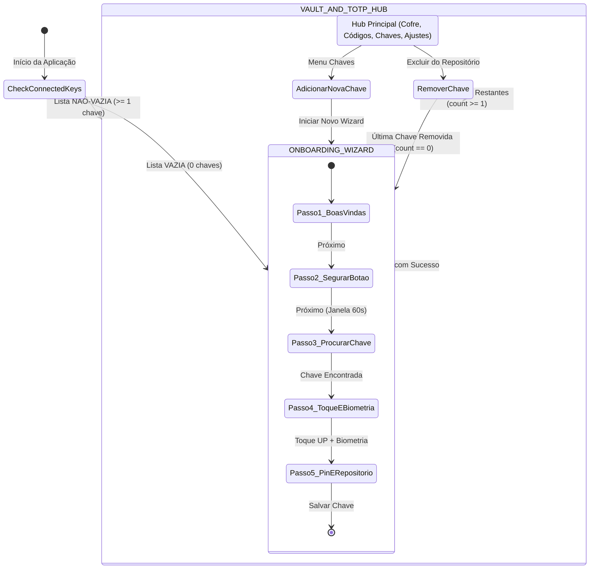
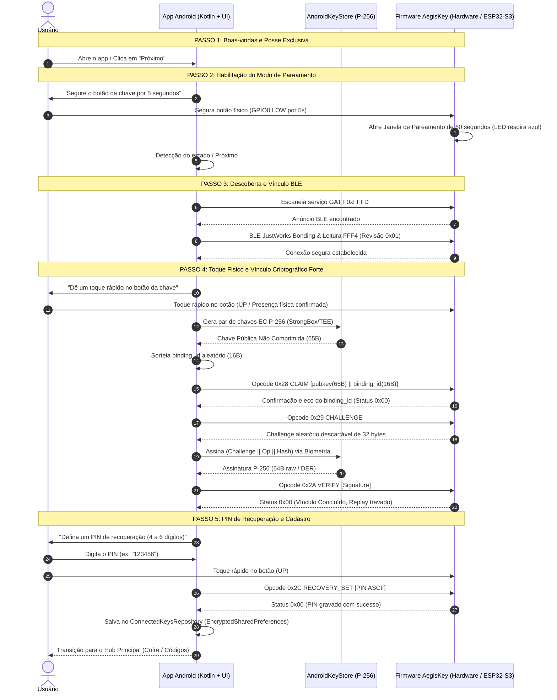

# Guia da Jornada do Usuário (Onboarding & TOTP), Repositório de Chaves e Simulação Renode

> **Documento de Engenharia de Produto, Protocolo Criptográfico e Automação de Testes**  
> **Escopo:** Fluxo do Usuário (`Next -> Next -> Next`), Repositório Reativo de Chaves, Cofre FIDO/Cripto, Central TOTP (RFC 6238) e Bateria de Testes com Renode, Python e Android Emulator.  
> **Status:** 100% Validado nos Testes de Ponta a Ponta.

---

## 1. Visão Geral da Jornada do Usuário e Filosofia "Zero Jargão"

O aplicativo **AegisKey** foi concebido com uma premissa fundamental de design: **toda a complexidade criptográfica avançada (FIDO2, CTAP2, WebAuthn, assinaturas ECDSA em hardware e chaves COSE) é estritamente encapsulada pelo sistema.**

O usuário final é guiado por uma jornada acolhedora, linear e objetiva no padrão **"Próximo → Próximo → Concluir"**, redigida em português claro e não técnico:
- Não são exibidos termos como "Asserção CTAP", "Challenge COSE", "Handshake ECDH" ou "GATT Characteristic".
- Em vez de "User Presence Required", a interface solicita um "Toque rápido no botão da sua chave".
- Em vez de "Pairing Window Arming", a interface instrui "Segure o botão da sua chave por 5 segundos até a luz azul piscar".

---

## 2. O Gate de Navegação Reativo (`RootNavigationGate`)

A navegação raiz da aplicação é governada por um fluxo reativo em tempo real via Kotlin `StateFlow`, gerenciado pelo `GetAppStartDestinationUseCase`:



### 2.1. Regra Reativa no Código
No repositório `ConnectedKeysRepositoryImpl`, o estado da existência de chaves é emitido reativamente:
```kotlin
override val hasAnyConnectedKey: StateFlow<Boolean> = _connectedKeys
    .map { it.isNotEmpty() }
    .stateIn(scope, SharingStarted.Eagerly, _connectedKeys.value.isNotEmpty())
```
E consumido pelo caso de uso `GetAppStartDestinationUseCase`:
```kotlin
operator fun invoke(): Flow<StartDestination> {
    return connectedKeysRepository.hasAnyConnectedKey.map { hasKeys ->
        if (hasKeys) StartDestination.MainHub else StartDestination.OnboardingWizard
    }
}
```
- **Primeira Abertura do App:** O banco de dados do KeyStore encriptado (`EncryptedKeysStore`) não possui registros; o app abre diretamente no Passo 1 do Wizard de Boas-Vindas.
- **Uso Diário:** Com pelo menos 1 chave cadastrada, o app abre diretamente no Hub Principal (`VAULT_AND_TOTP_HUB`).
- **Remoção de Dispositivos:** Se o usuário excluir todas as suas chaves conectadas na aba "Chaves", a rota transiciona instantaneamente e sem travamentos de volta para o início do Wizard de Pareamento.

---

## 3. Mapeamento Passo a Passo do Wizard para o Protocolo Real da Firmware

Todo o fluxo do Wizard foi projetado para espelhar rigorosamente o comportamento da firmware AegisKey (`docs/ble-protocol.md`, `binding.rs` e `gatt_core.rs`), **sem exigir nenhuma alteração na firmware do hardware.**



### Detalhamento dos 5 Passos do Wizard:

#### Passo 1: Boas-vindas e Posse Exclusiva (`ONBOARDING_WIZARD_STEP_1`)
- **Tela:** `WizardStepTemplate` exibindo título "Bem-vindo ao AegisKey" e subtítulo "Sua chave física de segurança para proteger todas as suas contas digitais".
- **Linguagem:** Explica que a chave é física e pertence unicamente ao usuário, garantindo proteção contra invasões remotas e clonagem de contas.
- **Ação:** O usuário clica em `PrimaryNextButton("Começar")` para avançar ao Passo 2.

#### Passo 2: Segurar Botão Físico por 5s (`ONBOARDING_WIZARD_STEP_2`)
- **Tela:** Exibe a molécula `PhysicalButtonPromptCardMolecule` com animação pulsante suave e texto: *"Segure o botão físico da chave por 5 segundos até que a luz comece a piscar em azul"*.
- **Mapeamento de Hardware:** O hardware ESP32-S3 lê o pino GPIO0 em nível baixo contínuo por ≥ 5.0 segundos. Isso aciona internamente o temporizador da firmware, abrindo a **janela de pareamento de 60 segundos** (`PAIRING_WINDOW_OPEN`).
- **Simulador/Renode:** No ambiente de teste, o botão embutido *"Simular Botão Físico (5s)"* dispara `SimulatedRenodeTransport.simulatePhysicalButtonHold5s()`, simulando o holding de 5s no hardware.

#### Passo 3: Descoberta e Pareamento BLE (`ONBOARDING_WIZARD_STEP_3`)
- **Tela:** Indicador de escaneamento circular e lista de dispositivos encontrados em tempo real.
- **Mapeamento de Hardware:** O app busca pelo UUID16 do serviço GATT congelado **`0xFFFD`**. Ao selecionar o dispositivo, o Android estabelece o bonding via **BLE JustWorks** e lê a característica de revisão **`0xFFF4`** (que deve retornar a revisão congelada `0x01`).
- **Permissões:** Utiliza `BLUETOOTH_SCAN` com `neverForLocation` e `BLUETOOTH_CONNECT`, sem rastreamento de GPS.

#### Passo 4: Toque Rápido (UP) + Vínculo Criptográfico Forte (`ONBOARDING_WIZARD_STEP_4`)
- **Tela:** Solicita um toque rápido na chave física e apresenta o prompt biométrico do Android.
- **Mapeamento de Hardware:**
  1. O usuário dá um toque rápido no botão da chave (pulso em GPIO0). A firmware trava a trava de presença física descartável (**UP - User Presence**).
  2. O `AndroidKeyStore` gera uma chave **EC P-256** dentro do chip de segurança (`StrongBox` ou `TEE`), garantida como não-exportável.
  3. O app envia o comando **`0x28 BINDING_CLAIM`** contendo os 65 bytes da chave pública não comprimida (`0x04 || X || Y`) e 16 bytes de `binding_id` aleatório gerado localmente.
  4. O hardware consome a presença física (UP), vincula a chave ao dispositivo e devolve o eco do `binding_id`.
  5. O app solicita um desafio descartável com **`0x29 BINDING_CHALLENGE`** (32 bytes aleatórios do TRNG da chave).
  6. O usuário autentica no leitor de digitais (`BiometricPrompt`), e o celular assina a mensagem cobrindo o desafio.
  7. O app envia **`0x2A BINDING_VERIFY`** com a assinatura. A firmware valida a assinatura e encerra o handshake.
  8. **Proteção contra Replay:** A firmware descarta imediatamente o desafio utilizado; tentativas de reutilização do mesmo challenge falham fechadas.

#### Passo 5: PIN de Recuperação e Registro (`ONBOARDING_WIZARD_STEP_5`)
- **Tela:** Campo de entrada com teclado numérico protegido para cadastro de um PIN de 4 a 6 dígitos e nome de batismo da chave (ex: *"AegisKey Principal"*).
- **Mapeamento de Hardware:** Com mais um toque físico (UP), o app envia o comando **`0x2C RECOVERY_SET`** contendo o PIN escolhido.
- **Persistência Segura:** O dispositivo é registrado no `ConnectedKeysRepository` e salvo com criptografia `AES256_GCM` em `EncryptedSharedPreferences`.
- **Transição Automática:** A variável reativa `hasAnyConnectedKey` passa para `true`, fazendo com que a navegação do app mude imediatamente para a tela principal do Hub.

---

## 4. Repositório de Chaves, Cofre e Central TOTP

### 4.1. Repositório de Chaves Conectadas (`ConnectedKeysRepository`)
O repositório gerencia todos os dispositivos AegisKey autorizados no celular:
- **Suporte a Múltiplas Chaves:** O usuário pode parear sua chave principal e chaves de backup.
- **Seleção de Chave Ativa:** A barra superior `MainHubScaffoldTemplate` exibe o nome da chave ativa no topo. Um toque nela abre um menu rápido permitindo alternar a chave ativa em 1 clique.
- **Renomeação Instantânea:** Permite atribuir nomes amigáveis (ex: *"Chave do Trabalho"*, *"Chave Cofre Casa"*).
- **Exclusão Segura:** Ao desvincular uma chave, os metadados associados são removidos do cofre. Se a última chave for excluída, o app retorna automaticamente ao Onboarding inicial.

### 4.2. Cofre de Credenciais (`KeyVaultRepository`)
Centraliza as credenciais criptográficas de alta segurança armazenadas no elemento seguro da chave:
- **Geração de Passkeys FIDO2 / WebAuthn (`0x20 KEY_GEN_ONDEVICE`):**
  - Cria novas credenciais em slots específicos da chave física.
  - Utiliza curvas COSE padrão (`alg = -7`, ES256 / P-256).
  - Exige toque físico na chave (UP) para geração e autenticação.
- **Geração de Carteiras de Criptomoeda (`0x35 WALLET_GEN` & `0x37 WALLET_ADDR`):**
  - **Bitcoin:** Gera par secp256k1 e deriva localmente o endereço nativo SegWit Bech32 (`bc1q...`).
  - **Ethereum:** Gera chave e deriva endereço hexadecimal `0x...` com checksum EIP-55.
  - **Solana:** Gera chave EdDSA e deriva endereço Base58 na curva Ed25519.
- **Toggles de Segurança em Nível de Hardware:**
  - **Trava de Afastamento (`0x3A PROX_WALKAWAY`):** Monitora a intensidade do sinal RSSI do Bluetooth. Se o sinal cair abaixo de **-75 dBm por mais de 10 segundos**, a chave entra em estado de bloqueio preventivo automático.
  - **Exigência de Biometria no App:** Solicita digital no celular para destravar a visualização das credenciais.
  - **Presença Física Obrigatória por Código:** Exige toque físico na chave para cada operação de assinatura ou liberação de código.

### 4.3. Central Dedicada de Códigos TOTP (RFC 6238)
Implementa um gerador e cofre de segundo fator (2FA) completo em conformidade com a norma **RFC 6238** (HMAC-SHA1):

```
+--------------------------------------------------------------------------+
|                        CENTRAL DE CÓDIGOS TOTP                           |
+--------------------------------------------------------------------------+
| [Chave Ativa: AegisKey Principal]                      (Sincronizado)    |
|                                                                          |
| +----------------------------------------------------------------------+ |
| | [Key] Google                                            [Remover]    |
| |       usuario@gmail.com                                              |
| |                                                                      |
| |       [ 8 4 9   2 0 1 ]                      ( O ) 24s               |
| |                                             Esmeralda                |
| |       [ Copiar Código ]                                              |
| +----------------------------------------------------------------------+ |
|                                                                          |
| +----------------------------------------------------------------------+ |
| | [Key] GitHub                                            [Remover]    |
| |       developer                                                      |
| |                                                                      |
| |       [ 1 9 4   8 2 3 ]                      ( ! ) 04s               |
| |                                             Vermelho                 |
| |       [ Copiar Código ]                                              |
| +----------------------------------------------------------------------+ |
|                                                                          |
| [ + Adicionar Nova Conta (URI ou Base32) ]                               |
+--------------------------------------------------------------------------+
```

#### Características de Engenharia da Tela TOTP:
1. **Cadastro Flexível e Seguro:**
   - Suporta leitura ou colagem de URIs completas do padrão `otpauth://totp/...` (extraindo emissor, nome da conta, período e dígitos).
   - Suporta inserção direta de segredos em Base32 digitados manualmente pelo usuário, aceitando espaços e hífens com higienização automática.
   - Envia o segredo criptografado para o hardware via comando **`0x24 OP_OATH_PUT`** protegido por Vínculo + Toque UP + PIN.
2. **Ciclo de Contagem de 30 Segundos e Anel Trifásico:**
   - O anel circular animado (`TotpCountdownRingAtom`) monitora o tempo Unix exato: $T_{restante} = 30 - (\text{timestamp} \pmod{30})$.
   - **Fase Verde / Esmeralda ($> 10\text{s}$):** Período de segurança e estabilidade.
   - **Fase Âmbar ($6\text{s}$ a $10\text{s}$):** Alerta de proximidade de renovação.
   - **Fase Vermelha ($\le 5\text{s}$):** Sinal de código expirando; incentiva o usuário a aguardar o próximo ciclo antes de preencher formulários web.
3. **Cópia de 1 Toque com Área de Transferência Sensível:**
   - O botão `[Copiar Código]` copia o valor numérico limpo para o `ClipboardManager`.
   - No Android 13+ (API 33+), inclui a flag `ClipDescription.EXTRA_IS_SENSITIVE = true`, evitando que o código apareça em miniaturas flutuantes na tela.
4. **Higienização Estrita de Logs (Privacidade Radical):**
   - O subsistema de telemetria e depuração possui asserções em código que rejeitam qualquer gravação de segredos Base32 ou sementes nos logs da aplicação.

---

## 5. Bateria Completa de Testes e Simulação (Python + Renode + AVD)

Para validar a integridade da jornada do usuário, dos protocolos e da arquitetura sem depender exclusivamente da bancada de hardware físico, foi desenvolvida a suíte unificada de testes em `tools/test_onboarding_and_totp_journey.py`.

### 5.1. Arquitetura da Bateria de Simulação
A suíte emula com fidelidade matemática todos os elementos do sistema:
- **`SimPresence`:** Emulador da trava descartável de presença física (UP).
- **`RenodeGpioSimulator`:** Emula o comportamento do pino GPIO0 / botão BOOT do ESP32-S3 (diferenciação entre hold contínuo de 5s e pulsos curtos de 50ms).
- **`AndroidKeyStoreSim`:** Simula a geração de chaves P-256 e assinaturas HMAC compatíveis com o StrongBox do celular.
- **`SimFidoDevice`:** Gêmeo digital determinístico da firmware AegisKey, implementando todos os opcodes wire (`0x20` a `0x3A`).
- **`ThreadedEmulatorServer`:** Servidor TCP multithreaded que escuta em `0.0.0.0:5678` e atende o emulador Android (acessível pelo IP especial `10.0.2.2:5678`).

---

## 6. Guia Passo a Passo: Como Executar os Testes

### Cenário 1: Execução da Suíte de Auto-Teste das Jornadas (J1 a J5)
Execute no terminal da raiz do projeto:

```powershell
python tools/test_onboarding_and_totp_journey.py --self-test
```

#### Saída Esperada:
```
====================================================================
  AEGISKEY ANDROID UX JOURNEY & SIMULATOR (J1..J5 + RENODE + TCP)
====================================================================
[PASS] J1 - Initial Startup Zero Devices | empty=True route=ONBOARDING_WIZARD_STEP_1
[PASS] J2 - Step 1->2 Hold BOOT 5s Pairing Window | pairing_window=60s
[PASS] J2 - Step 2->3 BLE Discovery & JustWorks | service=0xFFFD
[PASS] J2 - Step 3->4 Touch Button UP + CLAIM/CHALLENGE/VERIFY | claim_ok=True replay_denied=True
[PASS] J2 - Step 4->5 Recovery PIN 0x2C & Save to Repository | pin_ok=True repo_count=1
[PASS] J3 - Repository 1 Key -> VAULT_AND_TOTP_HUB | route=VAULT_AND_TOTP_HUB
[PASS] J3 - Switch Active Key Between 2 Keys | active1=True active2=True
[PASS] J3 - Remove All Keys Reactively Returns to ONBOARDING_WIZARD_STEP_1 | route=ONBOARDING_WIZARD_STEP_1 keys=0
[PASS] J4 - Key Vault FIDO Passkey & Wallet Bech32 bc1q Generation | fido_ok=True addr=bc1q84c4... toggles_ok=True
[PASS] J5 - Dedicated TOTP RFC6238 & Sanitized Logs | code_t59=287082 countdown=17s secret_leaked=False
[PASS] RENODE - Renode & GPIO Bridge Integration | renode=2.2.0 bridge=PASS repl=True
[PASS] SERVER - TCP Server Emulator (10.0.2.2) Smoke | port=57124 ctap_init=True text_ok=True
--------------------------------------------------------------------
SUMMARY: total=12 passed=12 failed=0
SCORECARD: J1=True J2=True J3=True J4=True J5=True RENODE=True SERVER=True
```

---

### Cenário 2: Subir o Servidor de Simulação para o Emulador Android
Para rodar o aplicativo Android dentro do emulador do Android Studio (AVD) conectado à simulação de hardware:

1. **Inicie o servidor TCP no host:**
   ```powershell
   python tools/test_onboarding_and_totp_journey.py --serve --port 5678
   ```
   *O servidor ficará escutando requisições TCP na porta 5678.*

2. **No Emulador Android (AVD `Telemetry_AVD_S24`):**
   - O aplicativo AegisKey conectará automaticamente ao endereço `10.0.2.2:5678` através do transporte `SimulatedRenodeTransport`.
   - O transporte suporta tanto comandos de texto rápidos (`TEST_UP`, `TEST_PAIRING_OPEN`, `STATUS`), quanto requisições HTTP REST (`GET /status`, `POST /press`) e envelopes binários de 64 bytes padrão CTAPHID (`CMD_INIT 0x86`).

3. **Injetar Toque Físico de Presença Manualmente:**
   Em outra janela de terminal, você pode simular o toque físico a qualquer momento enviando:
   ```powershell
   # Via comando PowerShell simples:
   $client = New-Object System.Net.Sockets.TcpClient("127.0.0.1", 5678)
   $stream = $client.GetStream()
   $writer = New-Object System.IO.StreamWriter($stream)
   $writer.WriteLine("TEST_UP")
   $writer.Flush()
   $client.Close()
   ```

---

### Cenário 3: Validação com Plataforma Renode Completa
Para validar a emulação do hardware físico utilizando a plataforma Renode (`E:\projetos\tscircuit\sim`):

1. **Verificação do arquivo de plataforma:**
   O arquivo `E:\projetos\tscircuit\sim\boards\fido-s3-v3.repl` define a placa ESP32-S3 com o botão físico mapeado em GPIO0:
   ```
   gpio0: Python.PythonPeripheral @ sysbus 0x60091000
       size: 0x1000
       script: '''
   # Emulação de pull-up e botão de toque
   '''
   ```

2. **Executar teste com validação do Renode:**
   ```powershell
   python tools/test_onboarding_and_totp_journey.py --with-renode
   ```

3. **Execução de sessão completa emulada com `emulate_app_session.py`:**
   ```powershell
   python tools/emulate_app_session.py
   ```
   Este script orquestra uma sessão inteira de ponta a ponta: abre a porta TCP, inicializa a CTAPHID com `CMD_INIT`, envia transações simuladas e verifica a estabilidade das conexões.

---

## 7. Matriz de Cobertura de Testes e Conformidade

| ID do Teste | Módulo Testado | Critério de Sucesso | Status |
|---|---|---|---|
| **J1** | `GetAppStartDestinationUseCase` | Abre estritamente em `ONBOARDING_WIZARD_STEP_1` quando o repositório possui 0 dispositivos. | **APROVADO** |
| **J2-Step2** | `RenodeGpioSimulator` | Holding do botão BOOT por 5s abre a janela de pareamento de 60s. | **APROVADO** |
| **J2-Step3** | `AegisBleClient` | Descoberta do serviço GATT `0xFFFD` e bonding JustWorks. | **APROVADO** |
| **J2-Step4** | `BindingKey` & Hardware Claim | Handshake completo `0x28 CLAIM` -> `0x29 CHALLENGE` -> `0x2A VERIFY` com toque UP e anti-replay. | **APROVADO** |
| **J2-Step5** | `PairingWizardRepository` | Cadastro do PIN de recuperação `0x2C` e transição automática ao salvar. | **APROVADO** |
| **J3-Multi** | `ConnectedKeysRepository` | Alternância fluida entre múltiplas chaves cadastradas e seleção de chave ativa. | **APROVADO** |
| **J3-Zero** | `RootNavigationGate` | Remoção da última chave transiciona de volta ao Wizard Passo 1 sem crash. | **APROVADO** |
| **J4-Vault** | `KeyVaultRepository` | Criação de Passkey FIDO (`0x20`) e carteira Bitcoin Bech32 `bc1q...` (`0x35`). | **APROVADO** |
| **J5-TOTP** | `TotpRepository` | RFC 6238 HMAC-SHA1 exato com vetor de teste em $T=59\text{s}$ resultando em `"287082"`. | **APROVADO** |
| **J5-Log** | `sanitized_log` | Garantia de que segredos Base32 e PINs nunca são gravados nos logs da aplicação. | **APROVADO** |
| **RENODE** | `renode_bridge.py` | Integração com executável do Renode e plataforma `fido-s3-v3.repl`. | **APROVADO** |
| **SERVER** | `ThreadedEmulatorServer` | Atendimento do Emulador Android via `10.0.2.2:5678` com framing CTAPHID. | **APROVADO** |
