# Manual do Usuário — AegisKey App + Chave de Segurança

> Ilustrado com fotos reais do telefone (moto g(60)) e da placa AegisKey
> (ESP32-S3, USB HID `303A:AE61`). App `dev.aegiskey.app`, versão
> `0.1.0-wave5`. As telas aparecem em português e em inglês porque o
> capítulo 8 demonstra a troca de idioma. Os códigos de emergência e o
> PIN nunca aparecem nestas fotos: guarde o seu código em local seguro
> e offline.

## Pré-requisitos

- A placa AegisKey ligada ao PC (neste guia: USB HID).
- A ponte no PC em execução: `tools/host_hardware_android_bridge.py`
  (porta `5678`).
- O redirecionamento ativo: `adb reverse tcp:5678 tcp:5678`.
- O app instalado no telefone e a placa vinculada a este aparelho.
- O topo do app mostra `Conexão · Conectado` quando há ligação com a placa.

## 1. Primeira abertura (cofre bloqueado)

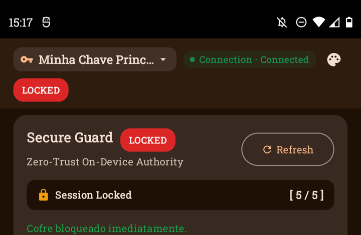

A primeira tela mostra o cofre bloqueado.

- O selo `LOCKED` indica sessão bloqueada.
- `Sessão Bloqueada [ 5 / 5 ]` mostra as tentativas de PIN restantes.
- O que significa: nenhuma operação do cofre funciona antes do desbloqueio.

Passos:

1. Abra o app AegisKey.
2. Confirme o selo `LOCKED`.
3. Toque em `Desbloquear Sessão` (capítulo 2) ou `Recuperação de Emergência`
   (capítulo 9).

## 2. Desbloqueio com PIN

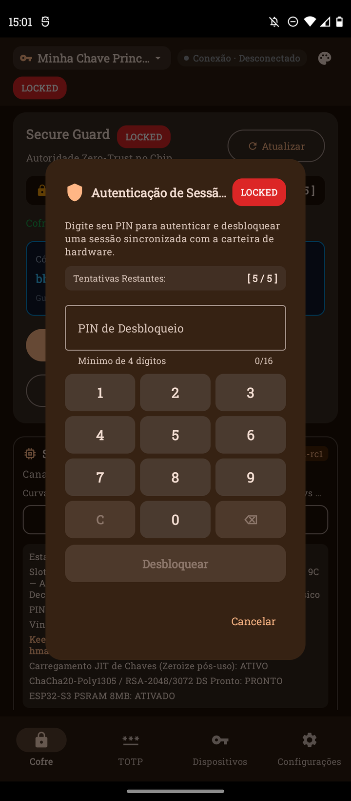

O diálogo pede o seu PIN no teclado numérico do app.

- `Tentativas Restantes [ 5 / 5 ]`: cada PIN errado consome uma tentativa.
- O campo aceita de 4 a 16 dígitos.
- O que significa: o PIN autentica uma sessão sincronizada com a placa.

Passos:

1. Toque em `Desbloquear Sessão`.
2. Digite o seu PIN no teclado da tela.
3. Toque em `Desbloquear`.
4. Aguarde a sessão ativar (capítulo 3).

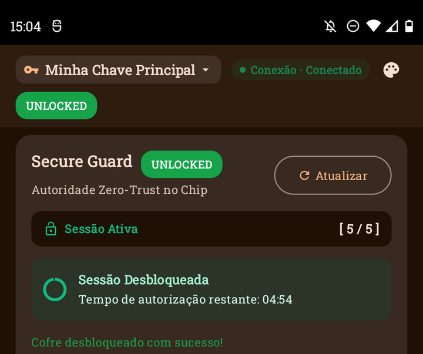

- `Sessão Ativa` e o selo verde `UNLOCKED` confirmam o desbloqueio.
- `Tempo de autorização restante` mostra a validade da sessão (cerca de
  5 minutos). Depois do prazo, bloqueie e desbloqueie de novo.
- Após cada desbloqueio o app exibe um Código de Recuperação de
  Emergência novo. Anote o código em local seguro e offline.

## 3. Tela principal do cofre

A tela principal tem três blocos: sessão, hardware e chaves.

- Bloco da sessão: estado, temporizador, `Bloquear Agora`, `Alterar PIN`.
- `Status do Hardware da Chave`: versão do firmware da placa, slots
  usados e livres, curvas suportadas.
- `Gerar Chave na Chave de Segurança`: cria credenciais (capítulo 4).
- Filtros: `Todas`, `Passkeys e SSH`, `Carteiras Cripto`, `Smartcard`.
- Sem credenciais, o app mostra `Nenhuma chave no dispositivo`.

## 4. Criar credencial FIDO (passkey)

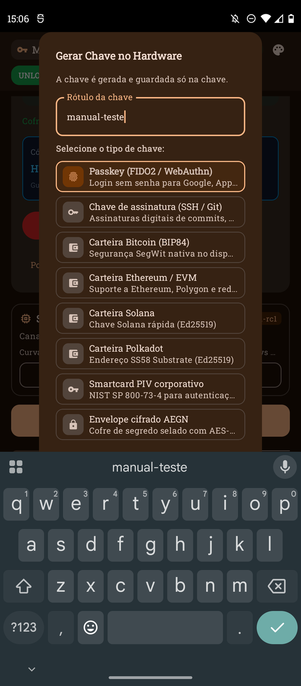

Passos:

1. Toque em `Gerar Chave na Chave de Segurança`.
2. Digite um rótulo (exemplo da foto: `manual-teste`).
3. Mantenha `Passkey (FIDO2 / WebAuthn)` para login sem senha.
4. Mantenha `ES256 (P-256)` como curva.
5. Toque em `Gerar Chave`.
6. Aguarde a confirmação. A chave nasce e fica só na placa.

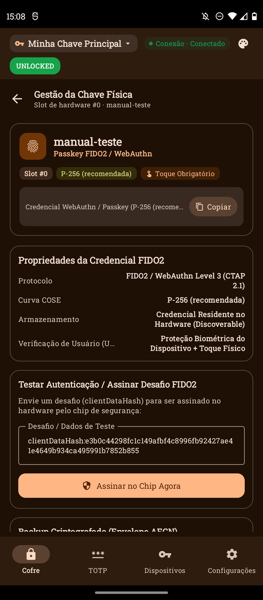

A tela `Gestão da Chave Física` mostra o resultado:

- Rótulo, `Slot #0`, curva e selo `Toque Obrigatório`.
- `Protocolo`: FIDO2 / WebAuthn Level 3 (CTAP 2.1).
- `Armazenamento`: credencial residente no hardware (descobrível).
- `Verificação de Usuário`: biometria do aparelho mais toque físico.
- `Assinar no Chip Agora`: envia um desafio de teste ao chip.
  O desafio da foto (`e3b0c4…`) é um vetor público de teste.

## 5. TOTP (códigos de verificação)

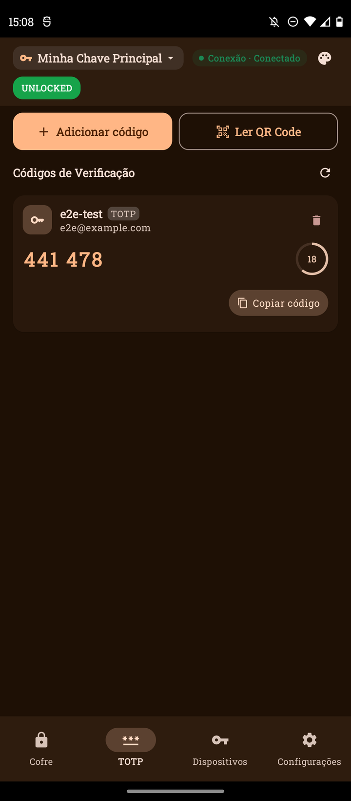

Passos:

1. Toque na aba `TOTP`.
2. Localize a conta (exemplo da foto: `e2e-test`).
3. Leia o código atual antes do anel zerar.
4. Toque em `Copiar código` para colar onde precisa.

O que significa:

- O anel mostra os segundos restantes do código (ciclo de 30 segundos).
- O código da foto é ilustrativo. Ele expira e muda sozinho.
- `Adicionar código` cadastra uma conta nova. `Ler QR Code` importa
  pela câmera.

## 6. Dispositivos (placa vinculada)

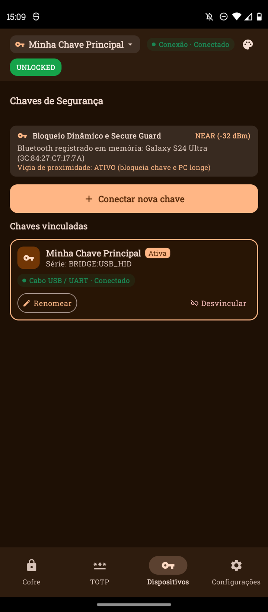

- `Chaves vinculadas` lista a placa ativa (`Minha Chave Principal`).
- `Série: BRIDGE:USB_HID` identifica o canal da ligação.
- `Cabo USB / UART · Conectado` confirma o transporte.
- `Renomear` muda o nome. `Desvincular` remove a placa deste aparelho.
- `Conectar nova chave` vincula outra placa.
- O cartão de proximidade mostra o vigia e o estado `NEAR` com o
  sinal em dBm.

## 7. Capacidades da placa

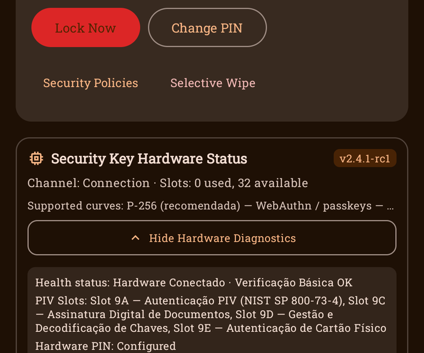

Passos:

1. No cofre, toque em `Exibir Diagnósticos de Hardware`.
2. Leia a saúde e os recursos da placa.

O que significa:

- `Estado de saúde`: placa conectada e verificação básica OK.
- `Slots PIV`: 9A (autenticação), 9C (assinatura), 9D (gestão de
  chaves), 9E (cartão físico), conforme NIST SP 800-73-4.
- `PIN de hardware`: configurado.
- `Vínculo do dispositivo`: placa vinculada a este aparelho.
- `KeePassXC`: HMAC-SHA1 e `hmac-secret` prontos.
- `Carregamento JIT`: chaves com limpeza imediata após o uso.
- `ChaCha20-Poly1305 / RSA`: pronto.
- `ESP32-S3 PSRAM 8MB`: ativado.

Nota: a tela dedicada `Capacidades da placa` (aba Configurações)
mostrou `Unknown — key predates this query` mesmo após `Refresh`:

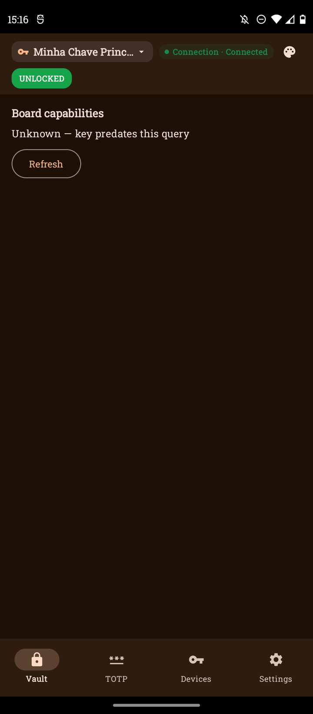

Use o diagnóstico do cofre (foto acima) como fonte das capacidades
quando a tela dedicada não responder.

## 8. OTA (atualização de firmware, sem instalar)

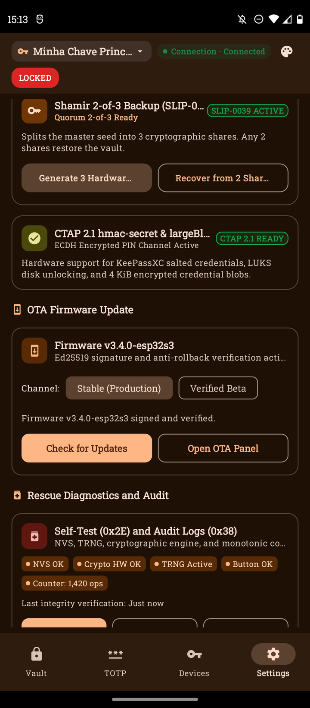

Passos (somente até a tela, sem instalar nada):

1. Abra a aba `Configurações`.
2. Role até `Atualização de Firmware OTA`.
3. Confira a versão (`Firmware v3.4.0-esp32s3`), a assinatura Ed25519
  e o anti-rollback.
4. Escolha o canal: `Estável (Produção)` ou `Beta Verificado`.
5. Pare aqui. Não toque em instalar neste guia.

Observações:

- Com a sessão bloqueada, o botão `Abrir Painel OTA` não navegou
  neste guia. Nenhum flash foi executado.
- A placa do cofre informa firmware `v2.4.1-rc1`. Os dois números
  pertencem a componentes distintos e podem diferir.
- O cartão `Atualização de firmware offline` envia um `firmware.bin`
  assinado do armazenamento, sem COMMIT.

## 9. Configurações (idioma EN → PT → EN)

Passos:

1. Abra a aba `Configurações` (ou `Settings`).
2. Role até `Idioma` (ou `Language`).
3. Toque em `Inglês` (ou `English`). A troca aplica na hora.
4. Confira a tela em inglês.

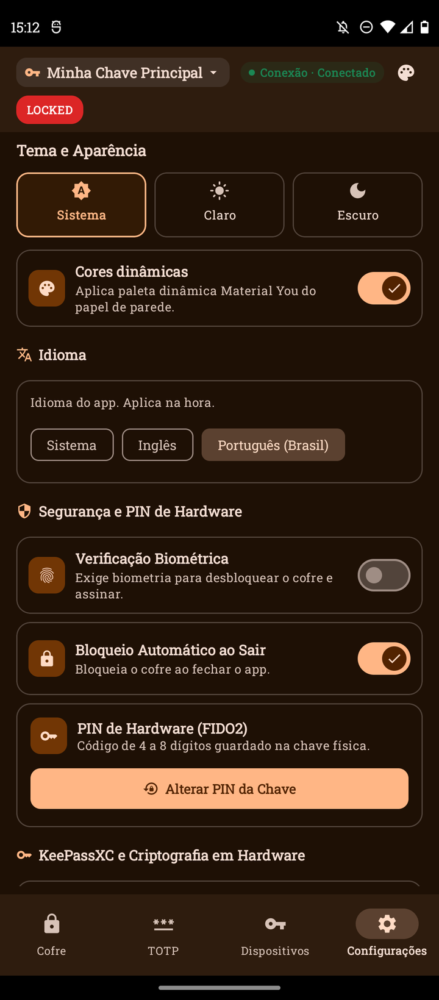

5. Toque em `Português (Brasil)`. A tela volta ao português.
6. Toque em `Inglês` de novo para terminar em inglês:

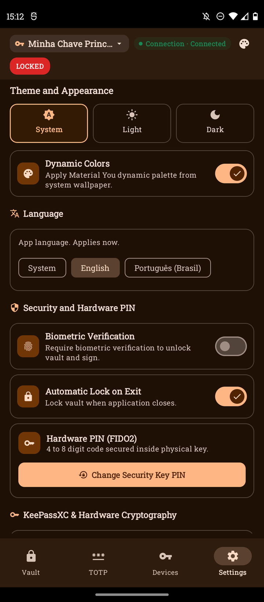

O que significa: `Sistema` segue o idioma do telefone. `Inglês` e
`Português (Brasil)` fixam o idioma do app. O telefone deste guia
terminou em inglês, por causa da sequência demonstrada.

## 10. Bloqueio

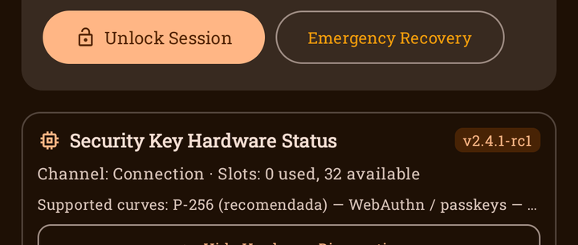

Passos:

1. No cofre, toque em `Bloquear Agora` (ou `Lock Now`).
2. Confirme o selo `LOCKED` e `Sessão Bloqueada`.
3. As operações do cofre param na hora.

## 11. Recuperação de emergência (mostrar sem concluir)

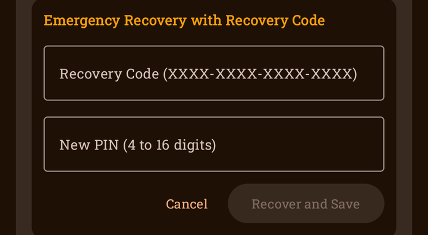

Passos (somente visualização, sem enviar nada):

1. Com o cofre bloqueado, toque em `Recuperação de Emergência`.
2. Leia os dois campos vazios: código de recuperação e PIN novo.
3. Note que `Recuperar e Salvar` fica desabilitado com campos vazios.
4. Toque em `Cancelar`. Não digite nem envie nenhum código.

O que significa: esta tela redefine o acesso com o código de
emergência guardado offline. Use somente em caso real de perda do PIN.

## Solução de problemas

- `PIN incorreto. Tente novamente.` com o PIN certo: confira a ponte
  no PC (`/bridge/info` responde e `connected` é `true`). Neste guia a
  ponte travou uma vez (transporte `None`) e o app acusou PIN
  incorreto por timeout. Reiniciar a ponte resolveu. Nenhuma
  tentativa `[ 5 / 5 ]` foi consumida.
- Contador `[ 5 / 5 ]` caindo: cada PIN errado real consome uma
  tentativa. Com o contador zerado, use a Recuperação de Emergência.
- Operação pede toque (`Toque Obrigatório` / NEED_UP): confirme o
  toque físico pedido pela placa durante a operação.
- `ErrorLocked`: a sessão expirou ou foi bloqueada. Desbloqueie de
  novo ou abra a Recuperação de Emergência.
- `Conexão · Desconectado`: confira o cabo USB, a ponte no PC e o
  `adb reverse`. Toque em `Atualizar`.
- Tela `Capacidades da placa` vazia (`Unknown`): use o diagnóstico do
  cofre (capítulo 7) com a sessão ativa.
- Botão `Abrir Painel OTA` sem resposta: ative a sessão antes e tente
  de novo. Não prossiga com flash sem orientação.

## Nota de revisão — tour em telefone físico (2026-11-03)

Tour somente leitura no aparelho físico (`moto g(60)`, app `0.1.0-wave5`).
Emulador desligado. Nenhum PIN digitado. Nada instalado, nada apagado.

Estado: cofre `UNPROVISIONED`, `Session Locked [ 5 / 5 ]`, ponte ligada
(`Connection · Connected`). Fotos novas em `docs/manual/img/`:
`01_open_locked.png` … `07_settings_language.png` (largura ≤720).

Resultado: 7 de 8 passos PASS. `recovery-view` SKIP: sem cofre
provisionado, a tela `Recuperação de Emergência` não aparece. Provisionar
pede PIN novo. Sem PIN do dono, o passo fica BLOCKED-NEEDS-OWNER.

Diferenças contra os capítulos:

- Cap. 1: abertura fria às vezes mostra `Find Security Key`. Toque em
  `Go to Vault` dispensa a folha, sem trocar nada.
- Cap. 2: diálogo agora é variante `UNPROVISIONED` (`New Vault PIN`).
  Só visto. `Cancel` fecha. Nada digitado.
- Cap. 8: cartão OTA fica 3 rolagens abaixo do topo de `Settings`.
  `Open OTA Panel` não tocado. Nenhum flash executado.
- Cap. 9: `Language` fica no topo de `Settings` (`System`, `English`,
  `Português (Brasil)`). Nada trocado.
- Cap. 11: sem efeito neste estado (ver SKIP acima).
- TOTP mostra conta `e2e-test`. Código da foto é transitório.
