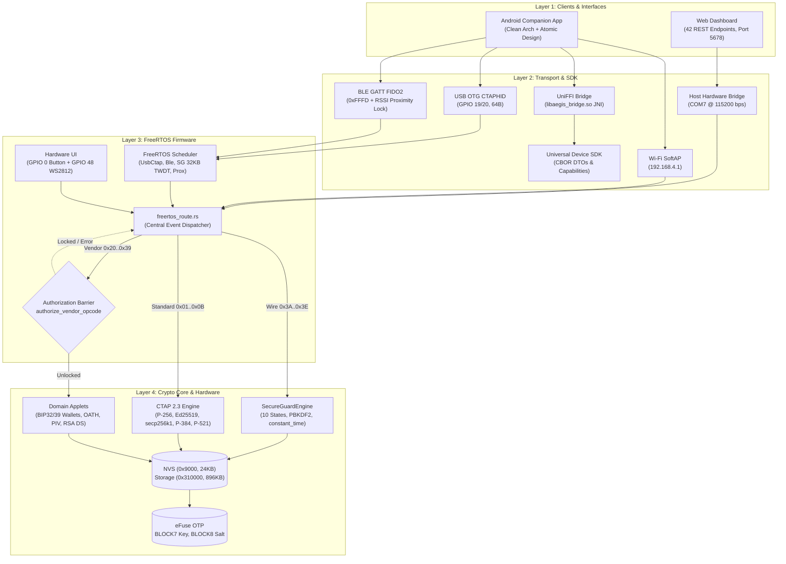

# PROJECT — AegisKey Authenticator (vision, architecture, modules, security)

> Style: ASD-STE100. Use short sentences. Use active voice. Use one instruction per sentence.
> Scope: consolidates vision, history, architecture, modules, transports, app, firmware, security.
> Sources: README.md, secure-guard, capacidades-modulos, matriz-funcionalidades, COMMS-map,
> ble-*, binding, APP-*, freertos, display, wifi, DESACOPLAMENTO, NVS, MACHINE, interop-matrix, excecoes-paridade.

## 1. Vision

- AegisKey is a FIDO2/WebAuthn security key.
- AegisKey runs 100 percent native Rust on ESP32-S3 and ESP32 classic.
- AegisKey removes legacy SDK dependencies.
- AegisKey follows FIDO Alliance, W3C WebAuthn, NIST, BIP-39, YKOATH, and Microsoft OS 2.0 descriptors.
- AegisKey exposes a web RP interface at `http://localhost:8888`.
- AegisKey exposes a web management dashboard at `http://127.0.0.1:5678/dashboard`.
- AegisKey exposes an interactive visual architecture map at `http://127.0.0.1:5678/architecture`.
- AegisKey uses USB VID `0x303A` and PID `0xAE61`.

## 2. History (summary)

- Wave 0 established gates, baselines, and NVS envelope AEGN v1.
- Wave 1 delivered PIV skeleton, proximity, wallet module, BLE connection, and audit plan.
- Wave 2 delivered F4 CCID/PIV end-to-end, RSSI lock, and USB validation.
- Wave 2.5 delivered SIZE and FLASH measurements on COM7.
- Wave 3 started OTA config, migration, and factory flow.
- FreeRTOS loops 1-4 delivered native tasks, proximity scheduler, FFI MAC, and hardware battery on COM13/COM14.
- Session 2026-10-20 proved F4 CCID/PIV handshake and BLE fix and buttonless flash.
- Session 2026-10-21 set the loop rule: stop after 3 to 5 attempts, then report.

## 3. Hardware map

| Peripheral | Pin or resource | Function |
|---|---|---|
| Presence button (UP) | GPIO 0 (BOOT), active-low | Authorize FIDO2, OTP, factory reset (50 ms debouncing) |
| RGB LED WS2812 | GPIO 48 | Show presence, success, error (24-bit GRB data) |
| Native USB | GPIO 19 (D-) / GPIO 20 (D+) | Expose CTAPHID 64 B endpoint (VID 0x303A, PID 0xAE61) |
| UART console | GPIO 43 (TX) / GPIO 44 (RX) | Flash firmware, read logs, and bridge serial at 115200 bps |
| Master key | eFuse BLOCK7, 256 bit | Seal vault envelopes |
| Device salt | eFuse BLOCK8, 256 bit | Derive device keys |
| Encrypted storage | SPI flash NVS and storage | Store resident credentials, OATH, large blobs, and wallet seeds |

- ESP32-S3 target: DevKitC-1, Xtensa LX7 dual-core 240 MHz, USB OTG native, WS2812.
- ESP32 classic target: LilyGO TTGO T-Display, ST7789 135x240, buttons GPIO 0 and GPIO 35, serial CTAPHID.
- Machine record lives in `docs/MACHINE.md` (quarantined). It lists COM ports, ESP-IDF v5.3.1, and Rust toolchain.
- Hardware acceleration map: S3 provides AES, SHA, RSA, ECC, RNG. Firmware uses them through approved drivers only.

## 4. Architecture

Open the interactive visual architecture map in your browser:
[ARCHITECTURE-MAP.html](file:///e:/projetos/fido/docs/project/ARCHITECTURE-MAP.html)

The bridge serves this map at `http://127.0.0.1:5678/architecture`.

```text
+--------------------------------------------------------------------------+
| LAYER 1: CLIENTS & INTERFACES                                            |
|   Android App (dev.aegiskey.app)     |  Web Dashboard (Port 5678)        |
+--------------------------------------------------------------------------+
                                    |
                                    v
+--------------------------------------------------------------------------+
| LAYER 2: TRANSPORT, BRIDGE JNI & SDK                                     |
|   UniFFI Bridge (libaegis_bridge.so) |  Universal Device SDK (CBOR DTOs) |
|   Physical Links: USB OTG (19/20)    |  BLE GATT 0xFFFD + Proximity Lock |
|   Wi-Fi SoftAP (192.168.4.1)         |  Host UART Bridge (COM7 115200)   |
+--------------------------------------------------------------------------+
                                    |
                                    v
+--------------------------------------------------------------------------+
| LAYER 3: ESP32-S3 FIRMWARE & FREERTOS                                    |
|   FreeRTOS Tasks: UsbCtaphid, BleGatt, SecureGuard (32KB TWDT), Proximity |
|   UI: GPIO 0 BOOT Button (UP)        |  GPIO 48 WS2812 RGB LED           |
|   ROUTER & AUTHORIZATION BARRIER (freertos_route.rs):                    |
|     • Standard FIDO2 (0x01..0x0B)    -> Exempt (Fail-Open WebAuthn)      |
|     • Protected Vendor (0x20..0x39)  -> Intercepted by Barrier (SG Lock) |
|     • Secure Guard Wire (0x3A..0x3E) -> Protocol Admin (CBOR)            |
+--------------------------------------------------------------------------+
                                    |
                                    v
+--------------------------------------------------------------------------+
| LAYER 4: CRYPTOGRAPHIC CORE NO_STD & HARDWARE PERIPHERALS                |
|   SecureGuardEngine: 10 States (0x00..0x09), PBKDF2-SHA256, constant_time|
|   Domain Engines: CTAP (5 Curves), Wallets (BIP32/39), OATH, PIV, RSA DS |
|   Persistence: nvs @ 0x9000 (24KB)   |  storage @ 0x310000 (896KB)       |
|   eFuse OTP: BLOCK7 (Master Key)     |  BLOCK8 (Device Derivation Salt)  |
+--------------------------------------------------------------------------+
```



### 4.1 Four-Layer Hierarchy

1. **Layer 1 — Clients & Interfaces**:
   - Android companion app (`dev.aegiskey.app`). The app uses Clean Architecture (`domain/` -> `data/` -> `ui/`). The app uses Atomic Design (`atoms/`, `molecules/`, `organisms/`, `templates/`). All strings follow ASD-STE100. `ConnectedKeyHeaderOrganism` acts as the single source of truth for connection status. The navigation bar provides 4 unique tabs without duplication: `Key Vault`, `TOTP Codes`, `Key Link`, `Settings`.
   - Web management dashboard (`tools/web_dashboard/index.html`). The bridge serves this dashboard at `http://127.0.0.1:5678/dashboard`. The dashboard provides 42 validated HTTP REST endpoints.

2. **Layer 2 — SDK, Bridge JNI & Transports**:
   - `crates/uniffi-bridge`. Generates `libaegis_bridge.so` C-ABI and JNI shared libraries for Kotlin on Android.
   - `crates/universal-device-sdk`. Provides CBOR DTOs, protocol codecs, and capability enforcement gates.
   - `tools/host_hardware_android_bridge.py`. Relays UART serial on `COM7` at 115200 bps to local HTTP port 5678.
   - Physical transport channels:
     - USB OTG CTAPHID Native: VID `0x303A`, PID `0xAE61`, GPIO 19 (D-), GPIO 20 (D+), 64-byte HID endpoint.
     - BLE GATT FIDO2: Service `0xFFFD`, characteristics `FFF1..FFF4`, MAC `3C:84:27:C7:17:7A`, and BLE RSSI Dynamic Proximity Lock.
     - Wi-Fi SoftAP: IP `192.168.4.1`, endpoints `/ctap`, `/oath/code`, `/config/wifi`.
     - UART Bridge: `COM7` at 115200 bps, GPIO 43 (TX), GPIO 44 (RX).

3. **Layer 3 — ESP32-S3 Firmware & FreeRTOS**:
   - FreeRTOS scheduler (`freertos_sched.rs`, `run_loop_freertos.rs`). Manages tasks: `UsbCtaphid` (prio 5, Core 1), `BleGatt` (prio 4), `SecureGuard` (32 KiB stack, prio 3, Task Watchdog Timer TWDT monitored), `Proximity` (prio 2, 1-second interval), `UiButton` (prio 4, GPIO 0 debouncing, GPIO 48 WS2812 RGB LED).
   - Event router and authorization barrier (`freertos_route.rs`).
     - Standard FIDO2 flow (`0x01..0x0B`: `MakeCredential`, `GetAssertion`, `GetInfo`, `ClientPin`): Exempt from Secure Guard. Fails open for WebAuthn standard compliance.
     - Protected Vendor flow (`0x20..0x39`: Keys `0x20..0x23`, OATH `0x24..0x27`, Pairing `0x28..0x2F`, OTA `0x30..0x34`, Wallets `0x35..0x37`, Logs `0x38`, PIV `0x39`): Intercepted by `authorize_vendor_opcode`. Fails closed if Secure Guard state is not `Unlocked`.
     - Secure Guard wire protocol (`0x3A..0x3E`): Status (0x3A), Provision (0x3B), Unlock (0x3C), Lock (0x3D), Wipe (0x3E).

4. **Layer 4 — Cryptographic Core no_std & Hardware Peripherals**:
   - `SecureGuardEngine` in `crates/aegis-fido-core/src/secure_guard/`. Pure `no_std` state machine with 10 discrete states: `Unprovisioned (0x00)`, `Provisioning (0x01)`, `Locked (0x02)`, `Authenticating (0x03)`, `Unlocked (0x04)`, `RecoveryRequired (0x05)`, `RateLimited (0x06)`, `WipePending (0x07)`, `WipeInProgress (0x08)`, `ErrorLocked (0x09)`. Uses PBKDF2-HMAC-SHA256 (10,000 iterations) with `constant_time_eq_32`. Enforces 5 consecutive attempts limit, progressive backoff delay, and selective factory wipe.
   - Domain cryptographic engines: `ctap` (P-256, Ed25519, secp256k1, P-384, P-521), `wallet` (BIP32/39 BTC, ETH, SOL, DOT), `oath` (TOTP/HOTP RFC 6238), `piv` (Slots 9A, 9C, 9D, 9E), `crypto_rsa` (ESP32-S3 DS peripheral), `proximity` (Kalman/Hysteresis).
   - Storage persistence: `nvs` partition at `0x9000` (24 KiB), `storage` partition at `0x310000` (896 KiB). Uses `sg_record_v1` format (256-byte payload, CRC32 check, AES-256-GCM AEGN envelope). Uses eFuse OTP `BLOCK7` (256-bit Master Key) and `BLOCK8` (256-bit Device Salt).

### 4.2 Workspace Crates

| Crate | Role | Key paths |
|---|---|---|
| `aegis-fido-core` | CTAP 2.x machine, CBOR, PIN, crypto, OATH, OTP, vault, extensions, SecureGuardEngine | `src/ctap`, `src/crypto`, `src/oath`, `src/otp`, `src/vault`, `src/secure_guard` |
| `aegis-fido-usb` | CTAPHID 64 B framer, channels, locks, timeouts | `src/ctaphid.rs` |
| `aegis-fido-firmware` | FreeRTOS tasks, router, barrier, button, LED, BLE, WiFi, OTA, NVS backend | `src/freertos_sched.rs`, `src/freertos_route.rs`, `src/run/`, `src/persistence.rs` |
| `universal-device-sdk` | Capabilities, providers, CBOR DTOs, `require_*` gates | `src/capabilities.rs`, `src/error.rs` |
| `uniffi-bridge` | UniFFI C-ABI/JNI bindings for Android Kotlin (`libaegis_bridge.so`) | `src/lib.rs` |

### 4.3 FreeRTOS Configuration

- Allocate tasks with static stacks: `UsbCtaphid` (prio 5, Core 1, 32 KiB), `BleGatt` (prio 4, 16 KiB), `SecureGuard` (prio 3, 32 KiB, TWDT monitored), `UiButton` (prio 4, 32 KiB), `Proximity` (prio 2, 16 KiB).
- Use one bounded event queue (`DEFAULT_QUEUE_DEPTH = 32`). Fail closed on queue full.
- Sample button on GPIO 0 with 50 ms debouncer.
- Run proximity tick at 1 second interval when feature `proximity` is active.

## 5. Modules and capabilities

| Domain | Status | Generation rule |
|---|---|---|
| Crypto ECC P-256/ECDSA/ECDH, SHA-2, HMAC, HKDF, AES-GCM/CCM, ChaCha20-Poly1305, HRNG | Ready in firmware modules | Generate on device |
| P-384, X25519, Ed25519 | Ready, measure RAM and flash | Generate on device |
| RSA 2048/3072/4096, PKCS1v1.5, PSS, OAEP | Ready, reject generate for 1024 | Generate on device |
| RSA-1024 generate, raw RSA, RSA-X.509, SHA-1 new use, ECB/CBC | Not supported | Never generate new |
| FIDO2 CTAP 2.x, passkey, discoverable, UP, UV PIN, credProtect, credBlob, hmac-secret, largeBlob | Ready, transport plus CTAP machine | Generate on device |
| Enterprise attestation cert | Provision outside, device only uses | Generate in app, store as envelope |
| PIV/CCID | Enumerates, handshake 100 percent, transfer pending | Generate on device |
| OATH TOTP/HOTP | Real cycle GEN-LIST-CODE-DELETE persists in NVS | Generate on device |
| Wallet store-only phase 1 | Real, slot policy enforced | Generate in app, store as envelope |
| OTA update | In progress, owns `ota.rs` and `nvs_backend.rs` | Sign outside, verify on device |
| Backup and export | Envelope only, never cleartext private | Generate in app, store as envelope |

## 6. Transports (COMMS single source)

| Transport | Path | Frame | Notes |
|---|---|---|---|
| Serial UART CTAPHID 64 B | `tools/host_hardware_android_bridge.py` | 64 B | Baud 115200 8N1 on COM7 |
| Native USB HID | `crates/aegis-fido-usb` + TinyUSB | CTAPHID 64 B | Primary for desktop (GPIO 19/20) |
| BLE GATT 0xFFFD | NimBLE stack (`ble_gatt.rs`) | FFF1..FFF4 | Service 0xFFFD, MAC 3C:84:27:C7:17:7A |
| Dynamic Proximity Lock | `proximity.rs` + NimBLE | Service data 0xFFFE | Kalman-filtered RSSI + walk-away lock |
| WiFi SoftAP | `wifi_ap.rs` | HTTP 1.1 | AP AegisKey-S3-XXXX at 192.168.4.1 |
| LCD + headless screens | `display/mod.rs`, ST7789 | Direct SPI | TTGO T-Display variant |

## 7. Android app

- Follow Clean Architecture, SOLID, and Atomic Design.
- Separate layers: presentation, domain, data, SDK bridge, firmware contract.
- Generate UniFFI bindings before Gradle. Output Java stubs under `app-android/app/src/main/java/uniffi/aegis_bridge/`.
- Place shared library under `app-android/app/src/main/jniLibs/arm64-v8a/libaegis_bridge.so`.
- Enforce `ConnectedKeyHeaderOrganism` as single connection source of truth.
- Provide 4 unique navigation tabs: `Key Vault`, `TOTP Codes`, `Key Link`, `Settings`.
- Write all user interface text in ASD-STE100.
- Never store raw master keys or plain PIN hashes on the mobile device.

## 8. Consolidated Repository Directory Architecture

| Directory | Role | Deliverables & Rules |
|---|---|---|
| `docs/project/` | System Architecture | `PROJECT.md`, `ARCHITECTURE-MAP.html`, hardware pinouts, security specifications |
| `docs/plans/` | Execution Roadmaps | `PLANS.md`, sprint tracking, feature roadmaps |
| `docs/tasks/` | Microtasks & Checklists | `TASKS.md`, HIL test checklists, release gating criteria |
| `docs/evaluation/` | Verification & Benchmarks | `EVALUATION.md`, automated test reports, historical quarantine |
| `crates/` | Rust Workspace | `aegis-fido-core`, `aegis-fido-usb`, `aegis-fido-firmware`, `universal-device-sdk`, `uniffi-bridge` |
| `app-android/` | Android Companion | Native companion app (`dev.aegiskey.app`) in Kotlin with Jetpack Compose |
| `tools/` | Bridge & Web Cockpit | `host_hardware_android_bridge.py`, `web_dashboard/index.html`, test scripts, simulators |
| `scripts/` | CI/CD Automation | Release cleanliness verifiers, formatters, and flash scripts |

## 9. Security

- Apply STRIDE across 7 primary threats. Mitigate each threat with a test.
- Enforce 20 non-negotiable rules. Enforce 6 homologation criteria.
- Enforce R1-R14 automation rules.
- Keep secure-boot OFF and flash encryption OFF in automatic test lane.
- Keep `TEST_*` commands gated strictly behind `--features test-mode`.
- Enforce Zero-Trust Authorization Barrier in `freertos_route.rs`: vendor commands fail closed when locked.
- Enforce constant-time PIN comparison with `constant_time_eq_32`.
- Rate-limit loops: cap a stuck stage at 3 to 5 attempts, then stop and report.
