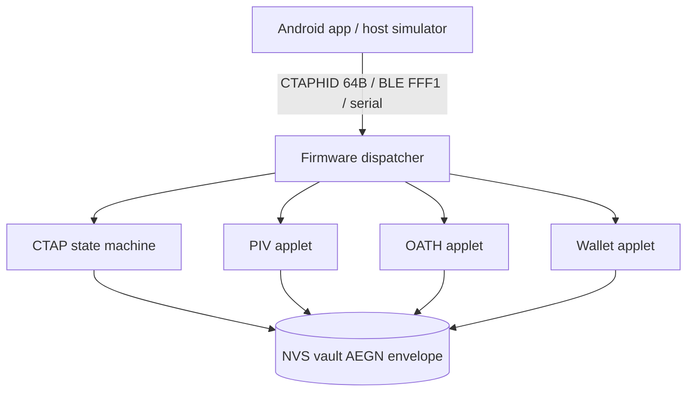

# PROJECT — AegisKey Authenticator (vision, architecture, modules, security)

> Style: ASD-STE100. Use short sentences. Use active voice. Use one instruction per sentence.
> Scope: consolidates vision, history, architecture, modules, transports, app, firmware, security.
> Sources: README.md, secure-guard/00-03+07-08, capacidades-modulos, matriz-funcionalidades, COMMS-map,
> ble-*, binding, APP-*, freertos, display, wifi, DESACOPLAMENTO, NVS, MACHINE, interop-matrix, excecoes-paridade.

## 1. Vision

- AegisKey is a FIDO2/WebAuthn security key.
- AegisKey runs 100 percent native Rust on ESP32-S3 and ESP32 classic.
- AegisKey removes legacy SDK dependencies.
- AegisKey follows FIDO Alliance, W3C WebAuthn, NIST, BIP-39, YKOATH, and Microsoft OS 2.0 descriptors.
- AegisKey exposes a web RP interface at `http://localhost:8888`.
- AegisKey uses USB VID `0x303A` and PID `0xAE61`.

## 2. History (summary)

- Wave 0 established gates, baselines, and NVS envelope AEGN v1.
- Wave 1 delivered PIV skeleton, proximity, wallet module, BLE connection, and audit plan.
- Wave 2 delivered F4 CCID/PIV end-to-end, RSSI lock, and USB validation.
- Wave 2.5 delivered SIZE and FLASH measurements on COM7.
- Wave 3 started OTA config, migration, and factory flow.
- FreeRTOS loops 1-4 delivered native tasks, proximity scheduler, FFI MAC, and hardware battery on COM13/COM14.
- Session 2026-10-20 proved F4 CCID/PIV handshake and BLE fix and buttonless flash.
- Session 2026-10-21 set the loop rule: stop after 3 to 5 attempts, then report.

## 3. Hardware map

| Peripheral | Pin or resource | Function |
|---|---|---|
| Presence button (UP) | GPIO 0 (BOOT), active-low | Authorize FIDO2, OTP, factory reset |
| RGB LED WS2812 | GPIO 48 | Show presence, success, error |
| Native USB | GPIO 19 (D-) / GPIO 20 (D+) | Expose CTAPHID, CCID, composite |
| UART console | COM bridge | Flash firmware and read logs |
| Master key | eFuse BLOCK7, 256 bit | Seal vault envelopes |
| Device salt | eFuse BLOCK8, 256 bit | Derive device keys |
| Encrypted storage | SPI flash NVS partition | Store resident credentials, OATH, large blobs |

- ESP32-S3 target: DevKitC-1, Xtensa LX7 dual-core 240 MHz, USB OTG native, WS2812.
- ESP32 classic target: LilyGO TTGO T-Display, ST7789 135x240, buttons GPIO 0 and GPIO 35, serial CTAPHID.
- Machine record lives in `docs/MACHINE.md` (quarantined). It lists COM ports, ESP-IDF v5.3.1, and Rust toolchain.
- Hardware acceleration map: S3 provides AES, SHA, RSA, ECC, RNG. Firmware uses them through approved drivers only.

## 4. Architecture

```text
+----------------+     USB CTAPHID/CCID      +------------------+
|  Host / App    | <------------------------> |  Firmware (S3)   |
|  simulator SDK |     BLE GATT 0xFFFD       |  CTAP + applets  |
|  proximity     | <------------------------> |  NVS vault       |
|  agents        |     WiFi AP + mDNS        |  FreeRTOS tasks  |
+----------------+                           +------------------+
        |                                            |
        +--> tools/host_sdk/transport.py              +--> crates/aegis-fido-core
             tools/app_simulator.py                        crates/aegis-fido-usb
             tools/host/{win,linux,macos}/                 crates/aegis-fido-firmware
```



### 4.1 Workspace crates

| Crate | Role | Key paths |
|---|---|---|
| `aegis-fido-core` | CTAP 2.x machine, CBOR, PIN, crypto, OATH, OTP, vault, extensions | `src/ctap`, `src/crypto`, `src/oath`, `src/otp`, `src/vault`, `src/credential`, `src/extensions` |
| `aegis-fido-usb` | CTAPHID 64 B framer, channels, locks, timeouts | `src/ctaphid.rs` |
| `aegis-fido-firmware` | Serial CTAPHID, binding, button, display, BLE, WiFi, OTA, NVS backend, FreeRTOS | `src/freertos.rs`, `src/proximity.rs`, `src/ble_nimble.rs`, `src/ota.rs`, `src/nvs_backend.rs` |
| `universal-device-sdk` | Capabilities, providers, `require_*` gates | `src/capabilities.rs`, `src/error.rs` |

### 4.2 FreeRTOS variant

- Use three explicit tasks: `usb_ctaphid` (prio 5, 8 KiB), `ui_button` (prio 4, 4 KiB), `housekeeping` (prio 2, 4 KiB).
- Use one bounded queue (`DEFAULT_QUEUE_DEPTH = 32`). Use non-blocking `send`. Fail closed on full.
- Use one EventGroup: `EVT_USB_RX`, `EVT_BUTTON_UP`, `EVT_BLE_RX`, `EVT_TICK_10MS`, `EVT_SHUTDOWN`.
- Pin `usb_ctaphid` to core 1. Leave `housekeeping` unpinned. Log core ID at boot.
- Run proximity tick at about 1 s when feature `proximity` is active.
- Run dispatcher as shutdown-break loop. Erase proximity keys on shutdown.
- Gate device code with features: `freertos`, `proximity`, `test-mode`. Keep defaults off unless required.

### 4.3 Decoupling rule

- Keep splits verified by file and line.
- Keep 5 NVS stores in `NamespacedStore`. Justify each direct access.
- Keep display, BLE, WiFi, and OTA behind explicit modules. Prohibit god objects.
- Record each split in section 1 of the old `DESACOPLAMENTO.md` (quarantined).

## 5. Modules and capabilities

| Domain | Status | Generation rule |
|---|---|---|
| Crypto ECC P-256/ECDSA/ECDH, SHA-2, HMAC, HKDF, AES-GCM/CCM, ChaCha20-Poly1305, HRNG | Ready in firmware modules | Generate on device |
| P-384, X25519, Ed25519 | Ready, measure RAM and flash | Generate on device |
| RSA 2048/3072/4096, PKCS1v1.5, PSS, OAEP | Ready, reject generate for 1024 | Generate on device |
| RSA-1024 generate, raw RSA, RSA-X.509, SHA-1 new use, ECB/CBC | Not supported | Never generate new |
| FIDO2 CTAP 2.x, passkey, discoverable, UP, UV PIN, credProtect, credBlob, hmac-secret, largeBlob | Ready, transport plus CTAP machine | Generate on device |
| Enterprise attestation cert | Provision outside, device only uses | Generate in app, store as envelope |
| PIV/CCID | Enumerates, handshake 100 percent, transfer pending | Generate on device |
| OATH TOTP/HOTP | Real cycle GEN-LIST-CODE-DELETE persists in NVS | Generate on device |
| Wallet store-only phase 1 | Real, slot policy enforced | Generate in app, store as envelope |
| OTA update | In progress, owns `ota.rs` and `nvs_backend.rs` | Sign outside, verify on device |
| Backup and export | Envelope only, never cleartext private | Generate in app, store as envelope |

- Full matrix lives in old `matriz-funcionalidades-esp32s3.md` and `plans/MATRIZ-TODO.md` (quarantined, summarized in PLANS.md).
- Interop matrix: test each client against each capability. Never claim support without a test vector.
- Parity exceptions G0: list what must change (W1-W3 with dedicated test) and what never changes (golden vectors Wave 0).

## 6. Transports (COMMS single source)

| Transport | Path | Frame | Notes |
|---|---|---|---|
| Serial UART CTAPHID 64 B | `tools/app_simulator.py` + `tools/host_sdk/transport.py` | 64 B | Default baud 115200 8N1 |
| Native USB HID | `HidLink` + `crates/aegis-fido-usb` | CTAPHID 64 B | Primary for desktop |
| BLE GATT 0xFFFD | NimBLE, service data | FFF1 framing, CTAP2-BLE opcodes | Contract frozen Wave 4 |
| CCID bulk | `ccid_device.c` + `CcidTransport` | CCID frames | HID stays first, CCID class 0x0B second |
| WiFi AP + station + mDNS | C component `esp-idf` | AP `AegisKey-XXXX` only in pairing | Use C component, lesson of stage A |
| LCD + headless screens | `display/mod.rs`, ST7789 | Screen-to-LED table | Vault needs UP before OATH |

### 6.1 BLE contract (frozen)

- Use GATT service `0xFFFD`.
- Use CTAP2-BLE opcodes. Use FFF1 framing.
- Use NimBLE, not Bluedroid.
- Enforce bonding for privileged ops. Enforce binding window 60 s after 5 s BOOT hold plus UP plus PIN.
- Return `NEED_BINDING 0x05` outside window. Never expose it on USB.
- Run proximity beacon Wave 2: service-data `0xFFFE [VER|CTR|TAG]`, TAG is AES-CCM-128 truncated to 4 B, tick about 1 s, anti-replay counter, `K_prox` in NVS `prox_k` with zeroize.
- Interop vector: `K=0x42*16`, fob `AA:BB:CC:DD:EE:FF`, ctr 7 yields `TAG=660d4941`.

### 6.2 Binding rule

- Bind BLE vendor plus WiFi management under one exclusive owner.
- Split use versus config per normative section 11.2.
- Allow test-mode bypass per normative section 11.3 only.
- Make binding-to-UP tests bypass-aware: test-mode skips the link by design, release enforces `NeedBinding` first.

### 6.3 NVS schema

- Use envelope AEGN v1, AES-256-GCM authenticated.
- Store `pin_hash`, `pin_retries`, `power_cycle_state` in NVS. Load them at boot.
- Store `K_prox` in `prox_k`. Zeroize on shutdown and factory reset.
- Formal W1 keys follow order: schema, RESC gate, nonce, retries, sign count.
- Never log secrets. Never store cleartext privates outside envelopes.

## 7. Android app

- Follow Clean Architecture plus SOLID plus Atomic Design.
- Separate layers: presentation, domain, data, SDK bridge, firmware contract.
- Generate UniFFI bindings before Gradle. Output Java stubs under `app-android/app/src/main/java/uniffi/aegis_bridge/`.
- Place `.so` under `app-android/app/src/main/jniLibs/arm64-v8a/libaegis_bridge.so`.
- Cover 8 key types in lifecycle doc: `PASSKEY_FIDO` plus vault, OATH, wallet, PIV, OTP, backup, policy.
- Apply zero-jargon onboarding. Gate navigation reactively in `RootNavigationGate`.
- Map each screen to device state and transport. Never leave the device: private keys, PIN hash, master key.
- App consumes SDK and firmware. App never implements crypto itself.

## 8. Firmware screens, LED, and rites

- Map GPIOs and channels in one table. Validate each GPIO on hardware.
- Follow screen journey: LCD plus headless, machine states, LED table, vault after UP.
- Follow LED order: breathing blue/green for presence, green pulse for success, red flash for error.
- Run rites: USB connect, BLE pair, LED check, wallet GEN/LIST/ADDR, OATH PUT/LIST/CODE/DELETE, TEST hooks only with `--test-mode`.
- Run lifetime debug only in dev. Keep it off in release. Read events through `TEST_LIFETIME_DUMP` only in test-mode.
- Run live monitor only in dev. Never enable it in release.

## 9. Security

- Apply STRIDE across 7 primary threats. Mitigate each threat with a test.
- Enforce 20 non-negotiable rules (section 2 of old review). Enforce 6 homologation criteria (section 17).
- Enforce R1-R14 automation rules. Violation aborts the lane. Key gates: R6 zero warnings, R7 test-mode gated, R11 doc plus build plus flash plus battery per large change, R12 mutable stubs as `NotCompiled`, R13 secure-boot and eFuse stub-only in automatic path, R14 hardware-first on rewrite.
- Keep secure-boot OFF and flash encryption OFF in automatic path. Record formal risk acceptance for missing secure-boot.
- Keep `TEST_*` inbox only under feature `test-mode`. Prove release cleanliness with `scripts/check-release-clean.py`.
- Enforce PIN plumbing: read `has_valid_pin_uv_session()` in BLE and serial dispatch. Return `0x02` without session, `0x00` with session.
- Enforce executor reality: vendor opcodes `0x20-0x27` persist through `KeyManager` and `OathApplet`, not `0x04` stubs.
- Enforce honest CCID: OATH and FIDO over CCID outside v1 return `6D 00`.
- Provision SPKI pins plus server integrity verification. Format 32 B base64. Load provision only with `--confirm`.
- Rate-limit loops: cap a stuck stage at 3 to 5 attempts, then stop and report.
