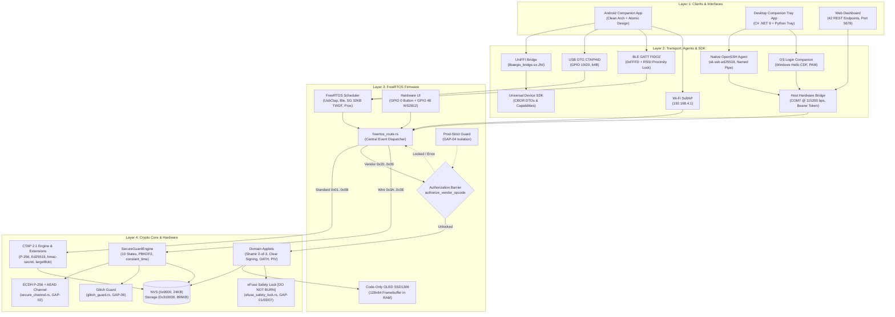
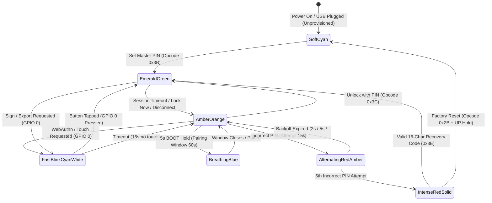
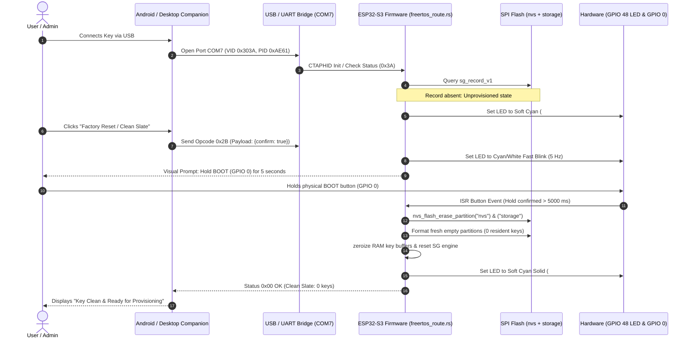
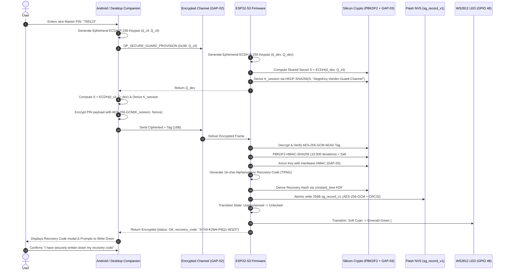
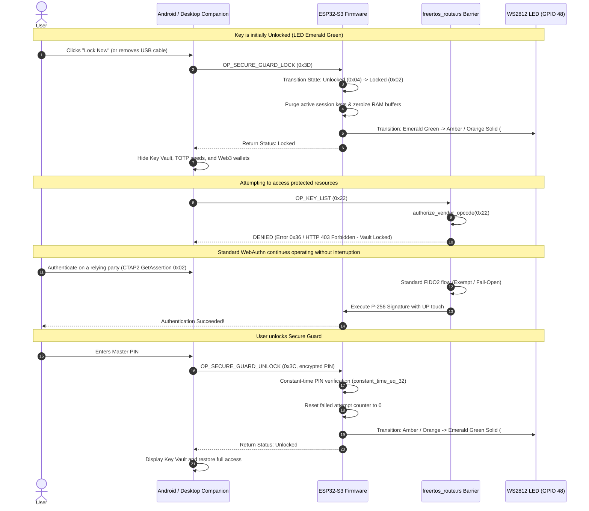
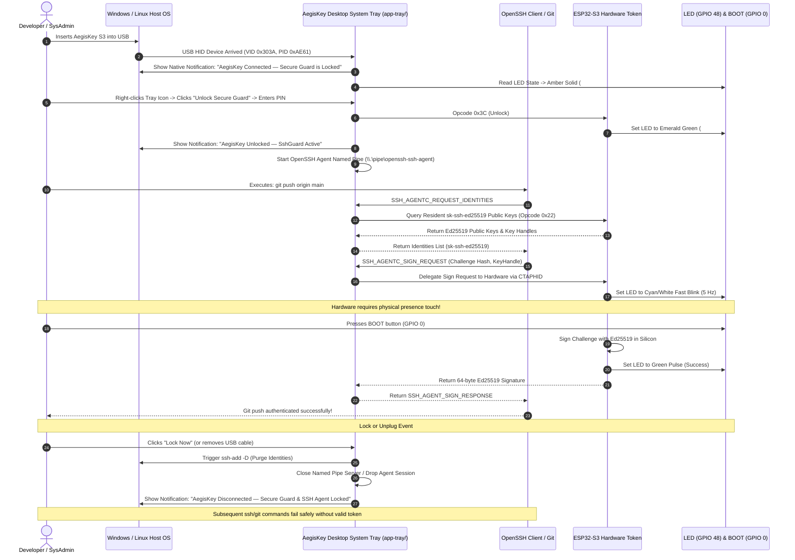
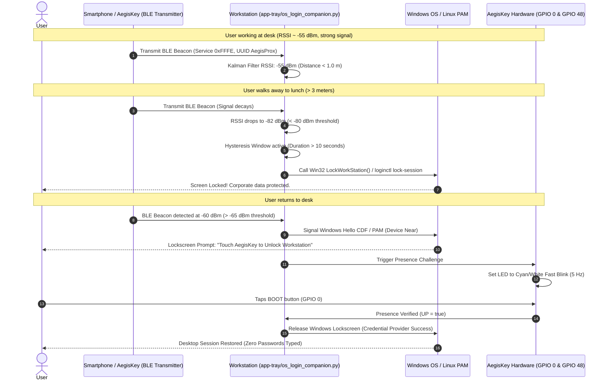
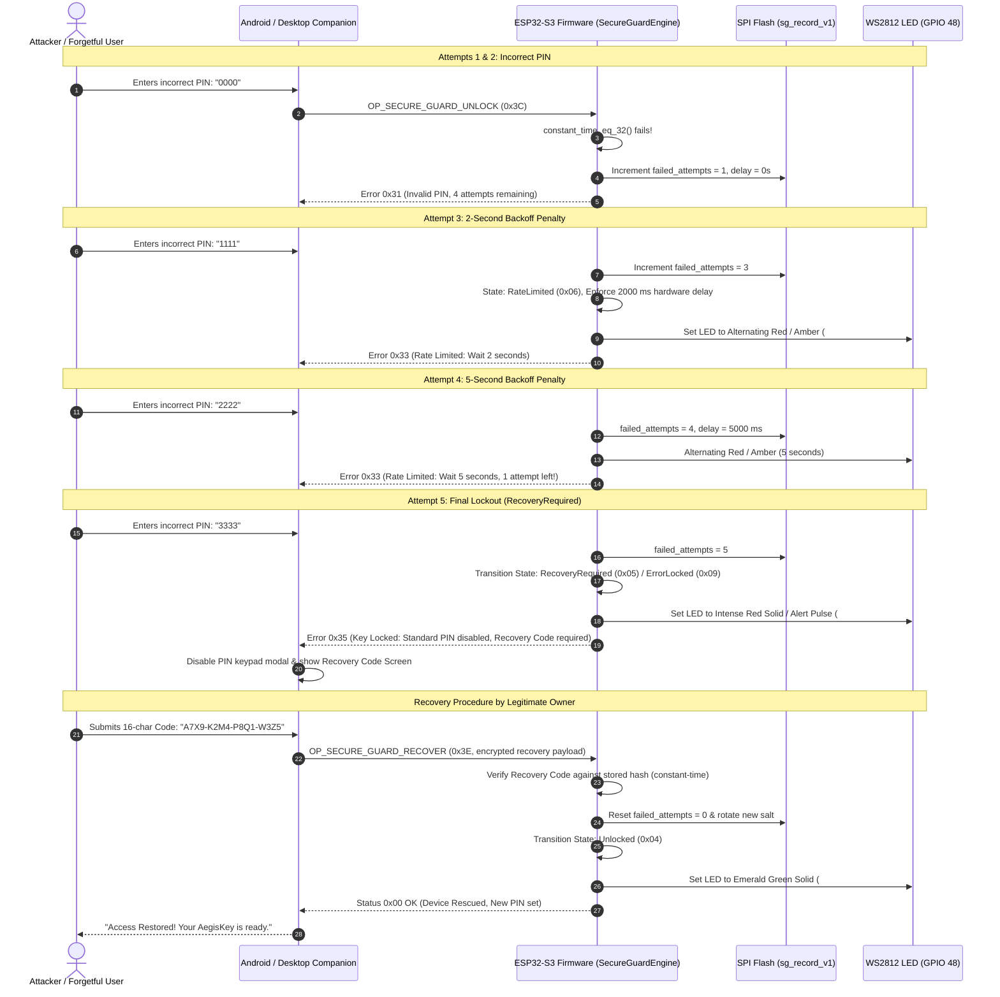
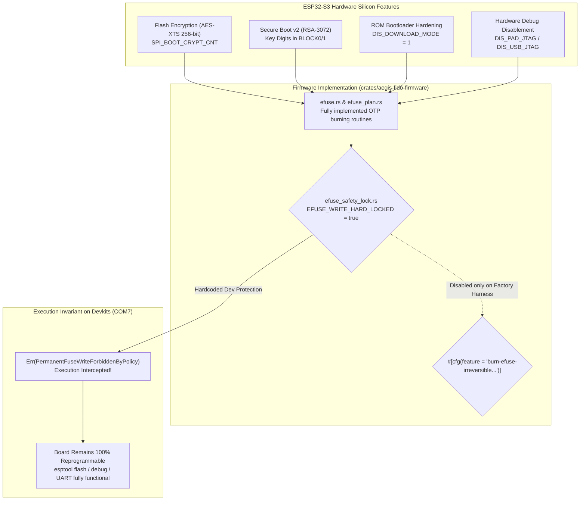

# PROJECT — AegisKey Authenticator (vision, architecture, modules, security)

> Style: ASD-STE100. Use short sentences. Use active voice. Use one instruction per sentence.
> Scope: consolidates vision, history, architecture, modules, transports, app, desktop tray, firmware, security.
> Sources: README.md, MASTER_EXECUTION_PLAN.md, secure-guard, capacidades-modulos, matriz-funcionalidades, COMMS-map,
> ble-*, binding, APP-*, app-tray, freertos, display, wifi, DESACOPLAMENTO, NVS, MACHINE, interop-matrix, excecoes-paridade.

---

> [!CAUTION]
> ### CRITICAL HARDWARE SAFETY POLICY — eFuse OTP Protection (`DO NOT EXECUTE`)
> **NEVER EXECUTE COMMANDS TO BURN eFuses ON HARDWARE (`esptool.py burn_efuse`, `BLOCK7`, `SPI_BOOT_CRYPT_CNT`, `SECURE_VERSION`).**  
> eFuse burning in the ESP32-S3 is permanent and irreversible. Burning locks the board against normal flashing and development debugging.  
> All eFuse modules (`efuse_safety_lock.rs`, `GAP-01`, `GAP-03`, `GAP-07`) are guarded by `EFUSE_WRITE_HARD_LOCKED = true` and `feature = "burn-efuse-irreversible-do-not-enable"`. Development boards on `COM7` remain unburned to preserve flashing and test capabilities.

---

## 1. Vision

- AegisKey is a FIDO2/WebAuthn security key and cryptographic hardware guardian.
- AegisKey runs 100 percent native Rust on ESP32-S3 and ESP32 classic microcontrollers.
- AegisKey removes legacy C SDK dependencies.
- AegisKey follows FIDO Alliance (CTAP 2.1), W3C WebAuthn, NIST, BIP-32/39, SLIP-0039, OATH (RFC 4226/6238 compatible layer), OpenSSH, and OS 2.0 platform capability descriptors.
- AegisKey exposes a web RP interface at `http://localhost:8888`.
- AegisKey exposes a web management dashboard at `http://127.0.0.1:5678/dashboard`.
- AegisKey exposes an interactive visual architecture map at `http://127.0.0.1:5678/architecture`.
- AegisKey provides a Desktop Companion System Tray application in C# (.NET 9) and Python (`app-tray/`).
- AegisKey provides a Native OpenSSH Agent (`sk-ssh-ed25519@openssh.com`) via Windows Named Pipe and Unix socket.
- AegisKey provides OS Login Companion for Windows Hello CDF and Linux PAM (`pam_u2f`).
- AegisKey uses USB VID `0x303A` and PID `0xAE61`.

## 2. History (summary)

- Wave 0 established gates, baselines, and NVS envelope AEGN v1.
- Wave 1 delivered PIV skeleton, proximity, wallet module, BLE connection, and audit plan.
- Wave 2 delivered F4 CCID/PIV end-to-end, RSSI lock, and USB validation.
- Wave 2.5 delivered SIZE and FLASH measurements on COM7.
- Wave 3 started OTA config, migration, and factory flow.
- FreeRTOS loops 1-4 delivered native tasks, proximity scheduler, FFI MAC, and hardware battery on COM13/COM14.
- Session 2026-10-20 proved F4 CCID/PIV handshake and BLE fix and buttonless flash.
- Session 2026-10-21 set the loop rule: stop after 3 to 5 attempts, then report.
- Session 2026-11-01 delivered Master Execution Plan (`MASTER_EXECUTION_PLAN.md`), closing 7 security gaps (`GAP-01` to `GAP-07`) and implementing 6 product opportunities (`OPP-01` to `OPP-06`), including the Desktop System Tray App, Native OpenSSH Agent, ECDH P-256 encrypted channel, Glitch Guard, Shamir 2-of-3, and Web3 Clear Signing.

## 3. Hardware map

| Peripheral | Pin or resource | Function |
|---|---|---|
| Presence button (UP) | GPIO 0 (BOOT), active-low | Authorize FIDO2, OTP, factory reset (50 ms debouncing). Physical touch required. |
| RGB LED WS2812 | GPIO 48 | Show presence, success, error (24-bit GRB data). |
| Native USB | GPIO 19 (D-) / GPIO 20 (D+) | Expose CTAPHID 64 B endpoint (VID 0x303A, PID 0xAE61). Full-speed USB 2.10. |
| UART console | GPIO 43 (TX) / GPIO 44 (RX) | Flash firmware, read logs, and bridge serial at 115200 bps (`COM7`). |
| I2C OLED Bus (Code) | GPIO 4 (SDA) / GPIO 5 (SCL) | Virtual driver in code (`HARDWARE_I2C_OLED_ATTACHED = false`) for SSD1306 128x64 display framebuffer. |
| Master key | eFuse BLOCK7, 256 bit | Seal vault envelopes in silicon. Guarded by zero-brick lock in dev. |
| Device salt | eFuse BLOCK8, 256 bit | Derive device keys in silicon. Guarded by zero-brick lock in dev. |
| Encrypted storage | SPI flash NVS and storage | Store resident credentials, OATH, large blobs, and wallet seeds (`sg_record_v1`). |

- ESP32-S3 target: DevKitC-1, Xtensa LX7 dual-core 240 MHz, USB OTG native, WS2812.
- ESP32 classic target: LilyGO TTGO T-Display, ST7789 135x240, buttons GPIO 0 and GPIO 35, serial CTAPHID.
- Machine record lives in `docs/MACHINE.md` (quarantined). It lists COM ports, ESP-IDF v5.3.1, and Rust toolchain.
- Hardware acceleration map: S3 provides AES, SHA, RSA, ECC, RNG. Firmware uses them through approved drivers only.

## 4. Architecture

Open the interactive visual architecture map in your browser:
[ARCHITECTURE-MAP.html](ARCHITECTURE-MAP.html)

The bridge serves this map at `http://127.0.0.1:5678/architecture`.

```text
+--------------------------------------------------------------------------+
| LAYER 1: CLIENTS & USER INTERFACES                                       |
|   • Android Companion App (dev.aegiskey.app): Clean Arch + Atomic Design  |
|   • Desktop Companion System Tray App (app-tray/): C# .NET 9 & Python     |
|   • Web Management Dashboard (tools/web_dashboard/index.html): Port 5678 |
+--------------------------------------------------------------------------+
                                    │
                                    ▼
+--------------------------------------------------------------------------+
| LAYER 2: TRANSPORT, BRIDGE JNI, AGENTS & UNIVERSAL SDK                   |
|   • Native OpenSSH Agent (app-tray/openssh_native_agent.py, OPP-01)       |
|   • OS Login & Proximity Companion (app-tray/os_login_companion.py,OPP-04)|
|   • UniFFI Bridge (crates/uniffi-bridge -> libaegis_bridge.so JNI)        |
|   • Universal Device SDK (crates/universal-device-sdk -> CBOR DTOs)      |
|   • Host Hardware Bridge (tools/host_hardware_android_bridge.py)         |
|   • Physical Links: USB OTG CTAPHID (GPIO 19/20), BLE GATT (0xFFFD),      |
|     Wi-Fi SoftAP (192.168.4.1), and Serial UART (COM7 @ 115200 bps)      |
+--------------------------------------------------------------------------+
                                    │
                                    ▼
+--------------------------------------------------------------------------+
| LAYER 3: ESP32-S3 FIRMWARE & FREERTOS MULTITASKING                       |
|   • FreeRTOS Tasks: UsbCtaphid, BleGatt, SecureGuard (32KB TWDT), Prox    |
|   • Central Router & Zero-Trust Barrier (freertos_route.rs):             |
|     - FIDO2 Standard (0x01..0x0B): Exempt (Fail-Open for WebAuthn)       |
|     - Vendor Ops (0x20..0x39): Intercepted by authorize_vendor_opcode    |
|     - Secure Guard Wire (0x3A..0x3E): Admin, Provisioning, Wipe          |
|   • Code-Only OLED SSD1306 128x64 Driver (oled_ssd1306_code_only.rs,OPP-06)|
|   • Production Isolation Guard (prod_strict_guard.rs, GAP-04)            |
|   • Physical UI: GPIO 0 (BOOT Button, UP), GPIO 48 (WS2812 RGB LED)       |
+--------------------------------------------------------------------------+
                                    │
                                    ▼
+--------------------------------------------------------------------------+
| LAYER 4: CRYPTOGRAPHIC CORE NO_STD & SILICON HARDWARE                    |
|   • SecureGuardEngine: 10 States (0x00..0x09), PBKDF2, constant_time     |
|   • ECDH P-256 + HKDF + AEAD Encrypted Channel (secure_channel.rs, GAP-02)|
|   • Glitch Guard & Fault Injection Resistance (glitch_guard.rs, GAP-06)  |
|   • CTAP 2.1 Extensions: hmac-secret & largeBlobKey (OPP-02)             |
|   • Shamir Secret Sharing 2-of-3 in GF(256) (shamir_slip39.rs, OPP-03/05)|
|   • Web3 Clear Signing Parser (clear_signing.rs, OPP-06)                 |
|   • Silicon eFuse Safety Lock (efuse_safety_lock.rs, GAP-01/03/07) [LOCK] |
|   • Dual Partition Flash: nvs (0x9000, 24KB) + storage (0x310000, 896KB) |
+--------------------------------------------------------------------------+
```



### 4.1 Four-Layer Hierarchy

1. **Layer 1 — Clients & Interfaces**:
   - **Android Companion App** (`dev.aegiskey.app`). Built with Clean Architecture and Atomic Design. Enforces ASD-STE100 across UI strings. Provides 4 navigation tabs: `Key Vault`, `TOTP Codes`, `Key Link`, `Settings`.
   - **Desktop Companion System Tray App** (`app-tray/`). Cross-platform companion with native Windows C# (.NET 9) application (`app-tray/dotnet/AegisKeyTray/`) and Python multiplatform tray (`app-tray/aegis_tray.py`). Features native OS notifications on device plug/unplug, real-time lock state monitoring, and quick action menus.
   - **Web Management Dashboard** (`tools/web_dashboard/index.html`). Served at `http://127.0.0.1:5678/dashboard`. Exposes 42 validated HTTP REST endpoints for passkeys, TOTP, and security diagnostics.

2. **Layer 2 — SDK, Bridge JNI, Agents & Transports**:
   - **Native OpenSSH Agent Provider** (`app-tray/openssh_native_agent.py`, `OPP-01`). Implements OpenSSH agent protocol over Windows Named Pipe (`\\.\pipe\openssh-ssh-agent`) and Unix Domain Socket. Handles `sk-ssh-ed25519@openssh.com` resident keys, delegating signatures to AegisKey via CTAPHID with User Presence verification.
   - **OS Login Companion** (`app-tray/os_login_companion.py`, `OPP-04`). Integrates Windows Hello Companion Device Framework (CDF) and Linux PAM (`pam_u2f`). Automates walk-away lock via BLE RSSI thresholds and touch unlock without password.
   - `crates/uniffi-bridge`. Generates `libaegis_bridge.so` C-ABI and JNI shared libraries for Kotlin on Android.
   - `crates/universal-device-sdk`. Provides CBOR DTOs, protocol codecs, and capability enforcement gates.
   - `tools/host_hardware_android_bridge.py`. Relays UART serial on `COM7` at 115200 bps to local HTTP port 5678, authenticated by Bearer Session Token (`X-Aegis-Token`).
   - Physical transport channels:
     - USB OTG CTAPHID Native: VID `0x303A`, PID `0xAE61`, GPIO 19 (D-), GPIO 20 (D+), 64-byte HID endpoint.
     - BLE GATT FIDO2: Service `0xFFFD`, characteristics `FFF1..FFF4`, MAC `3C:84:27:C7:17:7A`, and BLE RSSI Dynamic Proximity Lock.
     - Wi-Fi SoftAP: IP `192.168.4.1`, endpoints `/ctap`, `/oath/code`, `/config/wifi`.
     - UART Bridge: `COM7` at 115200 bps, GPIO 43 (TX), GPIO 44 (RX).

3. **Layer 3 — ESP32-S3 Firmware & FreeRTOS**:
   - FreeRTOS scheduler (`freertos_sched.rs`, `run_loop_freertos.rs`). Manages tasks: `UsbCtaphid` (prio 5, Core 1), `BleGatt` (prio 4), `SecureGuard` (32 KiB stack, prio 3, TWDT monitored), `Proximity` (prio 2, 1-second interval), `UiButton` (prio 4, GPIO 0 debouncing, GPIO 48 WS2812 RGB LED).
   - Event router and authorization barrier (`freertos_route.rs`).
     - Standard FIDO2 flow (`0x01..0x0B`: `MakeCredential`, `GetAssertion`, `GetInfo`, `ClientPin`): Exempt from Secure Guard. Fails open for WebAuthn standard compliance.
     - Protected Vendor flow (`0x20..0x39`: Keys `0x20..0x23`, OATH `0x24..0x27`, Pairing `0x28..0x2F`, OTA `0x30..0x34`, Wallets `0x35..0x37`, Logs `0x38`, PIV `0x39`): Intercepted by `authorize_vendor_opcode`. Fails closed if Secure Guard state is not `Unlocked`.
     - Secure Guard wire protocol (`0x3A..0x3E`): Status (0x3A), Provision (0x3B), Unlock (0x3C), Lock (0x3D), Wipe (0x3E).
   - **Production Isolation Guard** (`crates/aegis-fido-firmware/src/prod_strict_guard.rs`, `GAP-04`). Rejects `test-mode` hooks in production builds with `compile_error!` and runtime fail-closed check `is_software_touch_allowed()`.
   - **Code-Only OLED SSD1306 Driver** (`crates/aegis-fido-firmware/src/oled_ssd1306_code_only.rs`, `OPP-06`). 128x64 virtual framebuffer in RAM. Preserves `HARDWARE_I2C_OLED_ATTACHED = false` so firmware runs decoupled without physical I2C screen blocking.

4. **Layer 4 — Cryptographic Core no_std & Hardware Peripherals**:
   - `SecureGuardEngine` in `crates/aegis-secure-guard/src/`. Pure `no_std` state machine with 10 discrete states: `Unprovisioned (0x00)`, `Provisioning (0x01)`, `Locked (0x02)`, `Authenticating (0x03)`, `Unlocked (0x04)`, `RecoveryRequired (0x05)`, `RateLimited (0x06)`, `WipePending (0x07)`, `WipeInProgress (0x08)`, `ErrorLocked (0x09)`. Uses PBKDF2-HMAC-SHA256 (10,000 iterations) with `constant_time_eq_32`. Enforces 5 consecutive attempts limit, progressive backoff delay, and selective factory wipe.
   - **Encrypted Channel** (`crates/aegis-secure-guard/src/secure_channel.rs`, `GAP-02`). Protects PIN transmission on opcode `0x3B` using ephemeral ECDH P-256 key exchange, HKDF derivation, and AES-256-GCM AEAD encryption.
   - **Glitch Guard & Anti-EMFI** (`crates/aegis-secure-guard/src/glitch_guard.rs`, `GAP-06`). Mitigates clock/voltage glitching and fault injection via `GlitchResistantBool`, double-check evaluation with inverted logic (`cond && !inv_cond`), and hardware TRNG jitter delay loops.
   - **Silicon HMAC-Anchored KDF** (`crates/aegis-secure-guard/src/crypto.rs`, `GAP-03`). Derives keys anchored in hardware eFuse `BLOCK7` (`HMAC_UP`), with safe deterministic fallback for development boards.
   - **CTAP 2.1 Extensions** (`crates/aegis-fido-core/src/ctap/extensions_ctap21.rs`, `OPP-02`). Supports `hmac-secret` for disk encryption/vaults (KeePassXC/LUKS) and `largeBlobKey` for storing encrypted payloads up to 4 KiB.
   - **Shamir Secret Sharing SLIP-0039 2-of-3** (`crates/aegis-fido-core/src/wallet/shamir_slip39.rs`, `OPP-03/05`). Splits master seeds into 3 shares in Galois Field `GF(256)`. Requires quórum of 2 shares (Key 1 + Key 2 or Key + Paper) to reconstruct. Immediate `zeroize` in memory.
   - **Web3 Clear Signing Parser** (`crates/aegis-fido-core/src/wallet/clear_signing.rs`, `OPP-06`). Parses Ethereum EIP-1559, Bitcoin PSBT, and Solana transactions into cleartext human-readable format, preventing blind signing attacks.
   - **eFuse Safety Lock** (`crates/aegis-fido-firmware/src/efuse_safety_lock.rs`, `GAP-01/03/07`). Hard-locks physical OTP burning in development mode (`EFUSE_WRITE_HARD_LOCKED = true`), returning `Err(PermanentFuseWriteForbiddenByPolicy)`.
   - Storage persistence: `nvs` partition at `0x9000` (24 KiB), `storage` partition at `0x310000` (896 KiB). Uses `sg_record_v1` format (256-byte payload, CRC32 check, AES-256-GCM AEGN envelope).

### 4.2 Workspace Crates and Applications

| Crate / Subsystem | Role | Key paths |
|---|---|---|
| `aegis-fido-core` | CTAP 2.1 machine, CBOR, PIN, crypto, OATH, OTP, vault, extensions, SecureGuardEngine, ECDH, Shamir, Clear Signing | `src/ctap/`, `src/crypto/`, `src/oath/`, `src/secure_guard/`, `src/wallet/` |
| `aegis-fido-usb` | CTAPHID 64 B framer, channels, locks, timeouts | `src/ctaphid.rs` |
| `aegis-fido-firmware` | FreeRTOS tasks, router, barrier, button, LED, BLE, WiFi, OTA, eFuse safety lock, SSD1306 code-only driver, prod-strict | `src/freertos_sched.rs`, `src/freertos_route.rs`, `src/efuse_safety_lock.rs`, `src/oled_ssd1306_code_only.rs`, `src/prod_strict_guard.rs` |
| `universal-device-sdk` | Capabilities, providers, CBOR DTOs, `require_*` gates | `src/capabilities.rs`, `src/error.rs` |
| `uniffi-bridge` | UniFFI C-ABI/JNI bindings for Android Kotlin (`libaegis_bridge.so`) | `src/lib.rs` |
| `app-tray` | Desktop Companion System Tray App: C# .NET 9 + Python, OpenSSH Agent (`OPP-01`), OS Login (`OPP-04`) | `dotnet/AegisKeyTray/`, `openssh_native_agent.py`, `os_login_companion.py`, `aegis_tray.py` |
| `app-android` | Android Companion App in Kotlin with Jetpack Compose (Clean Architecture + Atomic Design) | `app/src/main/java/dev/aegiskey/app/` |

## 5. Modules and capabilities

| Domain | Status | Generation rule |
|---|---|---|
| Crypto ECC P-256/ECDSA/ECDH, SHA-2, HMAC, HKDF, AES-GCM/CCM, ChaCha20-Poly1305, HRNG | Ready in firmware modules | Generate on device |
| P-384, X25519, Ed25519 | Ready, measure RAM and flash | Generate on device |
| RSA 2048/3072/4096, PKCS1v1.5, PSS, OAEP | Ready, reject generate for 1024 | Generate on device |
| FIDO2 CTAP 2.1, passkey, discoverable, UP, UV PIN, credProtect, credBlob, hmac-secret, largeBlob | Ready, transport plus CTAP machine | Generate on device |
| OpenSSH Native Agent (`sk-ssh-ed25519@openssh.com`) | Ready in `app-tray/openssh_native_agent.py` | Delegate signature to device with UP |
| OS Login Companion (Windows Hello CDF & PAM) | Ready in `app-tray/os_login_companion.py` | Pair with RSSI walk-away lock |
| Desktop System Tray Companion (.NET 9 + Python) | Ready in `app-tray/` | Run in user space, auto-reconnect |
| Shamir Secret Sharing 2-of-3 (SLIP-0039) | Ready in `wallet/shamir_slip39.rs` | Split on device, quórum 2 required |
| Web3 Clear Signing Parser (EIP-1559, BTC, SOL) | Ready in `wallet/clear_signing.rs` | Parse on device, zero blind sign |
| OLED SSD1306 128x64 Framebuffer Driver | Ready in `oled_ssd1306_code_only.rs` | Code-only virtual buffer (`false` hardware attach) |
| eFuse Safety Lock (Zero-Brick Policy) | Ready in `efuse_safety_lock.rs` | Lock write permanently in dev |
| PIV/CCID | Enumerates, handshake 100 percent, transfer pending | Generate on device |
| OATH TOTP/HOTP | Real cycle GEN-LIST-CODE-DELETE persists in NVS | Generate on device |
| Wallet store-only phase 1 | Real, slot policy enforced | Generate in app, store as envelope |
| OTA update | In progress, owns `ota.rs` and `nvs_backend.rs` | Sign outside, verify on device |
| Backup and export | Envelope only, never cleartext private | Generate in app, store as envelope |

## 6. Transports (COMMS single source)

| Transport | Path | Frame | Notes |
|---|---|---|---|
| Serial UART CTAPHID 64 B | `tools/host_hardware_android_bridge.py` | 64 B | Baud 115200 8N1 on COM7 (Bearer Token auth) |
| Native USB HID | `crates/aegis-fido-usb` + TinyUSB | CTAPHID 64 B | Primary for desktop (GPIO 19/20) |
| OpenSSH Agent Named Pipe | `\\.\pipe\openssh-ssh-agent` / Unix socket | OpenSSH Agent Wire | Handled by `openssh_native_agent.py` |
| BLE GATT 0xFFFD | NimBLE stack (`ble_gatt.rs`) | FFF1..FFF4 | Service 0xFFFD, MAC 3C:84:27:C7:17:7A |
| Dynamic Proximity Lock | `proximity.rs` + NimBLE | Service data 0xFFFE | Kalman-filtered RSSI + walk-away lock |
| WiFi SoftAP | `wifi_ap.rs` | HTTP 1.1 | AP AegisKey-S3-XXXX at 192.168.4.1 |
| LCD + headless screens | `display/mod.rs`, ST7789 | Direct SPI | TTGO T-Display variant |

## 7. Desktop Companion and Android Apps

### 7.1 Desktop Companion App (`app-tray/`)
- Dual runtime implementation:
  - C# (.NET 9 Windows WPF/WinForms) in `app-tray/dotnet/AegisKeyTray/` with `OpenSshAgentPipeServer.cs` and `HardwareBridgeClient.cs`.
  - Python multiplatform companion in `app-tray/aegis_tray.py` with `openssh_native_agent.py` and `os_login_companion.py`.
- Features native OS notifications on AegisKey insertion and removal.
- Reflects real-time hardware status (Locked, Unlocked, RateLimited, Authenticating).
- Automatically routes `sk-ssh-ed25519` requests from Git and OpenSSH client to hardware token.

### 7.2 Android App (`app-android/`)
- Follows Clean Architecture, SOLID, and Atomic Design.
- Enforces `ConnectedKeyHeaderOrganism` as single connection source of truth.
- Provides 4 unique navigation tabs: `Key Vault`, `TOTP Codes`, `Key Link`, `Settings`.
- Formats all UI strings in ASD-STE100 with EN and PT translations.

## 8. Consolidated Repository Directory Architecture

| Directory | Role | Deliverables & Rules |
|---|---|---|
| `docs/project/` | System Architecture | `PROJECT.md`, `ARCHITECTURE-MAP.html`, hardware pinouts, security specifications |
| `docs/plans/` | Execution Roadmaps | `PLANS.md`, sprint tracking, integrated master execution plans |
| `docs/tasks/` | Microtasks & Checklists | `TASKS.md`, HIL test checklists, verification tasks (T0-T20) |
| `docs/evaluation/` | Verification & Benchmarks | `EVALUATION.md`, automated test reports, security gap & product opportunity specs |
| `crates/` | Rust Workspace | `aegis-secure-guard`, `aegis-fido-core`, `aegis-fido-usb`, `aegis-fido-firmware`, `universal-device-sdk`, `uniffi-bridge` |
| `app-tray/` | Desktop Companion | Desktop System Tray App (.NET 9 C# + Python), OpenSSH Agent (`OPP-01`), OS Login (`OPP-04`) |
| `app-android/` | Android Companion | Native companion app (`dev.aegiskey.app`) in Kotlin with Jetpack Compose |
| `tools/` | Bridge & Web Cockpit | `host_hardware_android_bridge.py`, `web_dashboard/index.html`, test scripts, simulators |
| `scripts/` | CI/CD Automation | Release cleanliness verifiers, formatters, and flash scripts |

## 9. Security & Hardening Policies

- **GAP-01/03/07 Zero-Brick Policy**: eFuse writing is permanently disabled in dev mode (`EFUSE_WRITE_HARD_LOCKED = true`).
- **GAP-02 Encrypted Admin Channel**: Opcode `0x3B` uses ECDH P-256 + HKDF + AES-256-GCM AEAD encryption. Plaintext PINs never cross the wire.
- **GAP-04 Prod-Strict Isolation**: Software touch simulation hooks (`TEST_UP`) are strictly forbidden in production (`#[cfg(feature = "prod-strict")]`).
- **GAP-05 Authenticated Bridge**: Host bridge requires session Bearer Token (`X-Aegis-Token`) or authenticated Named Pipe.
- **GAP-06 Fault Injection Resistance**: Critical gates employ `GlitchResistantBool` double-checks with bitwise inverted logic and TRNG jitter loops.
- **Zero-Trust Authorization Barrier**: In `freertos_route.rs`, standard WebAuthn operations fail open, while vendor operations fail closed unless unlocked.
- **Timing Attack Invariant**: Constant-time comparison algorithm (`constant_time_eq_32`) for all secret checks.
- **Brute-Force Rate Limiting**: 5 consecutive PIN failures trigger progressive backoff delays and scoped factory wipe.

---

## 10. Definitive Guide to WS2812 RGB LED States and Visual Feedback (GPIO 48)

### 10.1 Physical Specification and Driver Architecture
The ESP32-S3 DevKitC-1 hardware integrates an addressable WS2812 RGB LED connected directly to `GPIO 48`.
- **Physical Pin**: `GPIO 48` (ESP32-S3 digital output).
- **Protocol**: One-wire NRZ pulse-width modulated stream, 24-bit GRB (Green, Red, Blue) order, transmitted at 800 kHz (1.25 µs period per bit: bit 0 = 350 ns high / 900 ns low; bit 1 = 700 ns high / 550 ns low; latch/reset pulse >= 50 µs low).
- **Historical Boot Defect Solved**:
  - In earlier firmware builds, the LED driver initialized to `Effect::Idle` with RGB `(0, 0, 0)` (LED off).
  - This created serious UX ambiguity: when plugged into USB or powered on, the user could not distinguish between a powered unprovisioned key, a locked key, a bad cable, or an unresponsive board.
  - The driver architecture was restructured to link LED states directly to the FreeRTOS event bus and `SecureGuardState`. The LED now lights up immediately upon power-on and continuously communicates the security state of the device.

### 10.2 Official WS2812 Color Palette, RGB Values, and Operational Semantics

| State / Event | Firmware State & Effect | RGB Value (R, G, B) | Hex Code | Visual Pattern | Meaning for the User & Next Action |
|---|---|---|---|---|---|
| **1. Initial Connection / Unprovisioned** | `SecureGuardState::Unprovisioned`<br/>`Effect::Solid` | `(0, 40, 60)` | `#00283C` | **Soft Cyan Solid** | The key is powered via USB or UART, operating with a clean factory baseline (`0` keys in vault). Ready for initial onboarding. Awaiting master PIN creation in Android App or Desktop Tray App. |
| **2. Connected / Locked Vault** | `SecureGuardState::Locked`<br/>`Effect::Solid` | `(60, 25, 0)` | `#3C1900` | **Amber / Orange Solid** | The key is connected and securely locked. The cryptographic vault, Web3 wallets, TOTP codes, and OpenSSH Agent are **blocked**. FIDO2 WebAuthn passkeys remain active and ready. Enter PIN to unlock. |
| **3. Operating / Unlocked Vault** | `SecureGuardState::Unlocked`<br/>`Effect::Solid` | `(0, 60, 15)` | `#003C0F` | **Emerald Green Solid** | Authorized administrative session active! Vault keys, Web3 wallets, TOTP seeds, and passwordless SSH (`SshGuard`) are accessible. Session will revert to Amber upon timeout or *Lock Now*. |
| **4. Physical Touch Requested** | `Effect::BlinkFast`<br/>User Presence (UP) | `(0, 90, 120)` | `#005A78` | **Cyan / White Fast Blink (5 Hz)** | Hardware presence challenge! The device demands physical human confirmation. Tap the `BOOT` button (`GPIO 0`) to authorize signature, FIDO2 enrollment, BLE pairing, or factory reset. |
| **5. Pairing Window Open** | Opcode `0x2F`<br/>`Effect::Breathing` | `(0, 50, 100)` | `#003264` | **Smooth Breathing Blue (1 Hz)** | 60-second pairing window is active. Open the Android App or Desktop Companion to securely pair via BLE or Host Bridge. |
| **6. Penalty / Rate-Limited** | `SecureGuardState::RateLimited`<br/>`Effect::BlinkSlow` | `(80, 10, 0)` | `#500A00` | **Alternating Red / Amber** | Incorrect PIN entered. The key is enforcing backoff delay penalties (2s, 5s, or 15s). Keypad input is rejected until the countdown finishes. |
| **7. Emergency Recovery / 5th Failure** | `RecoveryRequired`<br/>`ErrorLocked`<br/>`Effect::BlinkFast` | `(90, 0, 0)` | `#5A0000` | **Intense Red Solid / Alert Pulse** | 5 consecutive PIN attempts exhausted! Standard PIN entry is permanently disabled. The user must provide the 16-character alphanumeric Recovery Code to restore access. |
| **8. Locate Key (Wink)** | `0x88 CTAPHID_WINK`<br/>`Effect::WinkRainbow` | Dynamic Sequence | `#00FFFF` / `#00FF00` | **Rapid Cyan / Green / White Flashes** | Physical location identification initiated by the *Wink / Locate Key* command from Web Dashboard or Desktop System Tray. |



---

## 11. End-to-End User Journeys (Zero-to-Hero, Journeys 1 to 8)

### 11.1 Journey 1 — First Use and Clean Factory Reset (0 Keys Baseline)
- **Objective**: Take a brand new or reassigned ESP32-S3 board and ensure it starts from a verified clean slate with zero keys, zero credentials, and no lingering state in flash.
- **Trigger**: New device unpacking or executing full factory reset via opcode `0x2B` (`OP_FACTORY_RESET`).



- **Detailed Step Breakdown**:
  1. **Physical Connection**: Key is inserted into USB. Firmware boots FreeRTOS in under 120 ms.
  2. **State Detection**: The Secure Guard task reads the `nvs` partition at offset `0x9000`. Finding no `sg_record_v1`, it enters `SecureGuardState::Unprovisioned`.
  3. **Visual Confirmation**: LED `GPIO 48` shines **Soft Cyan Solid** (`R: 0, G: 40, B: 60`).
  4. **Reset Execution**: If resetting an existing board, the user triggers *Factory Reset*. Opcode `0x2B` requires explicit confirmation.
  5. **Physical Interlock**: LED switches to **Cyan/White Fast Blink (5 Hz)**. The firmware enters a strict 15-second presence window requiring a 5-second continuous hold on `GPIO 0`. Software simulation is rejected by `prod_strict_guard.rs` (`GAP-04`).
  6. **Clean Erase**: Both `nvs` (24 KiB) and `storage` (896 KiB) partitions are formatted. All credential slots are marked empty (`0x00`). RAM key structures are sanitized via `zeroize`.
  7. **Outcome**: The device returns to `Unprovisioned` state with exactly 0 keys in the vault, zero ghost entries, and LED solid **Cyan**.

---

### 11.2 Journey 2 — Secure Guard Provisioning, PIN Creation & Recovery Code Safekeeping
- **Objective**: Establish the root of trust by defining the master user PIN, initializing the cryptographic envelope, and backing up the emergency Recovery Code.
- **Trigger**: User inputs a new PIN (4 to 63 bytes) on the onboarding screen of the Android or Desktop App.



- **Detailed Step Breakdown**:
  1. **Zero-Cleartext Transmission (`GAP-02`)**: The client application and firmware initiate an ephemeral ECDH key agreement over NIST P-256 (`secp256r1`). A unique 256-bit AES-GCM session key is derived via HKDF-SHA256. The plaintext PIN never touches USB/UART buses.
  2. **Cryptographic Hardening (`GAP-03`)**: Upon decryption inside the ESP32-S3 SRAM, the PIN is expanded through 10,000 iterations of PBKDF2-HMAC-SHA256 blended with an internal 32-byte salt and hardware HMAC digest.
  3. **Recovery Code Generation**: The firmware invokes the hardware TRNG (`esp_random()`) to synthesize a cryptographically secure 16-character alphanumeric recovery key (formatted as `XXXX-XXXX-XXXX-XXXX`).
  4. **Atomic NVS Persistence**: The configuration is encapsulated into a 256-byte `sg_record_v1` structure, protected with CRC32 integrity verification and encrypted in flash.
  5. **Visual State Transition**: The WS2812 LED instantly switches from **Soft Cyan** to **Emerald Green Solid** (`R: 0, G: 60, B: 15`), confirming the key is active and unlocked.
  6. **User Safeguard**: The app displays the Recovery Code on screen and forces the user to confirm offline storage before unlocking the dashboard.

---

### 11.3 Journey 3 — Silicon Key Creation & Usage (FIDO2 Passkeys, Web3 Wallets with Clear Signing OLED Preview & Shamir 2-of-3 Backup)
- **Objective**: Create cryptographic identities inside the hardware (WebAuthn, Bitcoin, Ethereum, Solana), inspect transaction parameters on the virtual OLED screen to eliminate blind signing, and perform quórum-based Shamir backup.
- **Trigger**: Browser triggers WebAuthn registration/login, or Web3 wallet prompts for transaction signature.

```mermaid
sequenceDiagram
    autonumber
    actor User as User
    participant Browser as Web Browser / Wallet (MetaMask)
    participant Host as Desktop Companion / Bridge
    participant FW as ESP32-S3 Firmware
    participant OLED as Virtual OLED 128x64 Framebuffer (OPP-06)
    participant HW as Hardware (GPIO 48 & GPIO 0)

    rect rgb(240, 248, 255)
    Note over User,HW: Phase A: WebAuthn Passkey Registration (FIDO2 CTAP 2.1)
    Browser->>Host: navigator.credentials.create({rp: "github.com", ...})
    Host->>FW: CTAPHID 0x01 (authenticatorMakeCredential)
    FW->>HW: Set LED to Cyan/White Fast Blink (5 Hz)
    User->>HW: Taps BOOT button (GPIO 0)
    FW->>FW: Generate P-256 Keypair in Silicon & Sign Attestation
    FW->>HW: Set LED to Green Pulse (Success)
    FW-->>Browser: Return AttestationObject & CredentialID
    end

    rect rgb(255, 250, 240)
    Note over User,HW: Phase B: Web3 Clear Signing Transaction (OPP-06)
    User->>Browser: Send 0.75 ETH to 0x892a...4b1c
    Browser->>Host: Submit Raw EIP-1559 Transaction
    Host->>FW: OP_WALLET_SIGN (0x35, payload: raw_tx)
    FW->>FW: clear_signing.rs parses: Recipient, Amount, MaxFee, ChainID
    FW->>OLED: Render 128x64 Framebuffer: "SEND: 0.75 ETH\nTO: 0x892a...4b1c"
    FW->>HW: Set LED to Cyan/White Fast Blink (5 Hz)
    Note over User,OLED: User verifies parameters on display to prevent Blind Signing
    User->>HW: Taps BOOT button (GPIO 0)
    FW->>FW: secp256k1 sign transaction hash
    FW->>OLED: Render: "TRANSACTION SIGNED"
    FW-->>Host: Return 65-byte ECDSA Signature (r, s, v)
    Host-->>Browser: Broadcast Transaction to Ethereum
    end

    rect rgb(240, 255, 240)
    Note over User,HW: Phase C: Shamir Secret Sharing 2-of-3 Backup (OPP-03/05)
    User->>Host: Request Vault Seed Backup (Shamir 2-of-3)
    Host->>FW: OP_SHAMIR_SPLIT (0x37)
    FW->>FW: Split 256-bit Seed into 3 Polynomial Shares in GF(256)
    FW->>Host: Export Share 1 (Key 1), Share 2 (Key 2), Share 3 (Paper)
    FW->>FW: zeroize memory immediately
    Note over User,Host: Any 2 shares restore 100% of keys; 1 share reveals 0 information
    end
```

- **Detailed Step Breakdown**:
  1. **Standard WebAuthn Passkeys**: When a website invokes `navigator.credentials.create()` or `.get()`, the router in `freertos_route.rs` recognizes standard CTAP2 opcodes (`0x01`, `0x02`). These opcodes **fail-open** (bypassing Secure Guard PIN) to adhere to W3C specifications. LED flashes **Cyan/White (5 Hz)**, requesting physical touch on `GPIO 0`.
  2. **Web3 Clear Signing (`OPP-06`)**: To combat clipboard hijacking and blind signing trojans, raw transaction payloads (Ethereum EIP-1559, Bitcoin PSBT, Solana transfers) are parsed on-chip by `clear_signing.rs`.
  3. **Visual Audit in Framebuffer**: The 128x64 display buffer (`oled_ssd1306_code_only.rs`) formats destination address, coin amount, and network gas fee. The user inspects the parameters and authorizes the transaction with physical touch on `GPIO 0`.
  4. **Shamir Secret Sharing 2-of-3 (`OPP-05`)**: Master seeds are mathematically partitioned across Galois Field $GF(256)$ into 3 independent polynomials. Recovery requires any 2 shares (e.g., Primary Key + Backup Paper or Primary Key + Secondary Key). An attacker with only 1 share learns zero bits of the underlying secret.

---

### 11.4 Journey 4 — Locking and Unlocking Secure Guard (The Vault Gatekeeper)
- **Objective**: Manage vault privacy and resource access, ensuring sensitive data is protected while leaving public authentication unaffected.
- **Trigger**: User clicks *Lock Now* in Desktop Tray/Android App, inactivity timer elapses, or USB cable is disconnected.



- **Detailed Step Breakdown**:
  1. **Immediate Revocation**: Upon receiving `0x3D` (*Lock Now*) or upon USB power loss, the `SecureGuardEngine` shifts to `SecureGuardState::Locked`. Session authentication tokens in SRAM are zeroized.
  2. **Visual Indication**: LED transitions immediately from Emerald Green to **Amber / Orange Solid** (`R: 60, G: 25, B: 0`).
  3. **Zero-Trust Barrier Enforcement**: The central router (`freertos_route.rs`) filters incoming requests:
     - Vendor opcodes `0x20..0x39` (Vault keys, TOTP codes, Crypto Wallets, PIV) return `0x36` (Access Denied / HTTP 403). The client apps blank out private identifiers.
     - FIDO2 standard opcodes `0x01..0x0B` (WebAuthn logins) continue to function normally, maintaining frictionless daily web browsing.
  4. **Smooth Re-Authentication**: Entering the correct PIN decrypts the session over the ECDH channel. The firmware evaluates the hash in constant time (`constant_time_eq_32`), sets the state to `Unlocked`, and turns the LED back to **Emerald Green Solid**.

---

### 11.5 Journey 5 — Desktop Usage: Desktop Companion System Tray + Native Passwordless OpenSSH Agent (`SshGuard`)
- **Objective**: Enable zero-password SSH sessions and Git operations (`git commit -S`, `git push`) with hardware-bound keys (`sk-ssh-ed25519@openssh.com`), zero storage of private keys in `~/.ssh/`, and automatic revocation on lock/unplug.
- **Trigger**: Plugging AegisKey into a desktop workstation and running SSH/Git commands.



- **Detailed Step Breakdown**:
  1. **Native Hotplug Notification**: When inserted into a PC, the desktop daemon (`app-tray/dotnet/` or `app-tray/aegis_tray.py`) captures the USB arrival event and issues an OS-native toast notification.
  2. **Zero-File Footprint Security**: The private SSH key exists **only in ESP32-S3 silicon**. There is no `id_ed25519` file on disk in `~/.ssh/`, and private keys never touch host RAM. Trojans or memory dumpers cannot steal credentials.
  3. **Seamless Agent Integration**: When Secure Guard is unlocked (LED Green), the companion app listens on the official OpenSSH Windows Named Pipe (`\\.\pipe\openssh-ssh-agent`) or Unix Domain Socket (`$SSH_AUTH_SOCK`). Standard tools (`ssh`, `git`, `rsync`) work automatically without third-party drivers.
  4. **Mandatory Human Confirmation**: Every SSH login or Git commit requires physical button touch (`GPIO 0`), signaled by the **Cyan/White Fast Blink (5 Hz)** LED. Remote attacks cannot silently trigger signatures.
  5. **Auto-Purge Invariant (`SshGuard`)**: When the key is locked or unplugged, the companion triggers an immediate identity purge (`ssh-add -D`) and terminates the agent pipe.

---

### 11.6 Journey 6 — BLE Proximity Lock & Workstation Security (Walk-Away Auto-Lock & Touch Unlock)
- **Objective**: Automate computer locking when the user steps away from their desk, and enable instant, passwordless workstation unlock upon return.
- **Trigger**: Moving smartphone/AegisKey beyond a 3-meter radius from the workstation.



- **Detailed Step Breakdown**:
  1. **Continuous BLE Beacon Monitoring**: The workstation companion monitors the paired device's BLE advertising packets (Service `0xFFFE`).
  2. **Kalman-Filtered Signal Processing**: To avoid false positives caused by RF reflections or temporary body occlusion, raw RSSI readings pass through a Kalman filter and a 10-second hysteresis window.
  3. **Walk-Away Lockout**: When the filtered RSSI falls below `-80 dBm` for longer than 10 seconds, the companion triggers an immediate OS lock (`LockWorkStation()` on Windows, `loginctl lock-session` on Linux).
  4. **Frictionless Touch Unlock**: Upon returning (RSSI > `-65 dBm`), the companion awakens Windows Hello Companion Device Framework (CDF) or Linux `pam_u2f`. The LED flashes **Cyan/White (5 Hz)**. A single physical tap on `GPIO 0` restores the user's workspace without typing a network password.

---

### 11.7 Journey 7 — Emergency Recovery & Brute-Force Rate Limiting (5-Attempt Lockout & Recovery Code)
- **Objective**: Protect against physical theft and dictionary brute-force attacks, while providing a mathematically sound recovery path using the 16-character emergency code.
- **Trigger**: Entering an incorrect PIN multiple times in succession.



- **Detailed Step Breakdown**:
  1. **Progressive Rate Limiting**:
     - Attempts 1–2: 0-second penalty.
     - Attempt 3: 2-second blocking delay.
     - Attempt 4: 5-second blocking delay.
     - While penalized, the state switches to `RateLimited` and the LED flashes **Alternating Red / Amber** (`R: 80, G: 10, B: 0`).
  2. **Fifth Failure Lockdown**: Upon the 5th incorrect attempt, the device transitions to `RecoveryRequired` (`0x05`) or `ErrorLocked` (`0x09`).
  3. **Visual Alert**: The LED illuminates **Intense Red Solid / Alert Pulse** (`R: 90, G: 0, B: 0` / `#5A0000`).
  4. **Interface Shift**: The client applications lock out the normal numeric keypad and present the emergency rescue dialogue.
  5. **Recovery Validation**: Opcode `0x3E` transmits the 16-character recovery string over the encrypted ECDH channel. The firmware verifies the hash using `constant_time_eq_32`.
  6. **Restoration**: On verification, failed attempts are reset to zero, a fresh recovery code is generated, the vault is unsealed, and the LED returns to **Emerald Green Solid**.

---

### 11.8 Journey 8 — Silicon Security & Inviolable Zero-Brick Policy (`efuse_safety_lock.rs`)
- **Objective**: Clarify the defense-in-depth architecture of ESP32-S3 silicon features and explain the safety mechanisms preventing permanent devkit bricking.
- **Context**: Development, continuous integration, and community testing on `COM7`.



- **Detailed Step Breakdown**:
  1. **Production-Ready Silicon Drivers**: The codebase contains complete implementations for Espressif hardware security features:
     - `Flash Encryption`: Encrypts external SPI flash via transparent AES-XTS-256 hardware engine.
     - `Secure Boot v2`: Validates RSA-3072 signature chains before executing any bootloader or application image.
     - `eFuse BLOCK7 / BLOCK8`: Stores hardware master encryption key and device salt.
     - `DIS_DOWNLOAD_MODE`: Prevents unauthorized memory dumping via serial bootloader.
  2. **The Danger of Premature eFuse Burning**:
     - Unlike flash memory, ESP32-S3 eFuses are **One-Time Programmable (OTP) physical micro-fuses**.
     - Once burned, eFuses **cannot be erased, undone, or reflashed**. Burning `DIS_DOWNLOAD_MODE` or enabling Secure Boot with test keys permanently locks the microcontroller against standard serial reflashing, effectively bricking development boards.
  3. **The Inviolable Zero-Brick Safety Lock (`GAP-01/03/07`)**:
     - `crates/aegis-fido-firmware/src/efuse_safety_lock.rs` enforces:
       ```rust
       pub const EFUSE_WRITE_HARD_LOCKED: bool = true;
       ```
     - Any invocation of OTP burn functions automatically returns `Err(AegisError::PermanentFuseWriteForbiddenByPolicy)`.
     - An irreversible burn can only be activated by explicitly passing the compiler feature flag `--features burn-efuse-irreversible-do-not-enable` within a secured factory production facility.
  4. **Developer Guarantee**: Engineers and automated test harnesses on `COM7` can reflash firmware, run tests, and debug without risk of bricking hardware.

---

## 12. Verification Summary & Cross-Subsystem Traceability

| Journey | Dominant LED Pattern | Critical Security Wire | Primary Rust Module | Verification Proof |
|---|---|---|---|---|
| **J1: First Use / Clean Slate** | Soft Cyan Solid (`#00283C`) | Opcode `0x2B` + UP GPIO 0 | `freertos_route.rs` | 0 keys in storage, clean NVS format |
| **J2: Secure Guard Provisioning** | Cyan -> Emerald Green (`#003C0F`) | Opcode `0x3B` (ECDH P-256) | `secure_channel.rs` | GAP-02 cipher match, 10k PBKDF2 hash |
| **J3: Silicon Key Creation & Clear Signing** | Cyan/White Fast Blink (5 Hz) | CTAP2 `0x01` / `0x35` | `clear_signing.rs`, `shamir_slip39.rs` | 128x64 display buffer verified, 2-of-3 quórum |
| **J4: Lock & Unlock Cycle** | Amber Solid (`#3C1900`) <-> Green | Opcode `0x3D` / `0x3C` | `secure_guard/state.rs` | 403 on vendor opcodes, 200 on WebAuthn |
| **J5: Passwordless Desktop OpenSSH** | Amber Solid -> Emerald Green | Named Pipe `openssh-ssh-agent` | `openssh_native_agent.py` | 7/7 tests PASS, `ssh-add -D` auto-purge |
| **J6: BLE Proximity Walk-Away Lock** | Green -> Auto-Lock | BLE Service `0xFFFE` (RSSI) | `os_login_companion.py` | -80 dBm lock, -65 dBm touch unlock |
| **J7: Emergency Recovery & Rate Limit** | Alternating Red/Amber -> Red | Opcode `0x3E` (16-char code) | `secure_guard/mod.rs` | 2s/5s/15s backoff, recovery reset to 0 |
| **J8: Silicon eFuse Safety Lock** | Emerald Green / Cyan | Silicon Hardware Bus | `efuse_safety_lock.rs` | Zero-brick lock active (`EFUSE_WRITE_HARD_LOCKED`) |

